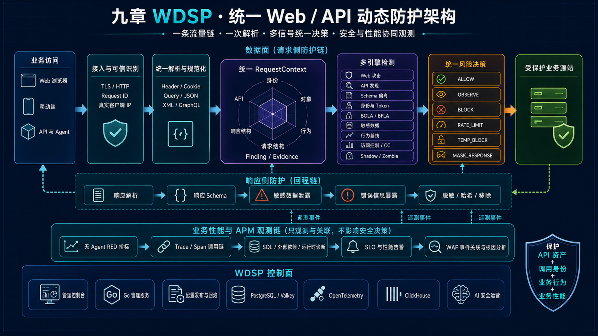
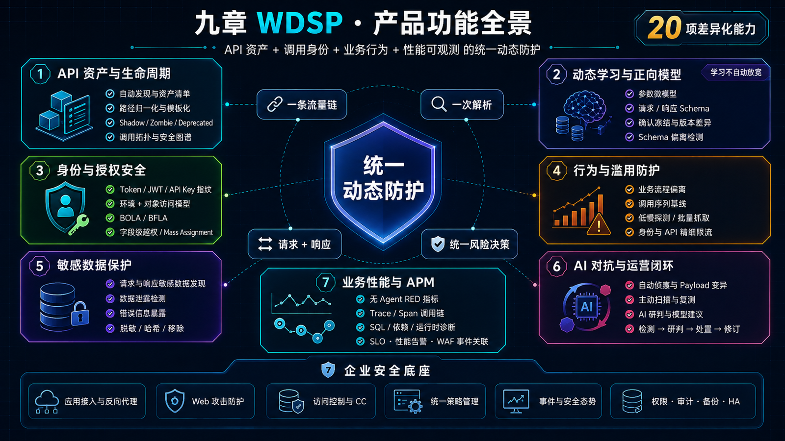

# 九章 WDSP 架构与产品功能图

本目录提供两张 16:9 横版 WDSP 产品图，可用于技术方案、产品介绍、汇报材料和大屏展示。

## WDSP 总体架构图

架构图展示业务访问、WDSP 数据面、统一 `RequestContext`、多引擎检测、统一风险决策、响应侧防护、业务性能与 APM 观测链及控制面之间的关系。APM 通过 OpenTelemetry 和 ClickHouse 汇聚 RED 指标、Trace/Span、依赖诊断、SLO 告警与 WAF 关联事件，只负责观测与关联，不改变安全决策主链。

## WDSP 产品功能全景图

功能图展示 API 资产与生命周期、动态学习与正向模型、身份与授权安全、行为与滥用防护、敏感数据保护、AI 对抗与运营闭环、业务性能与 APM 七大能力域，以及企业安全底座。

## 文件说明

- `wdsp-architecture-ai-16x9.png`：生图模型生成的总体架构图，1600 × 900。
- `wdsp-product-capabilities-ai-16x9.png`：生图模型生成的产品功能图，1600 × 900。
- `wdsp-architecture-16x9.svg`：总体架构图的矢量内容草稿。
- `wdsp-product-capabilities-16x9.svg`：产品功能图的矢量内容草稿。

图片内容主要参考：

- `docs/ARCHITECTURE.md`
- `docs/PRODUCT_REQUIREMENTS.md`
- `docs/WDSP_TOP20_VS_WAF.md`
- `docs/BUSINESS_PERFORMANCE_APM_DESIGN.md`
- `docs/APM_STAGE0_ADR.md`
- `docs/tasks/STAGE_8_UNIFIED_WEB_API_DYNAMIC_PROTECTION.md`
