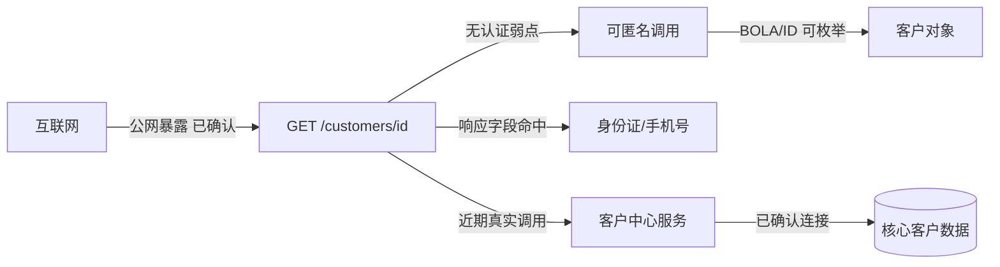
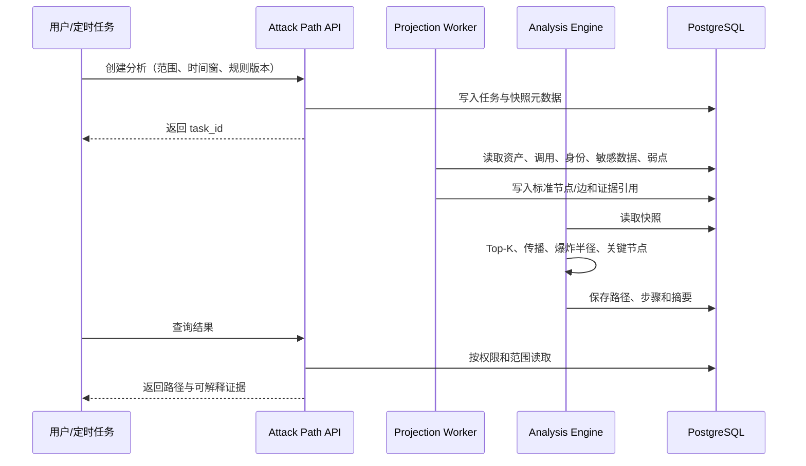

# 九章 WDSP API 攻击路径分析详细设计方案

> 文档状态：方案设计稿  
> 适用范围：九章 WDSP（API 安全、API 资产、安全图谱、身份与授权、敏感数据、运行时风险）  
> 目标读者：产品、架构、后端、前端、算法、安全运营、测试与交付团队  
> 说明：本文描述拟建设能力；“建议接口”和“建议数据表”均不是当前已经上线的接口或表结构。

## 1. 建设背景

传统 API 风险页面通常按漏洞、接口或告警逐条展示，能够回答“系统里有哪些问题”，但很难回答以下更重要的问题：

- 哪个公网入口能够一路到达核心客户数据？
- 一个“未认证”问题是否真的可被利用，它的下游影响是什么？
- 身份、接口、服务、数据、漏洞之间如何组合形成真实攻击链？
- 同时存在多个问题时，应该优先修复哪一个？
- 如果关闭某个接口、补上认证或阻断一条调用关系，整体风险会下降多少？
- 单点问题被利用后，可能影响多少接口、应用、身份、数据和业务系统？

API 攻击路径分析的核心不是把所有对象画在一张图上，而是将“资产可达性、漏洞可利用性、身份权限、数据敏感度、业务价值、调用关系和防护措施”统一建模，并基于证据生成可解释、可复现、可处置的攻击路径。

典型路径示例：

```text
互联网
  → 公网暴露 API：GET /customers/{id}
  → 未认证或认证可绕过
  → 对象 ID 可枚举 / BOLA
  → 响应包含身份证、手机号
  → 下游调用客户中心服务
  → 可继续访问核心客户档案库
```

## 2. 建设目标

### 2.1 核心目标

系统应支持：

1. **最短攻击路径**：从互联网、第三方、低信任身份等入口，找到到达核心资产或敏感数据的最低成本路径。
2. **关键节点识别**：识别出现在大量高风险路径中的接口、身份、服务、弱点和信任关系。
3. **爆炸半径分析**：评估某个入口、身份或漏洞被利用后，可影响的资产范围与业务后果。
4. **风险传播分析**：依据调用链、身份权限和数据流，将入口风险传播到下游目标，并控制衰减与边界。
5. **What-if 模拟**：模拟关闭接口、修复漏洞、增加认证、收紧权限或阻断调用后的风险变化。
6. **修复收益排序**：计算“修复哪个问题收益最大”，同时展示风险降低、受影响路径数量和实施成本。
7. **互联网到核心数据路径**：以公网暴露面为入口，以敏感数据、核心服务、高价值接口为终点持续发现路径。
8. **联合分析**：将身份、接口、应用、服务、数据、授权基线、漏洞、运行时告警和第三方关系放入同一分析模型。

### 2.2 非目标

第一阶段不建议将本功能设计为：

- 自动执行真实攻击或漏洞利用的攻击平台；
- 根据推断路径直接进行生产阻断的自动化处置系统；
- 替代 CMDB、SIEM、APM、漏洞扫描器或数据安全平台；
- 展示未经脱敏的令牌、Cookie、身份证号、手机号或业务报文；
- 仅依赖“节点之间有连线”就认定存在可利用攻击链。

## 3. 九章 WDSP 现有能力基线

基于当前代码与数据库迁移，系统已经具备构建攻击路径的主要数据基础：

| 现有能力 | 当前可用信息 | 对攻击路径的价值 |
|---|---|---|
| API 资产 | 应用、域名、方法、路径、资产状态、学习状态、命中次数、资产价值、业务分类 | 形成接口与应用节点，识别暴露入口和高价值目标 |
| API 调用图谱 | 源接口、目标接口、调用方指纹、调用次数、身份数量、首次/末次观测时间 | 形成已观测的接口调用边 |
| 身份画像 | 身份指纹、接口、认证类型、请求次数、质量分、首次/末次出现 | 建立身份访问接口关系，不保存原始凭证 |
| 运行时风险 | 风险类型、严重度、风险分、主体、证据、模型/策略版本、发生时间 | 提供路径中的可利用条件和风险证据 |
| API 弱点 | 弱点编码、类别、严重度、生命周期、证据、触发次数、责任人与复测状态 | 将长期弱点作为可治理的路径节点或条件 |
| 敏感字段 | 请求/响应方向、结构化字段路径、数据类型、置信度、检测来源 | 建立接口与敏感数据类型之间的数据流关系 |
| BOLA/BFLA 基线 | 对象权属、角色与方法/动作基线 | 识别对象级、功能级越权路径 |
| 字段权限 | 接口、字段路径、方向、角色、租户、字段属性 | 识别批量赋值与字段越权风险 |
| 用途与分类 | 暴露面、用途、数据分类、环境、合规、跨境等维度 | 为节点补充业务语义和约束 |

当前主要缺口：

1. 当前图谱主要是“接口节点 + 调用边”，尚未形成身份、服务、数据、弱点等异构节点的统一投影。
2. 图谱展示与攻击路径计算未分层，缺少可利用条件、路径分值、证据链和快照概念。
3. 缺少最短路径、Top-K 路径、爆炸半径、关键节点与风险传播算法。
4. 缺少 What-if 的临时图覆盖层和基线/模拟结果对比。
5. 缺少修复动作与风险下降之间的量化关系。
6. 缺少路径版本、规则版本、数据时间窗及结果可复现机制。

## 4. 总体设计原则

### 4.1 证据优先

每个节点、边和路径步骤都必须能够追溯到至少一种证据：运行时观测、配置、人工确认、扫描结果或规则推导。路径页面必须展示“为什么形成这一步”，不能只展示一条连线。

### 4.2 观察事实与安全推断分离

- **Observed（已观测）**：真实调用、真实身份访问、真实敏感字段命中。
- **Configured（配置事实）**：应用归属、域名暴露、角色权限、人工资产分类。
- **Detected（检测结果）**：运行时发现、弱点、主动扫描结果。
- **Inferred（推断）**：根据规则推导出的可枚举、可横向移动或风险传播关系。
- **Simulated（模拟）**：仅存在于 What-if 场景，不修改生产事实。

前端必须用不同线型或标识区分这些来源，推断关系不能伪装成已观测事实。

### 4.3 时间有界

攻击路径不是永久有效。调用边、身份访问和风险证据必须带时间窗。默认分析最近 7 天或 30 天，并允许切换；长期未观测的边应衰减或标记为陈旧，而不是永久参与高置信路径。

### 4.4 默认只读、人工闭环

第一阶段仅分析和建议，不自动阻断。修复建议需要进入现有弱点/工单闭环，由责任人确认、处置和复测。

### 4.5 租户和环境隔离

所有图计算都必须先应用租户、环境、项目或应用范围过滤，再执行路径搜索，避免先计算后过滤造成越权或数据侧信道。

## 5. 总体架构

```mermaid
flowchart LR
    subgraph Sources[现有事实与检测数据]
        A[API 资产与应用域名]
        B[API 调用边]
        C[身份画像与授权基线]
        D[敏感字段与数据分类]
        E[运行时风险与 API 弱点]
        F[服务资产与业务分类]
    end

    subgraph Projection[攻击图谱投影层]
        N[节点标准化]
        R[关系标准化]
        Q[证据与置信度计算]
        S[不可变分析快照]
    end

    subgraph Engine[分析引擎]
        P[Top-K 路径搜索]
        G[风险传播]
        BZ[爆炸半径]
        K[关键节点]
        W[What-if 与修复收益]
    end

    subgraph Experience[产品与治理]
        UI[攻击路径工作台]
        API[查询与分析 API]
        ACT[弱点/工单/复测闭环]
        AUDIT[审计与报告]
    end

    Sources --> Projection
    Projection --> Engine
    Engine --> Experience
```



设计上建议继续以 PostgreSQL 作为事实存储和首阶段图计算基础，通过快照、邻接表和预计算降低查询成本。只有当真实数据规模和查询复杂度超过 PostgreSQL 方案的容量目标时，再评估引入专用图数据库，避免第一阶段增加不必要的部署与运维复杂度。

## 6. 异构攻击图谱模型

### 6.1 节点类型

| 节点类型 | 含义 | 当前来源或建设方式 | 关键属性 |
|---|---|---|---|
| `EXPOSURE_ZONE` | 互联网、合作方网络、办公网、生产内网等信任区域 | 分类配置/域名与入口推导 | 信任级别、环境 |
| `DOMAIN` | 对外或内部访问域名 | 应用域名 | 公私网属性、协议、环境 |
| `APPLICATION` | WDSP 中的应用 | 应用资产 | 名称、环境、负责人、业务等级 |
| `SERVICE` | 微服务、网关后端或核心业务服务 | 服务资产；需与 API 应用关系对齐 | 服务类型、关键等级、负责人 |
| `ENDPOINT` | 具体 API 接口 | API 资产 | 方法、路径、协议、资产状态、价值 |
| `IDENTITY` | 用户、服务账号、API Key 指纹或匿名身份 | 身份画像，仅使用指纹 | 认证类型、质量分、活跃度、风险等级 |
| `ROLE` | 身份承担的角色 | BFLA/身份上下文；缺失时标为未知 | 角色名、租户、权限范围 |
| `DATA_OBJECT` | 订单、客户、账户等业务对象 | 对象权属基线和业务映射 | 对象类型、归属范围，不存原始敏感值 |
| `SENSITIVE_DATA_TYPE` | 身份信息、凭证、财务、位置等数据类型 | 敏感字段与数据分类 | 敏感等级、合规标签、跨境属性 |
| `FINDING` | 某次或聚合后的运行时风险 | API 运行时风险 | 类型、严重度、风险分、状态、证据 |
| `WEAKNESS` | 可治理、可复测的长期弱点 | API 弱点 | 编码、状态、严重度、责任人 |
| `CONTROL` | 认证、鉴权、限流、签名、mTLS 等控制 | 配置事实或人工确认；首期可作为边属性 | 控制类型、状态、强度、来源 |
| `THIRD_PARTY` | 外部合作方、Webhook 来源、SaaS 平台 | 第三方分类和域名映射；需补充确认机制 | 信任等级、责任方、连接方式 |
| `DATA_STORE` | 数据库、缓存、对象存储、消息系统 | 需要服务资产/APM/人工映射补充 | 类型、核心等级、环境 |

首期不要求一次性建立所有节点。MVP 应优先支持 `EXPOSURE_ZONE`、`DOMAIN`、`APPLICATION`、`SERVICE`、`ENDPOINT`、`IDENTITY`、`SENSITIVE_DATA_TYPE`、`FINDING`、`WEAKNESS`，其余节点按数据质量逐步接入。

### 6.2 关系类型

| 关系 | 示例 | 证据来源 | 是否允许传播 |
|---|---|---|---|
| `EXPOSES` | Internet → Domain/Endpoint | 暴露面分类、域名配置、流量观测 | 是 |
| `BELONGS_TO` | Endpoint → Application/Service | API 资产归属 | 是 |
| `CALLS` | Endpoint A → Endpoint B | `api_call_edges` | 是 |
| `ACCESSES` | Identity → Endpoint | 身份画像/运行时事件 | 是 |
| `HAS_ROLE` | Identity → Role | 认证上下文或确认基线 | 是，受租户约束 |
| `ALLOWS` | Role → Endpoint/Action | BFLA 基线 | 是 |
| `OWNS` | Identity → Data Object | BOLA 对象权属基线 | 是，限对象范围 |
| `ACCEPTS` | Endpoint → Sensitive Data Type | 请求敏感字段 | 是，代表写入面 |
| `RETURNS` | Endpoint → Sensitive Data Type | 响应敏感字段 | 是，代表泄露影响 |
| `HAS_FINDING` | Endpoint/Identity → Finding | 运行时风险 | 作为可利用条件 |
| `HAS_WEAKNESS` | Endpoint → Weakness | API 弱点 | 作为可利用条件 |
| `CONNECTS_TO` | Service → Data Store/Third Party | 服务配置、APM 或人工映射 | 是 |
| `TRUSTS` | Service/Domain → Third Party | 签名、白名单、证书或配置关系 | 条件传播 |
| `PROTECTED_BY` | Endpoint → Control | 认证/鉴权/限流/签名配置 | 降低或阻断传播 |

每条关系至少包含：

- `source_node_id`、`target_node_id`、`edge_type`；
- `evidence_type`：observed/configured/detected/inferred/simulated；
- `confidence`：0～1；
- `first_seen_at`、`last_seen_at`；
- `source_ref_type`、`source_ref_id`，用于回溯原始记录；
- `tenant_scope`、`environment`；
- `attributes`：调用次数、身份数量、认证方式等非索引扩展属性。

### 6.3 路径必须满足的语义

一条有效攻击路径至少包含：

1. **入口**：互联网、第三方回调、匿名身份、低信任身份或已失陷身份。
2. **可利用条件**：无认证、认证绕过、BOLA/BFLA、敏感数据暴露、弱签名、过度权限等。
3. **可达关系**：真实调用边、允许访问关系、服务连接或可信的数据流关系。
4. **高价值终点**：核心应用/服务、敏感数据、管理接口、跨境数据出口或高价值业务对象。
5. **证据链**：每一步的来源、时间、置信度与规则解释。

仅有“接口 A 调用接口 B”并不自动构成攻击路径；必须同时判断攻击者能否控制输入、身份或权限是否可继承、下游控制是否阻断，以及目标是否存在实际影响。

## 7. 数据投影与快照

### 7.1 数据来源映射

| 攻击图元素 | 当前事实来源 | 投影逻辑 |
|---|---|---|
| API/应用节点 | API 资产、应用、应用域名 | 按稳定 ID 投影，业务分类作为属性 |
| 公网入口 | 暴露面分类、域名、公网流量 | 优先采用人工确认，其次配置和流量推断 |
| 调用边 | `api_call_edges` | 保留调用次数、身份数量和观测时间 |
| 身份访问边 | `api_identity_profiles`、运行时事件 | 使用身份指纹，不复制凭证 |
| 对象与角色关系 | `api_object_ownership`、`api_role_baselines` | 区分学习基线与人工确认基线 |
| 字段权限关系 | `api_field_permissions` | 作为字段写入/读取限制与越权条件 |
| 敏感数据关系 | `api_sensitive_fields` | 请求映射为 `ACCEPTS`，响应映射为 `RETURNS` |
| 风险与弱点 | 运行时风险、`api_weaknesses` | 只纳入有效生命周期状态并保留证据引用 |
| 服务/数据存储关系 | 服务资产、未来 APM 或人工配置 | 未确认前标为 inferred，不得作为唯一高置信证据 |

### 7.2 为什么需要快照

攻击路径结果必须可复现。若直接查询持续变化的业务表，同一条路径在复核时可能已经改变。建议生成不可变分析快照，记录：

- 快照时间和数据时间窗；
- 租户、环境、应用范围；
- 节点/边数量及过滤规则；
- 风险规则版本、评分模型版本；
- 原始数据水位；
- 生成状态与异常信息。

实时页面可使用最新增量图，报告、审计与复测必须绑定一个明确快照。

### 7.3 建议新增数据表

以下名称为设计建议，最终需在开发阶段通过迁移评审确认：

| 表 | 用途 | 核心字段 |
|---|---|---|
| `api_attack_graph_snapshots` | 保存分析快照元数据 | scope、window、rule_version、watermark、status、counts |
| `api_attack_graph_nodes` | 保存快照内标准化节点 | snapshot_id、node_type、source_ref、risk/value/confidence、attributes |
| `api_attack_graph_edges` | 保存快照内标准化边 | snapshot_id、source/target、edge_type、evidence、confidence、time、attributes |
| `api_attack_paths` | 保存路径摘要 | snapshot_id、entry/target、score、confidence、hop_count、status |
| `api_attack_path_steps` | 保存路径的有序步骤和解释 | path_id、step_no、node/edge、rule、evidence_ref、score_delta |
| `api_attack_simulations` | 保存 What-if 场景与差异 | baseline_snapshot、overlays、before/after metrics、creator |
| `api_attack_path_suppressions` | 管理误报和例外 | target_type/id、reason、expires_at、approver、scope |

图节点不应复制原始业务报文或敏感值，只保存类型、摘要、指纹和原记录引用。

## 8. 攻击路径生成规则

### 8.1 入口规则

可配置入口包括：

- 暴露面为“公网”的域名、应用和接口；
- 无需认证接口或匿名身份访问的接口；
- 第三方 Webhook、回调和开放平台入口；
- 低质量、异常、新出现或疑似泄露的身份指纹；
- 测试接口、影子接口、僵尸接口在生产环境被调用；
- 主动扫描或运行时检测确认可由外部触达的接口。

入口应同时展示“确认来源”和“最后观测时间”。人工分类与真实流量冲突时，不覆盖事实，而是产生“暴露面分类冲突”提示。

### 8.2 可利用条件

建议首批规则：

| 条件 | 典型证据 | 传播效果 |
|---|---|---|
| 无认证敏感接口 | 认证类型 + 敏感响应字段 + 弱点 | 大幅降低进入成本 |
| BOLA/对象可枚举 | 对象权属偏离、连续对象访问、风险发现 | 允许跨对象扩展爆炸半径 |
| BFLA/功能越权 | 角色基线与实际访问冲突 | 允许到达高权限操作 |
| 敏感数据置于 URL | 弱点 + 请求字段位置 | 增加泄露与日志扩散影响 |
| 废弃/影子接口仍可调用 | 生命周期 + 命中记录 | 提升未知与失管风险 |
| 弱认证或共享身份 | 认证类型、身份质量、异常访问 | 增加身份横向移动概率 |
| 响应返回高敏感字段 | 响应敏感字段 | 提升目标影响分 |
| 第三方回调缺少强校验 | 签名/mTLS 配置缺失 + 调用事实 | 允许第三方入口传播 |
| 字段写入权限过宽 | 字段权限与请求字段偏离 | 支持批量赋值/权限提升路径 |

每条规则必须输出机器可读规则编码、中文解释、证据引用、置信度和建议动作。

### 8.3 终点规则

高价值终点包括：

- 返回认证凭证、身份信息、财务数据、交易数据等高敏感数据的接口；
- 资产价值为核心或业务等级较高的应用/服务；
- 管理、权限、资金、客户、订单等高风险操作接口；
- 核心数据库、客户中心、支付系统、身份中心；
- 涉及跨境、监管或特殊合规范围的数据节点；
- 能够连接大量下游节点的高扇出服务或接口。

## 9. 分析算法

### 9.1 最短攻击路径

不能只按跳数计算。应将每条边转换为“攻击成本”，成本越低表示越容易被利用：

```text
edge_cost = base_cost
          × control_factor
          × confidence_penalty
          × freshness_penalty
          × scope_penalty
```

- 无认证、已确认漏洞、真实观测调用：成本更低；
- 有 mTLS、强签名、明确拒绝策略：成本显著提高或禁止穿越；
- 低置信推断、长期未观测关系：成本更高；
- 跨租户或跨环境：默认禁止穿越；
- 身份与权限不可继承：不允许沿调用边继续传播。

可使用 Dijkstra 计算最低成本路径，使用 Yen 算法或同类 Top-K 算法返回多条不同路径。为避免结果爆炸，默认限制最大深度、最大分支数、最小置信度和 Top-K 数量。

### 9.2 路径风险评分

建议使用可解释的乘积模型，并将结果归一化到 0～100：

```text
PathRisk = 100 × Exposure × Exploitability × Reachability
               × Impact × Confidence × (1 - Mitigation)
```

| 因子 | 含义 |
|---|---|
| Exposure | 入口的可触达程度，公网高于合作网，合作网高于内网 |
| Exploitability | 无认证、越权、弱点严重度及利用前置条件 |
| Reachability | 路径是否由近期真实调用或可靠配置支持 |
| Impact | 终点资产价值、敏感数据等级、受影响业务范围 |
| Confidence | 整条证据链的综合置信度，避免推断路径虚高 |
| Mitigation | 认证、鉴权、限流、签名、mTLS、阻断策略等缓解强度 |

乘积模型可避免单一高严重度漏洞在完全不可达时仍获得最高优先级。具体权重必须版本化，并通过真实案例回放校准。

### 9.3 风险传播

风险传播建议采用“有界、衰减、受控制约束”的模型：

```text
propagated_risk(next) = current_risk
                      × edge_confidence
                      × reachability
                      × privilege_transfer
                      × decay
                      × (1 - control_strength)
```

约束：

- 默认最大路径深度建议为 8，可按场景调整；
- 对环路使用访问状态或强连通分量折叠，防止无限传播；
- 同一目标接收多条路径时使用上限合并或概率并集，避免简单相加超过 100；
- 过期边按时间衰减；
- 无法证明身份/输入可传递时，调用边只表示依赖，不表示可利用传播；
- 被强控制明确阻断的边保留展示，但不计入可达结果。

### 9.4 爆炸半径

爆炸半径不是简单节点数，应同时输出数量与业务权重：

- 可达接口数、应用数、服务数；
- 可达身份和高权限角色数；
- 可达敏感数据类型数及最高敏感等级；
- 涉及的业务对象、环境和合规范围；
- 关键资产数量与加权影响分；
- 受影响路径中“已观测”和“推断”的占比。

```text
BlastRadiusScore = Σ(可达资产价值 × 到达概率 × 数据/业务影响 × 新鲜度)
```

页面必须同时显示绝对数量，避免一个抽象分数掩盖真实范围。

### 9.5 关键节点识别

关键节点不能只依据度数，应综合：

- 高风险路径覆盖率；
- 加权介数中心性，即有多少入口到核心目标的低成本路径经过该节点；
- 下游加权爆炸半径；
- 单点修复后的风险下降量；
- 节点自身资产价值和可利用性；
- 控制部署的可操作性。

最终输出“关键攻击入口”“关键中转节点”“关键身份”“关键薄弱控制”和“关键目标”五类结果。

### 9.6 What-if 模拟

What-if 使用覆盖层，不修改事实图和生产配置。支持模拟：

- 关闭或下线某个接口；
- 将公网接口改为内网；
- 增加 JWT、签名或 mTLS；
- 修复某个弱点；
- 将角色权限收紧到确认基线；
- 阻断某条接口调用或服务连接；
- 将敏感字段移除、脱敏或降低返回范围；
- 隔离某个身份或吊销某类凭证。

模拟结果至少包含：

- 总风险分变化；
- 高/严重路径数量变化；
- 消失、新增和仍然存在的路径；
- 爆炸半径变化；
- 被保护的核心目标与敏感数据；
- 可能发生的替代路径。

### 9.7 “修复哪个问题收益最大”

对每个候选修复动作执行快速模拟：

```text
GrossBenefit(action) = BaselineAggregateRisk - SimulatedAggregateRisk

Priority(action) = GrossBenefit
                 × Coverage
                 × Confidence
                 ÷ max(EstimatedCost, minimum_cost)
```

输出时不能只给综合排名，还应分开展示：

- 风险降低值和降低比例；
- 可消除的严重/高风险路径数；
- 可保护的核心资产与敏感数据；
- 受益应用/服务数量；
- 建议修复位置；
- 预计实施成本、业务影响和证据置信度。

实施成本首期可由人工选择“低/中/高”，后续再根据历史工单周期学习，避免算法虚构精确工时。

## 10. 典型场景

### 10.1 公网无认证接口到核心客户数据



系统应解释：入口为何被认定公网暴露、无认证证据是什么、对象枚举由何种运行时行为确认、敏感字段来自请求还是响应、下游调用何时最后出现、终点为何是核心资产。

### 10.2 第三方回调进入内部服务

```text
第三方平台
  → Webhook 回调接口
  → 缺少签名或签名校验弱
  → 可伪造事件
  → 订单服务内部接口
  → 订单状态修改 / 消息发布
```

### 10.3 低权限身份到管理接口

```text
普通用户身份
  → 正常业务接口
  → 角色基线偏离
  → BFLA 功能越权
  → 管理接口
  → 批量导出敏感数据
```

## 11. 后端能力设计

### 11.1 服务模块

建议在现有 `api-security` 领域内新增独立攻击路径模块，内部拆分为：

- `projection`：从现有业务表生成标准节点、边和证据；
- `snapshot`：管理全量/增量快照、水位和规则版本；
- `rules`：入口、可利用条件、目标和控制规则；
- `search`：最短路径、Top-K、路径去重；
- `propagation`：风险传播与爆炸半径；
- `simulation`：覆盖层与基线对比；
- `ranking`：关键节点和修复收益；
- `report`：路径摘要、证据包和导出数据。

模块应通过只读查询使用现有事实数据，不应反向改写资产、身份、弱点或运行时风险源表。

### 11.2 建议 API

以下为建议接口，非现有接口：

| 方法 | 路径 | 用途 |
|---|---|---|
| `POST` | `/api/v1/api-security/attack-paths/analyze` | 创建指定范围和时间窗的分析任务 |
| `GET` | `/api/v1/api-security/attack-paths/summary` | 获取路径数量、风险等级、入口/目标摘要 |
| `GET` | `/api/v1/api-security/attack-paths` | 分页查询路径，支持入口、目标、环境、风险和置信度过滤 |
| `GET` | `/api/v1/api-security/attack-paths/{id}` | 获取完整步骤、证据、分值解释和修复建议 |
| `GET` | `/api/v1/api-security/attack-paths/critical-nodes` | 查询关键节点及排名原因 |
| `GET` | `/api/v1/api-security/attack-paths/blast-radius` | 从指定节点计算爆炸半径 |
| `POST` | `/api/v1/api-security/attack-paths/simulations` | 创建 What-if 模拟 |
| `GET` | `/api/v1/api-security/attack-paths/simulations/{id}` | 查看模拟前后差异 |
| `POST` | `/api/v1/api-security/attack-paths/{id}/suppress` | 创建有期限、有审计的误报/例外记录 |
| `POST` | `/api/v1/api-security/attack-paths/{id}/actions` | 将建议动作关联至现有弱点或治理流程 |

所有列表接口都应限制返回规模并支持游标或稳定分页。图数据应按视窗和层级按需加载，禁止一次返回完整租户图谱。

### 11.3 分析任务流程



触发方式：

- 定时全量分析，例如每日低峰期；
- 调用边、重要弱点、敏感数据分类或公网暴露状态显著变化时增量分析；
- 用户针对特定应用、接口或身份手动分析；
- 修复复测完成后自动对绑定路径重算。

## 12. 前端产品设计

### 12.1 导航与页面

建议在“API 防护”或“安全图谱”下增加“攻击路径”一级页面，包含以下视图：

1. **风险总览**：严重/高风险路径、互联网到核心数据路径、关键入口、关键目标、风险趋势。
2. **路径浏览器**：按入口、目标、风险、环境、应用、证据类型和时间窗筛选 Top-K 路径。
3. **路径详情**：逐步解释节点、关系、证据、风险增量、防护控制和修复建议。
4. **关键节点**：关键入口、中转节点、身份、薄弱控制和目标排名。
5. **爆炸半径**：从任意节点向下游展开影响，并按接口/服务/数据/身份聚合。
6. **What-if 模拟器**：配置一个或多个假设动作，对比修复前后指标和替代路径。
7. **规则与例外**：查看规则版本、阈值、抑制项、过期例外和人工确认关系。

### 12.2 路径详情布局

- 顶部：路径标题、风险等级、分数、置信度、最后计算时间和快照编号；
- 左侧：线性攻击步骤，适合运营人员逐项阅读；
- 中部：局部图，只展示当前路径及一层相关节点；
- 右侧：证据抽屉，展示来源类型、发生时间、规则解释和原对象链接；
- 底部：爆炸半径、替代路径、修复建议、预计收益和治理状态。

图中颜色只表达风险等级；节点类型使用形状或图标区分。已观测关系使用实线，推断关系使用虚线，模拟删除关系使用灰色删除线，避免颜色承担过多语义。

### 12.3 关键交互

- 点击任一步骤可定位原 API 资产、身份、运行时发现或弱点详情；
- 支持只看“全部已观测证据”的路径；
- 支持隐藏低置信度和陈旧关系；
- 支持对比两个时间快照，查看新增/消失路径；
- 支持将路径保存为调查视图或导出脱敏报告；
- What-if 结果必须明确标注“模拟，不代表生产配置已变更”。

## 13. 权限、安全与审计

### 13.1 建议权限

可在现有 `api_graph.read` 基础上评估新增更细权限：

- `api_attack_path.read`：查看路径和脱敏证据；
- `api_attack_path.analyze`：发起分析；
- `api_attack_path.simulate`：创建 What-if 场景；
- `api_attack_path.manage`：管理规则、例外和人工关系。

权限必须同时受应用/租户数据范围约束。拥有图谱读取权限不应默认获得所有敏感字段证据或身份详情。

### 13.2 数据保护

- 身份只使用不可逆指纹或脱敏标识；
- 敏感数据只展示类型、字段路径和命中统计，不展示原值；
- 请求/响应证据沿用系统脱敏策略；
- 导出文件包含操作者、生成时间、数据范围和水印；
- 推断及模拟数据不得回写真实资产属性；
- 任何跳转到原始证据的操作都再次校验权限。

### 13.3 审计事件

记录分析创建、查看高敏路径、导出、创建模拟、添加例外、人工确认关系、创建治理动作和修改规则等事件。审计内容不记录敏感原文。

## 14. 误报治理和数据质量

攻击路径的主要风险不是漏画一条边，而是把低质量推断包装成确定事实。因此必须建设：

- **证据分级**：已确认 > 已观测 > 配置 > 检测 > 推断；
- **新鲜度衰减**：超过时间窗的调用边降权并标记陈旧；
- **最小证据要求**：高风险路径至少包含一个已观测/确认入口和一个有效风险证据；
- **冲突检测**：人工分类、配置和运行时观测不一致时产生质量提示；
- **有期限例外**：所有抑制项必须说明理由、审批人和过期时间；
- **规则回放**：规则版本升级前，在历史快照上比较新增、消失路径和误报变化；
- **人工反馈**：路径可标记有效、误报、已接受风险或证据不足，用于后续规则校准。

首期禁止仅依据大模型解释生成攻击路径；模型可用于摘要和辅助说明，但节点、边、分数与结论必须来自结构化规则和可追溯证据。

## 15. 性能与容量设计

### 15.1 计算策略

- 按租户、环境和应用域分区生成邻接表；
- 先筛选有效入口与高价值终点，再执行路径搜索；
- 对常用时间窗生成预计算快照；
- 对 Top-K、关键节点和爆炸半径进行快照级缓存；
- 增量事件只重算受影响的连通子图；
- 对低置信、过期和低价值节点先剪枝；
- 图详情按需扩展，避免全图序列化。

### 15.2 建议容量验收目标

以下是首阶段建议目标，需用客户真实数据压测后调整：

- 单分析范围支持 10 万节点、100 万关系；
- 常用筛选条件下路径列表 P95 小于 2 秒；
- 已生成路径详情 P95 小于 1 秒；
- 单入口爆炸半径与 Top-10 路径 P95 小于 3 秒；
- 全量快照异步完成，不阻塞资产、风险和防护主流程；
- 分析失败可重试，不产生半完成快照供用户查询。

达到容量瓶颈时，优先优化投影、索引、剪枝和并行计算；只有在证据表明关系遍历成为稳定瓶颈时再评估专用图存储。

## 16. 测试方案

### 16.1 单元测试

- 节点/边投影与去重；
- 时间窗、新鲜度和置信度计算；
- 环路、断边、多路径和不可达场景；
- Top-K 去重与稳定排序；
- 风险评分边界值和模型版本；
- 风险传播上限、衰减与控制阻断；
- What-if 覆盖层不修改基线；
- 修复收益排序的确定性。

### 16.2 集成测试

构造一套固定数据集，至少覆盖：

1. 公网 → 无认证 → BOLA → 身份信息 → 核心客户服务；
2. 第三方回调 → 弱签名 → 内部写操作；
3. 普通角色 → BFLA → 管理接口 → 批量导出；
4. 存在调用关系但身份不可传递，应判定不可利用；
5. 强控制阻断路径；
6. 过期调用边被降权或剔除；
7. What-if 修复主路径后发现替代路径；
8. 不同租户、生产与测试环境绝不串图。

### 16.3 端到端和可视化测试

- 从总览筛选严重路径，进入详情并查看每一步证据；
- 从接口资产反查其上游入口和下游爆炸半径；
- 创建 What-if 场景并验证前后差异；
- 创建例外、到期恢复和审计记录；
- 权限不足时不显示敏感节点细节；
- 自动截图验证关键页面、空状态、超大图和错误状态；
- 每次升级在测试环境运行，生成包含用例、结果、日志摘要和截图的报告。

### 16.4 安全测试

- 跨租户/跨应用数据范围越权；
- 通过节点 ID、路径 ID、模拟 ID 进行 IDOR；
- 导出数据脱敏和公式注入；
- 图属性中的存储型 XSS；
- 超大深度、分支和循环导致的拒绝服务；
- 分析接口频率限制与任务配额；
- 审计不可绕过和证据跳转二次授权。

## 17. 分阶段实施计划

### 阶段 0：数据与规则基线

目标：确认可用数据质量，完成架构决策和样例路径回放。

- 盘点接口、调用边、身份、敏感字段、弱点、授权基线覆盖率；
- 明确应用、服务、域名和环境的稳定 ID 关系；
- 制定节点、关系、证据和评分字典；
- 准备 10～20 条人工确认的黄金攻击路径；
- 确定快照、规则版本和权限模型。

### 阶段 1：MVP——互联网到敏感数据路径

目标：使用现有数据形成第一批可解释路径。

- 建设图谱投影和不可变快照；
- 支持公网入口、API、应用/服务、运行时风险、弱点和敏感数据节点；
- 支持最短路径、Top-K、路径详情和证据抽屉；
- 支持时间窗、环境、应用、风险等级和证据类型过滤；
- 支持路径导出和人工有效性反馈。

### 阶段 2：身份、授权和爆炸半径

目标：形成身份—接口—对象—角色联合分析。

- 接入身份画像、BOLA/BFLA、对象权属和字段权限；
- 支持身份继承约束、横向/纵向越权路径；
- 支持风险传播、爆炸半径和关键节点；
- 接入弱点治理与复测状态。

### 阶段 3：What-if 与修复收益

目标：从“发现路径”升级到“指导治理”。

- 建设模拟覆盖层；
- 支持关闭入口、增加控制、修复弱点和收紧权限；
- 识别替代路径；
- 输出修复收益、覆盖范围、实施成本和优先级；
- 支持模拟方案保存、比较与评审。

### 阶段 4：高级关系与持续验证

目标：覆盖更完整的攻击面和运行环境。

- 接入 APM 的服务、数据库、消息队列和分布式调用链；
- 接入第三方、跨境数据、LLM/MCP 接口等特殊风险关系；
- 支持快照趋势、规则回放和持续路径验证；
- 在测试环境加入自动化攻击路径回归用例。

## 18. 研发拆分建议

### 后端

- 节点/边/证据统一模型；
- 快照迁移、投影任务、水位与重试；
- 路径搜索、评分、传播、爆炸半径和关键节点；
- 模拟覆盖层与修复收益；
- API、权限、审计、分页与缓存；
- 单元、集成、容量和安全测试。

### 前端

- 攻击路径总览；
- 路径列表、筛选与详情；
- 局部图可视化与证据抽屉；
- 爆炸半径和关键节点页面；
- What-if 配置、差异比较和替代路径；
- 权限、空状态、失败状态、超大结果和导出交互。

### 产品与安全运营

- 入口、终点和可利用规则字典；
- 风险评分权重及黄金样例；
- 误报、例外、人工确认和复测流程；
- 修复动作成本分级；
- 报告模板、指标定义和验收口径。

## 19. 验收标准

MVP 上线至少满足：

1. 能重现“公网 → 无认证 → 可枚举对象/BOLA → 敏感响应 → 核心服务”的完整路径。
2. 每个步骤均显示证据类型、来源、时间、置信度和规则解释。
3. 能返回最低成本路径以及至少 3 条可区分的候选路径，若实际存在。
4. 能从任意接口查看上游入口、下游目标和爆炸半径。
5. 已观测、配置、检测、推断和模拟关系在数据与界面上明确区分。
6. 路径评分在同一快照和规则版本下可重复计算并得到一致结果。
7. What-if 不修改真实资产或配置，且能准确展示消失路径和替代路径。
8. 能给出修复收益排序，并解释风险降低来自哪些路径和目标。
9. 不展示原始凭证、身份证号、手机号或未脱敏报文。
10. 租户、应用和环境隔离测试全部通过，所有敏感操作有审计记录。
11. 在约定容量数据集上达到性能目标，失败任务可重试且不会暴露半成品快照。
12. 测试环境自动回归报告包含详细用例、执行结果、关键日志和页面截图。

## 20. 关键风险与应对

| 风险 | 后果 | 应对措施 |
|---|---|---|
| 调用边不代表攻击可传播 | 路径误报 | 引入身份/输入可控性、控制条件和证据等级 |
| 资产归属或环境标注错误 | 出现跨环境假路径 | 先按稳定 ID 投影，冲突提示，人工确认 |
| 图规模快速增长 | 查询超时、界面不可用 | 分区、剪枝、预计算、Top-K、局部加载 |
| 分数看似精确但依据不足 | 错误排序 | 展示因子与置信度，版本化并用黄金样例校准 |
| 推断关系被当成事实 | 错误处置 | 数据模型和视觉双重区分，首期禁止自动阻断 |
| 敏感证据泄露 | 二次安全风险 | 指纹化、脱敏、细粒度授权、审计和水印 |
| 修复主路径后仍有替代路径 | 治理收益被高估 | Top-K 与 What-if 必须重新搜索替代路径 |
| 例外长期不清理 | 风险被永久隐藏 | 例外强制过期、审批和周期复核 |

## 21. 建议的核心指标

- 互联网可达的核心数据路径数量；
- 严重/高风险路径数量及趋势；
- 已观测证据路径占比；
- 未认证或弱认证入口覆盖的核心目标数；
- 关键节点 Top 10 覆盖的高风险路径比例；
- 平均路径确认时间和误报率；
- 平均修复时间、复测通过率；
- 单次修复平均消除的路径数和风险分；
- 陈旧调用边和资产分类冲突数量；
- 路径分析任务成功率与 P95 耗时。

## 22. 推荐落地顺序

优先顺序建议为：

1. 先保证资产归属、暴露面、环境、调用边和敏感数据的质量；
2. 再做可解释的互联网到敏感数据 Top-K 路径；
3. 接入身份、BOLA/BFLA 和字段权限，解决“能否真正利用”的判断；
4. 在路径可信后建设爆炸半径、关键节点和风险传播；
5. 最后建设 What-if 与修复收益，避免基于低质量图谱做出精确但错误的治理建议。

这条路线能够最大程度复用九章 WDSP 现有 API 资产、安全图谱、身份、敏感数据、运行时风险和弱点能力，同时将新增范围控制在独立投影、分析引擎和产品工作台内，不破坏现有业务模块。

## 23. 结论

九章 WDSP 已具备攻击路径分析所需的大部分基础事实，但需要从当前以接口调用关系为主的图谱，升级为带证据、时间、置信度和控制语义的异构攻击图谱。建设重点不是单纯增加图形展示，而是建立以下完整闭环：

```text
事实采集
  → 标准化攻击图谱
  → 可解释路径计算
  → 爆炸半径与关键节点
  → What-if 与修复收益
  → 弱点治理与复测
  → 新快照持续验证
```

首期应以“互联网暴露面到核心数据”为主线，严格区分事实与推断，并用现有身份、授权、敏感字段、运行时风险和弱点数据提高路径可信度。待数据质量和黄金样例验证稳定后，再扩展至 APM 服务链路、数据库、消息队列、第三方和跨境数据场景。
