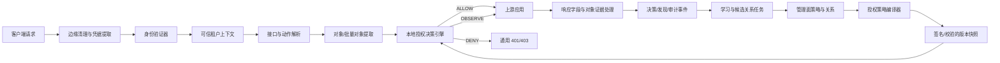

# WDSP BOLA / BFLA 与多租户授权防护开发设计

> 文档状态：开发设计稿  
> 适用产品：九章 WDSP / API 安全网关  
> 目标读者：产品、架构、后端、网关、前端、测试、安全运营、实施运维  
> 设计原则：可信身份先于授权判断；观察证据不等于所有权；管理面配置不等于网关已执行；所有阻断必须可解释、可审计、可回滚。

## 1. 背景

WDSP 已具备角色基线、对象权属观测、字段权限和运行时风险发现等基础能力，但目前还不能形成完整的多租户授权闭环：

- 对象权属数据已经入库并可离线评估，但尚未编译、下发到网关执行；
- 当前对象权属主要由历史访问行为学习，访问事实不能直接证明真实所有权；
- BFLA 角色基线能够下发网关，但网关目前从未验签 JWT 中读取角色，只能作为观察信号，不能作为可靠阻断依据；
- 字段权限支持 `tenant` 配置，但网关没有可信租户上下文，租户专属规则会被跳过；
- Session、API Key 和请求头目前只能证明“存在凭据”，不能证明凭据有效、属于谁、属于哪个租户；
- 批量对象、共享对象、委托访问、跨租户管理员等真实业务场景缺少统一授权关系模型；
- 阻断事件还需要提供不泄露敏感信息的原因码、证据和策略版本。

本设计将可信身份验证、租户上下文、对象关系、功能权限、字段权限和网关执行连接为统一的授权决策链，支持从 `OBSERVE` 平滑演进到 `PROTECT`。

### 1.1 典型场景

```text
用户 A（tenant-01）
  → GET /orders/1001
  → 订单 1001 的 OWNER 是用户 B（tenant-01）
  → 用户 A 不具备共享、委托、客服代查或管理员权限
  → 高置信度 BOLA
  → OBSERVE：放行并记录完整证据
  → PROTECT：返回通用 403，并生成可审计决策事件
```

跨租户场景：

```text
用户 A（tenant-01）
  → PUT /customers/9001
  → 客户 9001 属于 tenant-02
  → 请求中的 tenant_id 被篡改为 tenant-02
  → 可信令牌租户与对象租户冲突
  → 高置信度跨租户越权
```

BFLA 场景：

```text
普通用户角色 CUSTOMER
  → POST /admin/users/disable
  → 接口要求 TENANT_ADMIN 或 PLATFORM_ADMIN
  → 高置信度 BFLA
```

## 2. 建设目标与非目标

### 2.1 建设目标

1. 从 JWT、Session、API Key、mTLS 和受信上游身份头中建立可验证的统一身份上下文。
2. 建立租户提取、冲突检测、层级租户和跨租户授权模型。
3. 建立“用户—角色—租户—对象—字段—接口—动作”授权关系图。
4. 将对象权属从“访问观测”升级为带来源、置信度和状态的关系证据。
5. 在网关请求阶段执行 BOLA、BFLA、跨租户、字段写入和批量对象检查。
6. 在响应阶段执行字段读取、敏感字段暴露和对象归属学习。
7. 支持授权策略模拟、影响面分析、灰度、回滚和 `OBSERVE → PROTECT` 发布。
8. 对每个允许、观察和拒绝决策提供机器可读原因码及面向运营人员的证据解释。
9. 不在网关热路径访问管理数据库，使用经过签名或校验的本地编译策略快照。

### 2.2 非目标

- 不替代业务系统自身的授权控制；WDSP 是纵深防御和统一治理层。
- 不尝试从单次成功访问推断真实所有权。
- 不自动把低置信学习结果直接切换为阻断。
- 不在日志、发现或策略中保存原始 Token、Session Cookie、API Key 或密码。
- 不允许客户端自行声明的角色、租户头直接成为授权依据。
- 首期不实现通用业务规则语言；先采用结构化策略，避免不可控脚本进入网关。

## 3. 安全不变量

以下约束不得被产品配置绕过：

1. **未验证身份不能用于保护模式授权。** 未验签 JWT 的 `sub`、`roles`、`tenant_id` 只能用于观察，不能形成阻断或放行依据。
2. **凭据存在不等于凭据有效。** `Authorization`、Cookie 或 `X-API-Key` 存在时仍必须经过对应验证器。
3. **访问过不等于拥有。** 历史访问记录只能生成候选关系，不能自动确认为 `OWNER`。
4. **租户身份与资源选择分离。** 请求参数中的 `tenant_id` 是目标资源选择条件，不是可信身份租户。
5. **显式拒绝优先。** 在相同作用域和优先级下，`DENY` 高于 `ALLOW`；例外必须是更高优先级、可审计且有有效期的策略。
6. **保护模式必须有证据门槛。** 身份、租户、接口、动作、对象和策略任一关键要素未知时，不得把推测当成高置信拒绝。
7. **网关失败策略可预测。** 验证失败、验证器不可用、策略过期、策略缺失必须分别处理，不能统一静默放行。
8. **客户端错误信息最小化。** 响应不得泄露对象是否存在、真实所有者、其他租户或所需管理员角色。
9. **所有保护决策可追溯。** 必须记录决策 ID、规则、证据摘要、策略版本和执行节点。

## 4. 当前能力与目标差距

| 能力 | 当前状态 | 主要问题 | 本设计目标 |
|---|---|---|---|
| 对象 ID 识别 | 支持路径、Query、Body 的候选识别 | 权属持久化主要依赖路径占位符 | 支持多位置、复合键、批量和协议扩展 |
| 对象权属 | `api_object_ownership` 保存访问关系 | 访问记录可能被误当作所有权，且未下发网关 | 引入权威来源、候选关系、确认状态和策略编译 |
| 离线 BOLA 评估 | 已有多级置信度评估接口 | 不在网关热路径执行 | 本地策略快照实时执行 |
| BFLA | 已有角色基线并可下发 | 角色来自未验签 JWT | 只使用已验证身份角色进入保护模式 |
| 字段写权限 | 已有 FORBIDDEN 等规则 | 租户规则因无上下文被跳过 | 统一角色、租户和对象上下文后执行 |
| 字段读权限 | 响应侧观察 | 缺少安全转换/阻断策略 | 支持掩码、删除、整包拒绝和观察 |
| 租户 | 表结构中部分字段预留 | 缺少提取、验证、冲突与对象租户判断 | 完整可信租户上下文和跨租户检测 |
| 策略发布 | 角色/字段规则可编译 | 对象关系和身份验证器未进入统一版本 | 单一授权策略版本、原子下发和回滚 |
| 解释证据 | 有运行时发现 | 缺少统一决策模型 | 决策、发现、审计关联同一 decision_id |

## 5. 威胁模型

### 5.1 BOLA

攻击者拥有合法账号和合法接口访问权，但把对象标识从自己的对象改为其他用户的对象。例如：

- `/orders/1000` 改为 `/orders/1001`；
- `?customer_id=A` 改为 `?customer_id=B`；
- JSON 中的 `accountId`、`documentId`、`projectId` 被替换；
- GraphQL variables 中的对象 ID 被替换；
- 批量请求中混入一个或多个无权对象。

### 5.2 BFLA

攻击者拥有普通功能访问权，但调用管理员、运维、财务审批、批量导出或内部接口，包括：

- 猜测未在菜单展示的管理接口；
- 将 GET 改为 DELETE、PATCH 或敏感动作；
- 普通用户调用管理员接口；
- 租户管理员调用平台管理员接口；
- API Key 超出其 scope 调用功能。

### 5.3 跨租户越权

- 修改 Host、Path、Query、Header 或 Body 中的租户标识；
- 同一用户加入多个租户时使用错误租户上下文；
- 服务账号把一个租户的数据写入另一个租户；
- 父租户、子租户或渠道商层级边界配置错误；
- 受信上游头未被边缘网关清理，导致身份头伪造。

### 5.4 字段级与批量越权

- 普通用户写入 `role=ADMIN`、`tenant_id`、`owner_id`、`status=APPROVED`；
- 响应向不具备权限的角色返回身份证、手机号、密钥或内部备注；
- 批量查询、导出、修改、删除绕过单对象检查；
- 列表接口通过过滤条件读取其他用户或其他租户数据。

### 5.5 学习链路投毒

- 攻击者第一次访问他人对象，系统把攻击者学习为 owner；
- 测试账号、运维账号或爬虫访问大量对象，污染所有权关系；
- 重放或伪造创建响应，制造错误所有权；
- 低置信自动规则被直接发布到保护模式。

## 6. 总体架构



### 6.1 控制面

负责身份提供方配置、租户提取规则、对象模型、关系维护、策略管理、模拟、审批、版本编译、发布和回滚。

### 6.2 数据面

网关使用本地快照执行请求，不逐请求查询 PostgreSQL。验证密钥、Session 校验结果和 API Key 元数据使用短期缓存，并设置严格容量、过期和失效规则。

### 6.3 分析面

对决策事件、响应证据和业务导入关系进行聚合，生成所有权候选、角色基线候选、租户冲突、授权覆盖率和误报指标。

## 7. 统一可信身份上下文

### 7.1 标准数据结构

```go
type TrustedIdentityContext struct {
    Authenticated       bool
    PrincipalID        string
    PrincipalType      string // USER, SERVICE, API_KEY, SESSION, WORKLOAD
    IdentityFingerprint string // HMAC 后的稳定关联键
    ProviderID          string
    CredentialType     string // JWT, OPAQUE_TOKEN, SESSION, API_KEY, MTLS, TRUSTED_HEADER
    Roles              []string
    Scopes             []string
    TenantIDs          []string
    ActiveTenantID     string
    AuthTime           time.Time
    ExpiresAt          time.Time
    AssuranceLevel     string // VERIFIED, BOUND, OBSERVED, UNTRUSTED, UNKNOWN
    Evidence           []IdentityEvidence
}
```

`PrincipalID` 是内部规范化标识，不应直接等同外部 `sub`。推荐按 `provider_id + subject` 映射，避免不同 issuer 的相同 `sub` 冲突。

### 7.2 可信等级

| 等级 | 含义 | 可否参与 PROTECT |
|---|---|---:|
| `VERIFIED` | 凭据的密码学或权威后端验证成功 | 是 |
| `BOUND` | 受信代理通过 mTLS/签名上下文绑定的身份 | 是 |
| `OBSERVED` | 凭据存在或声明可解析，但未验证 | 否 |
| `UNTRUSTED` | 客户端可自由控制的 Header/参数/Claim | 否 |
| `UNKNOWN` | 未获得身份 | 仅适用于明确允许匿名的接口 |

### 7.3 身份来源优先级

默认优先级：mTLS 工作负载身份 → 已验证 JWT/不透明令牌 → 已验证 Session → 已验证 API Key → 受信上游签名身份头。一个请求出现多个有效身份时，必须按接口配置选择组合或报冲突，不能静默取第一个。

## 8. JWT 验证

### 8.1 必检项目

- 仅允许配置的算法白名单，禁止 `none`，禁止算法降级和密钥类型混淆；
- 验证签名；
- 验证 `iss` 精确匹配；
- 验证 `aud` 至少命中一个配置受众；
- 验证 `exp`、`nbf`，按配置校验 `iat`，时钟偏差默认不超过 60 秒；
- 要求 `sub` 非空并符合长度、字符集限制；
- 可选验证 `typ`、`azp`、`client_id`、`jti`；
- 对关键接口可配置最大 Token 年龄和认证强度；
- 角色、scope、租户 Claim 的路径和类型必须显式配置。

### 8.2 JWKS 安全

- 只访问管理员预配置的 HTTPS JWKS URL；
- 禁止使用 Token 内的 `jku`、`x5u` 或任意 URL，防止 SSRF；
- 限制响应大小、证书链、重定向、DNS/IP 范围和超时；
- 按 `kid` 缓存，未知 `kid` 可触发一次受限刷新，防止刷新风暴；
- 支持当前密钥和轮换密钥重叠期；
- 缓存超过最大陈旧时间后，不得继续把新请求视为已验证；
- 所有错误归一为安全原因码，日志不记录完整 Token。

### 8.3 不透明令牌

通过配置的 introspection 端点或本地授权服务验证。要求 mTLS 或受保护的服务凭据、短超时、短 TTL 缓存和主动撤销。保护模式下验证服务不可用时，按接口风险执行失败策略，不能把“不可验证”当作“有效”。

## 9. Session、API Key 与受信身份头

### 9.1 Session

Session 验证器支持：

- 连接业务 Session Store 的只读适配器；
- 调用受控身份验证端点；
- 验证加密/签名 Session Cookie；
- 映射用户、角色、租户、过期时间、吊销状态和认证时间。

只提取配置的 Cookie 名，不对整个 Cookie Header 生成业务身份。Session ID 只可做 HMAC 指纹，不得落明文。

### 9.2 API Key

API Key 必须映射到 key ID、主体、租户、scope、状态、有效期和允许来源。数据库只保存不可逆摘要或加密材料。验证支持轮换重叠期、吊销和最后使用时间。角色不能由客户端附加 Header 提供。

### 9.3 受信上游 Header

只有同时满足以下条件才可使用：

1. 请求来自配置的受信代理链；
2. 代理与网关之间使用 mTLS，或身份上下文有可验证签名；
3. 边缘入口先删除客户端同名 Header；
4. Header 包含时间戳、nonce/请求摘要并防重放；
5. Header 映射规则有版本和审计记录。

`X-User-ID`、`X-Roles`、`X-Tenant-ID` 单独出现时一律视为 `UNTRUSTED`。

## 10. 租户上下文

### 10.1 提取来源与优先级

可信身份租户来源：

1. 已验证 JWT 的租户 Claim；
2. 已验证 Session 的租户绑定；
3. API Key 的租户绑定；
4. mTLS 工作负载身份的租户绑定；
5. 受信上游签名身份上下文。

目标租户来源：Host、Path、Query、Header、Body、对象关系。目标租户只描述“请求想访问哪个租户”，不能替代身份租户。

### 10.2 提取规则示例

```yaml
tenant_rule:
  id: order-api-tenant-v1
  endpoint_selector: "orders-*"
  identity_sources:
    - type: verified_claim
      path: "tenant_id"
  resource_sources:
    - type: path
      name: "tenantId"
    - type: json
      path: "$.tenant_id"
  normalize: "lowercase_trim"
  conflict_action:
    OBSERVE: record
    PROTECT: deny
```

### 10.3 冲突判断

- 单租户主体：目标租户必须等于身份租户；
- 多租户主体：目标租户必须属于已验证租户集合，并明确选中活动租户；
- 父子租户：只有显式关系和策略允许时才能跨层访问；
- 平台管理员：必须有独立高权限角色、强认证和明确跨租户动作，不能仅靠 `ADMIN` 字符串；
- 请求多个位置出现租户且不一致时，生成 `AUTHZ-CONTEXT-001`；保护模式默认拒绝。

### 10.4 租户状态

租户需支持 `ACTIVE`、`SUSPENDED`、`DELETED`。已暂停租户的写请求默认拒绝；读取策略由产品配置，但必须可审计。

## 11. 授权关系图

### 11.1 节点类型

| 节点 | 说明 |
|---|---|
| `PRINCIPAL` | 用户、服务账号、工作负载或 API Key 主体 |
| `ROLE` | 平台、租户、应用或资源域角色 |
| `TENANT` | 租户、组织、项目、空间，可形成层级 |
| `GROUP` | 用户组、部门、项目组 |
| `ENDPOINT` | 规范化 API 端点 |
| `ACTION` | READ、CREATE、UPDATE、DELETE、EXPORT、APPROVE 等 |
| `OBJECT_TYPE` | ORDER、CUSTOMER、DOCUMENT 等对象类型 |
| `OBJECT` | 规范化对象引用 |
| `FIELD` | 请求或响应字段路径 |
| `POLICY` | 授权策略及版本 |

### 11.2 关系类型

| 关系 | 示例 | 说明 |
|---|---|---|
| `MEMBER_OF` | 用户 → 用户组 | 组成员关系 |
| `HAS_ROLE` | 用户 → 租户管理员 | 带租户、时间和来源作用域 |
| `BELONGS_TO` | 对象 → 租户 | 对象租户归属 |
| `OWNER` | 用户 → 订单 | 真实所有者 |
| `CREATOR` | 用户 → 工单 | 创建者，不必等于 owner |
| `CUSTODIAN` | 服务 → 数据集 | 托管者 |
| `SHARED_WITH` | 对象 → 用户/组 | 分享关系及权限 |
| `DELEGATED_TO` | 用户/角色 → 用户 | 临时委托 |
| `PARENT_OF` | 租户 → 子租户 | 租户层级 |
| `CAN_INVOKE` | 角色 → 接口动作 | BFLA 规则 |
| `CAN_READ/WRITE_FIELD` | 角色 → 字段 | 字段权限 |

每条关系必须包含：来源、置信度、状态、创建/确认人、有效期、策略作用域、证据引用和最后更新时间。

## 12. 对象模型与对象提取

### 12.1 对象模型

```yaml
object_model:
  endpoint: "GET /orders/{orderId}"
  object_type: ORDER
  identifiers:
    - location: path
      name: orderId
      primary: true
  tenant_binding:
    relation: BELONGS_TO
  required_relation:
    any_of: [OWNER, SHARED_WITH, SUPPORT_ACCESS]
  operation: READ
```

### 12.2 支持位置

- 路径占位符；
- Query 参数和数组参数；
- JSON、表单和 multipart 字段；
- Header 中业务对象引用，但不得与身份头混淆；
- GraphQL variables 和 operation；
- gRPC message 字段；
- 响应 JSON 中的对象 ID；
- 复合键，如 `tenant_id + order_no`；
- 批量对象数组、CSV ID 列表和批量过滤条件。

### 12.3 对象标识保护

对象 ID 可能是身份证号、订单号或客户号。默认保存带域分隔的 HMAC 引用，并保留对象类型。只有业务解析和人工处置确需明文时，才允许加密存储，并实施字段级权限、密钥轮换和访问审计。

## 13. 对象所有者自动学习

### 13.1 证据等级

| 来源 | 默认等级 | 能否直接确认为 OWNER |
|---|---|---:|
| 业务数据库/CMDB 权威同步 | 强 | 是，需验证映射 |
| 已签名领域事件 | 强 | 是 |
| 创建接口成功响应绑定创建者 | 中强 | 可按规则确认 |
| 业务所有权解析 API | 强 | 是 |
| OpenAPI 扩展/人工导入 | 中强 | 经审批后是 |
| 多次读取或修改历史 | 弱 | 否，只生成候选 |
| 单次访问 | 极弱 | 否 |
| 未验证身份访问 | 不可信 | 否 |

### 13.2 创建绑定

对 `POST /orders`：请求身份验证成功、上游返回成功、响应出现新对象 ID，且对象模型声明“创建者即初始所有者”时，可生成 `OWNER` 候选。进入确认态前应满足：

- 响应未被缓存或复用；
- 对象 ID 唯一且解析成功；
- 创建事务成功状态明确；
- 主体与活动租户一致；
- 策略未标记“服务代创建”或“创建者不是 owner”。

### 13.3 防投毒措施

- 现有历史访问行迁移为 `OBSERVED_ACCESS`，不得直接作为已确认 `OWNER`；
- 高权限运维、测试机器人、扫描器和服务账号默认不参与 owner 学习；
- 一个对象突然出现大量 owner 候选时冻结自动确认；
- 已确认 owner 变化必须来源于权威变更事件或人工审批；
- 学习任务设置每端点、主体、对象类型的速率和数量上限；
- 对候选关系计算来源多样性，重复同一弱信号不能无限抬高置信度；
- 主动扫描仅在测试环境或明确授权目标执行，扫描结果不能直接写入生产 owner 关系。

### 13.4 关系生命周期

支持转让、共享、撤销、过期、对象删除和租户迁移。历史关系保留审计状态，不应硬删除后失去决策解释能力。

## 14. 统一授权决策模型

### 14.1 输入

```json
{
  "principal": "p:8f...",
  "assurance": "VERIFIED",
  "roles": ["CUSTOMER"],
  "scopes": ["orders:read"],
  "identity_tenants": ["tenant-01"],
  "active_tenant": "tenant-01",
  "endpoint": "GET /orders/{orderId}",
  "action": "READ",
  "objects": [{"type": "ORDER", "ref": "hmac:..."}],
  "fields": ["json.shipping_address"],
  "context": {"source_zone": "INTERNET", "auth_age_seconds": 320}
}
```

### 14.2 输出

```json
{
  "decision": "DENY",
  "reason_code": "AUTHZ-BOLA-001",
  "confidence": 0.98,
  "policy_version": "authz-2026-08-31.12",
  "decision_id": "01J...",
  "mode": "PROTECT",
  "evidence_refs": ["rel:...", "rule:..."]
}
```

### 14.3 三值和错误语义

- `ALLOW`：有明确有效授权；
- `DENY`：有明确拒绝或授权条件不满足；
- `UNKNOWN`：缺少关键证据；
- `ERROR`：验证器、编译策略或执行发生错误。

执行模式再把结果映射为放行、观察或阻断。禁止把 `UNKNOWN` 自动转换为“高置信越权”。

## 15. BOLA 检测与执行

### 15.1 判定顺序

1. 身份是否达到策略要求的可信等级；
2. 接口是否命中对象模型；
3. 对象标识是否完整提取；
4. 身份租户、目标租户和对象租户是否一致；
5. 主体是否为 owner、共享者、受委托者或允许的管理员；
6. 关系是否有效、未过期、作用域覆盖当前动作；
7. 是否存在显式拒绝或敏感状态约束；
8. 根据策略模式产生结果。

### 15.2 置信度建议

| 条件 | 结论 | 建议置信度 |
|---|---|---:|
| 已验证主体，已确认对象 owner 为其他主体，且无任何允许关系 | 高置信 BOLA | 0.95–1.00 |
| 已验证主体与已确认对象租户冲突 | 高置信跨租户 | 0.98–1.00 |
| 只有弱访问候选表明对象属于他人 | 可疑 BOLA | 0.50–0.75，仅观察 |
| 对象不存在关系数据 | 证据不足 | 不得阻断 |
| 身份未验证 | 身份风险/证据不足 | 不得按 BOLA 阻断，可按认证规则处理 |

### 15.3 列表接口

列表接口没有单一对象 ID 时，检查租户过滤条件、owner 过滤条件、响应对象归属采样和数据范围策略。未经业务确认不得由网关擅自改写查询条件；保护模式可拒绝缺少必要范围的请求。

## 16. BFLA 检测与执行

### 16.1 动作标准化

HTTP 方法不能完全代表业务动作。默认映射后允许人工覆盖：

| 方法/语义 | 动作 |
|---|---|
| GET/HEAD | READ |
| POST 创建 | CREATE |
| PUT/PATCH | UPDATE |
| DELETE | DELETE |
| `/approve` | APPROVE |
| `/export` | EXPORT |
| `/disable` | DISABLE |
| `/impersonate` | IMPERSONATE |

### 16.2 策略判断

- 角色和 scope 必须来自已验证身份；
- 角色有平台、租户、应用和对象域作用范围；
- 管理员接口默认要求显式 allow list；
- 普通用户访问平台管理、租户管理、审批、导出和身份模拟接口产生高风险 BFLA；
- 服务账号使用 scope 和工作负载身份，不应伪装成人类角色；
- 对 method override、GraphQL operation 和 RPC method 做一致解析，防止只按 URL 判断。

### 16.3 角色基线学习

已观察流量只能产生候选基线。只有来自已验证身份、经过最小样本量、稳定周期、异常账号排除和人工确认的基线才能进入保护模式。现有 confirmed 基线在切换前须重新检查其角色来源是否可信。

## 17. 字段级读取和写入权限

### 17.1 规则优先级

建议匹配顺序：精确主体例外 → 角色+租户 → 租户 → 角色 → 接口默认。相同优先级下显式拒绝优先。

### 17.2 请求字段

- `FORBIDDEN`：任何主体不得提交；
- `SERVER_GENERATED`：客户端不得提交；
- `READ_ONLY`：创建或更新时不得提交；
- `ADMIN_WRITABLE`：仅匹配的已验证管理员角色可写；
- `WRITABLE`：在对应角色、租户、动作范围内可写；
- `OWNER_WRITABLE`：仅对象 owner 或明确代理可写。

重点字段包括 `tenant_id`、`owner_id`、`role`、`permissions`、`status`、`approved_by`、价格、余额和数据级别。

### 17.3 响应字段

可配置处理方式：

- `OBSERVE`：记录违规暴露；
- `MASK`：按类型掩码；
- `REMOVE`：仅在 JSON 结构安全且客户端契约允许时删除；
- `DENY_RESPONSE`：对高敏接口拒绝整个响应；
- `ALLOW`：明确允许。

响应变换可能影响签名、Content-Length、缓存和客户端契约，必须按端点启用并经过测试。流式、大文件和压缩响应不适合通用缓冲修改，首期仅观察或整包拒绝。

## 18. 批量对象越权

### 18.1 提取

支持数组、逗号分隔 ID、GraphQL 列表、CSV 上传和批量操作对象。每请求设置最大检查对象数、最大解析字节和最大证据样本数，超过上限使用 `AUTHZ-BATCH-002`。

### 18.2 决策语义

- 批量写、删除、审批：任一对象无权，默认整批拒绝，防止部分成功造成状态不一致；
- 批量读：默认整批拒绝；只有业务接口明确支持逐项过滤且契约允许时，才能由应用或专用适配器返回部分结果；
- 导出：必须检查租户、角色、数据范围和数量阈值；
- 混合租户对象：除显式平台管理动作外默认拒绝；
- 只记录有限数量的对象证据，其他用计数和摘要表示，避免日志膨胀。

## 19. 策略结构

```yaml
policy:
  id: order-read-owner-v1
  scope:
    applications: [order-service]
    endpoints: ["GET /orders/{orderId}"]
    tenants: ["*"]
  subject:
    assurance: VERIFIED
    roles_any: [CUSTOMER, SUPPORT_AGENT, TENANT_ADMIN]
  resource:
    object_type: ORDER
    relations_any: [OWNER, SHARED_WITH, SUPPORT_ACCESS]
    same_tenant: true
  action: READ
  mode: OBSERVE
  unknown_action: OBSERVE
  priority: 500
  valid_until: null
```

策略禁止引用原始密钥。身份验证器的敏感材料通过独立 Secret 引用注入，不进入管理 API 响应、审计差异或策略导出。

## 20. 授权策略模拟

### 20.1 模拟输入

- 手工构造主体、角色、租户、接口、对象和字段；
- 选择已脱敏历史决策事件重放；
- 导入测试环境流量样本；
- 对比当前版本和候选版本；
- What-if：改变 owner、角色、租户关系或模式。

### 20.2 模拟输出

- 当前与候选决策；
- 命中的策略和未满足条件；
- 预计新增拒绝、减少拒绝和保持不变数量；
- 受影响接口、主体、租户和对象类型；
- 置信度分布；
- 建议灰度范围；
- 不能模拟的原因，例如身份未验证或对象关系不足。

模拟永远不得写入真实关系或发布策略。

## 21. OBSERVE → PROTECT 发布

### 21.1 阶段

| 阶段 | 目标 | 允许动作 |
|---|---|---|
| 0 盘点 | 识别身份源、租户源、对象模型 | 不作授权结论 |
| 1 验证身份 | 建立 VERIFIED 上下文 | 记录身份验证结果 |
| 2 OBSERVE | 运行完整决策但全部放行 | 生成发现、证据和模拟报表 |
| 3 SHADOW_PROTECT | 计算若保护会拒绝的请求 | 不影响请求，评估误报 |
| 4 CANARY_PROTECT | 按站点/租户/接口/节点小流量阻断 | 自动熔断和一键回滚 |
| 5 PROTECT | 达标范围正式阻断 | 持续监控和版本回滚 |

### 21.2 进入保护模式门槛

- 身份验证成功率达到约定阈值；
- 租户上下文覆盖率满足接口要求；
- 对象关系中强证据占比达标；
- 至少完成一个完整业务周期的观察；
- 历史模拟和测试环境回归通过；
- 误报率、未知率和验证器错误率低于阈值；
- 明确回滚版本、值班人和变更窗口；
- 管理员、批量、支付、审批等高风险接口单独审批。

### 21.3 自动回退

当策略错误率、验证器不可用率或阻断率异常升高时，可自动从 `PROTECT` 回退到 `OBSERVE`。JWT 签名明确无效、凭据过期等认证失败不应因授权回退而放行，二者必须独立配置。

## 22. 网关执行顺序

```text
1. 规范化请求与清理伪造身份头
2. 匹配站点、应用和端点
3. 提取凭据并执行身份验证
4. 构建可信主体、角色、scope 和身份租户
5. 提取目标租户并进行上下文冲突检查
6. 解析动作、对象、批量对象和请求字段
7. 执行认证要求
8. 执行跨租户策略
9. 执行 BFLA
10. 执行 BOLA/对象关系
11. 执行字段写权限
12. 按模式放行或拒绝
13. 响应阶段执行字段读权限和对象证据提取
14. 异步写入决策、发现和审计事件
```

顺序设计重点：先确认可信身份和租户，再判断角色、对象和字段；高成本响应解析放在上游响应后；事件写入不得阻塞请求热路径。

## 23. 失败策略

| 场景 | OBSERVE | PROTECT 默认建议 |
|---|---|---|
| 无凭据，接口允许匿名 | 放行 | 放行 |
| 无凭据，接口要求认证 | 放行并记录 | 401 |
| JWT 签名/issuer/audience 明确错误 | 放行并高危记录 | 401 |
| 身份验证器超时 | 放行并告警 | 关键接口失败关闭；普通接口可配置失败开放 |
| 租户上下文冲突 | 放行并高危记录 | 403 |
| 对象关系缺失 | 放行并标记 UNKNOWN | 默认放行并观察，严格接口可显式失败关闭 |
| 明确 owner 不匹配 | 放行并高危记录 | 403 |
| 角色不匹配 | 放行并高危记录 | 403 |
| 策略快照过期 | 告警 | 超过最大陈旧期后按接口风险回退或失败关闭 |
| 事件存储不可用 | 放行并本地缓冲 | 不影响已编译授权执行，告警并限量缓冲 |

失败开放/关闭必须按接口风险显式配置并显示在管理页面，不能隐藏在全局默认值中。

## 24. 阻断响应与证据解释

### 24.1 客户端响应

```http
HTTP/1.1 403 Forbidden
Content-Type: application/json

{
  "code": "authorization_denied",
  "message": "当前身份无权执行该操作",
  "decision_id": "01J..."
}
```

不返回“对象属于用户 B”“tenant-02 存在”或“需要 PLATFORM_ADMIN”等信息。

### 24.2 管理面证据

- 决策时间、站点、应用、端点、方法和动作；
- 主体类型和 HMAC 指纹；
- 身份提供方、验证结果和可信等级；
- 身份租户、目标租户、对象租户及各自来源；
- 对象类型和受保护引用；
- 匹配关系、缺失关系或冲突关系；
- 策略 ID、版本、模式和命中条件；
- 规则编号、风险等级、置信度；
- 网关节点、trace ID、request ID；
- 最终动作及是否由灰度、例外或回退改变。

只有具备授权调查权限的人员能查看完整证据；普通运营角色只能看到脱敏摘要。

## 25. 规则编号

| 编号 | 名称 | 默认等级 | PROTECT 动作 |
|---|---|---:|---|
| `AUTHN-JWT-001` | JWT 签名无效 | 严重 | 401 |
| `AUTHN-JWT-002` | issuer/audience 不匹配 | 高 | 401 |
| `AUTHN-TOKEN-003` | Token 过期或尚未生效 | 高 | 401 |
| `AUTHN-SESSION-001` | Session 无效或已吊销 | 高 | 401 |
| `AUTHN-APIKEY-001` | API Key 无效/超 scope | 高 | 401/403 |
| `AUTHZ-CONTEXT-001` | 多来源身份/租户冲突 | 高 | 403 |
| `AUTHZ-TENANT-001` | 跨租户对象访问 | 严重 | 403 |
| `AUTHZ-TENANT-002` | 未选择有效活动租户 | 中/高 | 403 |
| `AUTHZ-BOLA-001` | 对象 owner 不匹配 | 高 | 403 |
| `AUTHZ-BOLA-002` | 对象关系不足 | 中 | 默认观察 |
| `AUTHZ-BFLA-001` | 角色无权调用功能 | 高 | 403 |
| `AUTHZ-BFLA-002` | scope 无权执行动作 | 高 | 403 |
| `AUTHZ-FIELD-W-001` | 禁止/只读字段写入 | 高 | 403 |
| `AUTHZ-FIELD-R-001` | 无权字段读取 | 高 | 掩码/删除/拒绝 |
| `AUTHZ-BATCH-001` | 批量请求包含无权对象 | 严重 | 403 |
| `AUTHZ-BATCH-002` | 对象数量超过检查上限 | 高 | 413/403 |
| `AUTHZ-POLICY-001` | 策略缺失或无法判断 | 中 | 默认观察 |
| `AUTHZ-POLICY-002` | 策略快照过期 | 高 | 按风险策略 |

## 26. 数据库设计

### 26.1 复用现有表

- `api_role_baselines`：保留，增加身份可信来源、作用域和发布状态；
- `api_object_ownership`：历史数据迁移为访问证据或候选，不直接视为 confirmed owner；
- `api_field_permissions`：保留，补充动作、对象关系、处理方式和明确优先级；
- `api_identity_profiles`、`api_runtime_events`：继续作为行为画像和事件来源，不保存原始凭据。

### 26.2 建议新增表

#### `api_identity_providers`

保存 provider 类型、issuer、audience、算法白名单、JWKS/验证器引用、Claim 映射、状态和版本。敏感凭据只保存 Secret 引用。

#### `api_identity_extraction_rules`

保存应用/站点/端点作用域、凭据位置、Cookie 名、Header 清理规则、优先级和冲突处理。

#### `api_tenants`

保存规范租户 ID、名称、父租户、状态和外部映射。

#### `api_tenant_extraction_rules`

保存身份租户和目标租户的来源、字段路径、规范化方式、优先级与冲突动作。

#### `api_principals`

保存内部主体 ID、provider、外部 subject 的 HMAC 映射、主体类型、状态和最后验证时间。

#### `api_principal_roles`

保存主体—角色—租户—应用作用域、来源、有效期和确认状态。

#### `api_objects`

保存对象类型、受保护对象引用、租户、状态、首次/最后发现时间。唯一键至少包含应用、对象类型、对象引用。

#### `api_object_relations`

保存主体/组/租户与对象之间的 `OWNER`、`SHARED_WITH`、`DELEGATED_TO` 等关系，包含来源、置信度、确认状态和有效期。

#### `api_object_relation_candidates`

保存自动学习候选及证据聚合，不参与保护模式决策。

#### `api_authorization_policies`

保存策略元数据、作用域、模式、优先级、当前草稿和审批状态。

#### `api_authorization_policy_versions`

保存不可变策略快照、内容摘要、编译状态、发布范围、创建/审批/回滚信息。

#### `api_authorization_decisions`

保存决策摘要、原因码、证据引用、策略版本、模式和最终动作。按时间分区并设置保留期。

#### `api_authorization_exceptions`

保存临时例外，必须有适用范围、理由、审批人、工单引用和到期时间。

### 26.3 关键约束

- confirmed 关系和 candidate 关系物理或逻辑隔离；
- 同一作用域策略优先级唯一或在编译时检测冲突；
- 所有保护配置采用不可变版本；
- 删除主体或对象时保留最小审计引用；
- 所有外部标识进入索引前先规范化并做长度限制；
- 决策事件避免保存完整请求/响应正文。

## 27. 策略编译与下发

### 27.1 编译内容

- 身份验证器非密配置和 Secret 引用；
- 租户提取规则和租户层级摘要；
- endpoint/action 角色基线；
- 对象模型和已确认关系索引；
- 字段权限；
- 发布模式、灰度范围、失败策略和例外；
- 规则版本和 reason code 文案版本。

### 27.2 发布要求

- 编译前执行语义校验、冲突检测和容量估算；
- 快照带版本、摘要、创建时间和最大有效期；
- 网关先验证再原子替换，禁止加载半份配置；
- 发布失败保留上一有效版本；
- 支持按节点、站点、应用、端点、租户灰度；
- 控制面记录节点确认水位和未同步节点；
- 对象关系量过大时使用分片索引、按应用加载或本地只读存储，避免单一巨型 JSON。

## 28. 后端任务

1. **身份映射任务**：把已验证外部 subject 映射为内部 principal。
2. **对象证据任务**：从创建响应、领域事件和权威导入生成候选。
3. **候选聚合任务**：聚合来源、次数、时间跨度和异常信号。
4. **关系过期任务**：处理共享、委托、角色和例外到期。
5. **基线候选任务**：基于已验证角色生成 BFLA 建议。
6. **策略编译任务**：校验、编译、摘要和发布版本。
7. **决策聚合任务**：形成接口、租户、主体和规则维度指标。
8. **关系对账任务**：与业务权威源定期核对，发现漂移和孤儿关系。

任务必须幂等、可重试、有水位、有死信记录，并区分“任务失败”和“没有新数据”。

## 29. 管理 API

建议统一位于 `/api/v1/api-security/authz`：

| 方法 | 路径 | 用途 |
|---|---|---|
| GET/POST | `/identity-providers` | 查询/创建身份提供方 |
| POST | `/identity-providers/{id}/validate` | 测试验证器配置，不返回密钥 |
| GET/POST | `/identity-rules` | 身份提取规则 |
| GET/POST | `/tenant-rules` | 租户提取规则 |
| GET/POST | `/object-models` | 对象模型管理 |
| GET | `/ownership/candidates` | 所有权候选列表 |
| POST | `/ownership/candidates/{id}/confirm` | 确认候选关系 |
| POST | `/ownership/candidates/{id}/reject` | 拒绝候选并记录原因 |
| GET/POST | `/relations` | 查询/维护已确认关系 |
| GET/POST | `/policies` | 授权策略管理 |
| POST | `/policies/{id}/simulate` | 单策略模拟 |
| POST | `/policy-versions/compare` | 版本影响对比 |
| POST | `/policy-versions/{id}/publish` | 审批后发布 |
| POST | `/policy-versions/{id}/rollback` | 回滚 |
| GET | `/decisions` | 查询授权决策 |
| GET | `/decisions/{id}` | 查看脱敏证据链 |
| GET | `/coverage` | 身份/租户/对象/策略覆盖率 |

现有角色基线、对象权属评估和字段权限接口保持兼容，先在服务层映射到新模型，再逐步标记旧接口废弃。

## 30. 权限点

建议新增或细分：

- `api_authorization.read`：查看策略与汇总；
- `api_authorization.manage`：编辑草稿；
- `api_authorization.approve`：审批和发布；
- `api_authorization.rollback`：回滚；
- `api_authorization.identity_manage`：维护身份验证器；
- `api_authorization.tenant_manage`：维护租户规则；
- `api_authorization.relation_manage`：确认对象关系；
- `api_authorization.simulate`：执行模拟；
- `api_authorization.evidence_read`：查看脱敏详细证据；
- `api_authorization.exception_manage`：维护临时例外。

配置、审批和发布应支持职责分离。高风险策略不能由同一账号创建并自审批。

## 31. 前端页面

### 31.1 授权防护总览

- 已验证身份覆盖率；
- 租户上下文覆盖率/冲突率；
- 对象模型和已确认 owner 覆盖率；
- BOLA、BFLA、跨租户、字段和批量风险趋势；
- OBSERVE、SHADOW_PROTECT、PROTECT 接口数量；
- 验证器健康、策略同步和过期节点。

### 31.2 身份与租户

可视化配置身份来源、Claim/Session/API Key 映射、可信等级、租户提取优先级和冲突策略。提供测试输入时只显示脱敏解析结果。

### 31.3 关系图

以主体、角色、租户、对象和接口为节点，显示 owner、共享、委托和角色关系。低置信候选必须使用不同颜色和虚线，不能与 confirmed 关系混淆。

### 31.4 策略工作台

- 结构化策略编辑；
- 冲突提示；
- 当前/候选版本 diff；
- 历史事件模拟；
- 灰度范围选择；
- 审批、发布、回滚；
- 保护门槛检查。

### 31.5 决策详情

用时间线展示身份验证 → 租户判断 → BFLA → BOLA → 字段 → 最终动作。页面不得默认展示原始对象 ID 或外部用户标识。

## 32. 性能与容量

### 32.1 热路径目标

- 本地策略匹配 P95 增量目标 ≤ 2 ms，不含远程 Session/introspection；
- JWT 本地验签使用解析后密钥缓存；
- 远程验证器设置严格超时和并发隔离；
- 对象和字段解析遵循已有请求体大小限制；
- 决策事件异步批量写入；
- 禁止每请求查询 PostgreSQL。

### 32.2 容量控制

- 每请求最大角色、scope、租户、对象和字段数量；
- 每端点对象关系索引上限与分片策略；
- 缓存按 provider/tenant/application 隔离；
- 对攻击者可控的 `kid`、object ID 和 tenant ID 设置缓存准入，防止缓存污染；
- 决策表按时间分区并按法规和客户要求设置保留期。

## 33. 隐私与安全

- 原始凭据不写日志、数据库、消息队列、trace 和错误响应；
- 身份与对象引用使用不同域分隔 HMAC，避免跨用途关联；
- 生产环境必须配置随机密钥，禁止固定回退盐参与保护模式；
- Secret 轮换支持双密钥窗口和重新指纹映射方案；
- 对象/主体搜索通过授权的受控映射完成，不能让任意用户反查 HMAC；
- 管理 API 防止 SSRF、路径表达式注入、正则灾难和策略包资源耗尽；
- 策略快照和发布通道需完整性校验；
- 决策查询、关系变更、模拟和导出全部审计；
- 导出的报告继续脱敏，并添加水印和导出人信息。

## 34. 可观测性

核心指标：

- `authz_identity_verified_total{provider,result}`；
- `authz_identity_verify_duration_seconds`；
- `authz_tenant_context_total{result}`；
- `authz_decisions_total{decision,reason,mode}`；
- `authz_unknown_total{stage}`；
- `authz_policy_version_info{version}`；
- `authz_policy_stale_nodes`；
- `authz_relation_candidates_total{source,status}`；
- `authz_batch_objects_checked`；
- `authz_event_dropped_total`。

严禁把 principal、对象 ID、Token、Session 或租户明文作为高基数指标标签。

## 35. 测试方案

### 35.1 单元测试

- JWT 正确签名、错误签名、错误 issuer/audience、过期、nbf、未知 kid、算法混淆；
- JWKS 缓存、轮换、超时、重定向和恶意 jku；
- Session 有效、吊销、过期和验证器不可用；
- API Key scope、租户绑定、轮换和吊销；
- 受信 Header 的来源、签名、重放和客户端伪造；
- 租户多来源一致、冲突、缺失、多租户选择和父子租户；
- 对象提取的 Path、Query、JSON、复合键和批量；
- 角色、scope、对象关系和字段策略优先级；
- UNKNOWN、ERROR 和显式 DENY 的区别；
- OBSERVE 与 PROTECT 的动作差异；
- 证据脱敏和客户端错误最小化。

### 35.2 集成测试矩阵

| 场景 | 身份 | 租户 | 关系/角色 | 预期 |
|---|---|---|---|---|
| 用户 A 读自己的订单 | VERIFIED | 同租户 | OWNER | ALLOW |
| 用户 A 读用户 B 订单 | VERIFIED | 同租户 | 无关系 | BOLA，PROTECT 403 |
| 用户 A 读共享订单 | VERIFIED | 同租户 | SHARED_WITH/READ | ALLOW |
| tenant-01 访问 tenant-02 对象 | VERIFIED | 冲突 | 无跨租户权 | 403 |
| 普通用户调用管理接口 | VERIFIED | 同租户 | CUSTOMER | BFLA 403 |
| 租户管理员调用本租户管理接口 | VERIFIED | 同租户 | TENANT_ADMIN | ALLOW |
| 租户管理员调用平台管理接口 | VERIFIED | 任意 | 无 PLATFORM_ADMIN | 403 |
| 未验签 JWT 声明 ADMIN | OBSERVED | 伪造 | ADMIN 字符串 | 不信任；按认证策略处理 |
| 写入 owner_id/role | VERIFIED | 同租户 | 普通用户 | 字段写越权 403 |
| 响应含无权敏感字段 | VERIFIED | 同租户 | 无读取权 | MASK/REMOVE/DENY |
| 批量更新含一个他人对象 | VERIFIED | 同租户 | 混合 | 整批 403 |
| 对象关系未知 | VERIFIED | 同租户 | 无数据 | UNKNOWN，默认观察 |
| 策略版本过期 | VERIFIED | 同租户 | 任意 | 告警并按失败策略 |

### 35.3 端到端测试

在独立测试环境准备用户 A、用户 B、租户 1、租户 2、普通用户、租户管理员和平台管理员：

1. 用户 A 创建订单 1001，确认生成 owner 候选；
2. 人工或权威源确认 owner；
3. 用户 A 读取成功；
4. 用户 B 修改对象 ID 后，在 OBSERVE 中放行但产生高置信发现；
5. 将该接口切换 CANARY_PROTECT；
6. 用户 B 再访问收到通用 403；
7. 决策详情显示 owner 不匹配但不向客户端泄露 owner；
8. 回滚后恢复 OBSERVE；
9. 测试跨租户、管理员接口、字段写入和批量对象；
10. 自动报告包含用例、请求摘要、断言、截图、策略版本和 decision_id。

主动 BOLA 对比扫描只能在测试环境或明确授权范围执行，并默认只使用安全读操作。

### 35.4 性能与稳定性测试

- 无授权策略、单策略、千级策略和大规模对象索引基准；
- JWT 验签缓存命中/未命中；
- Session 验证器慢、失败和雪崩；
- 决策事件存储中断；
- 策略下发中断和旧版本继续服务；
- 批量超限、深层 JSON、压缩炸弹和畸形 GraphQL；
- 高并发下缓存容量和内存上限。

## 36. 数据迁移与兼容

1. 新建身份提供方、租户规则、主体、对象关系、策略版本和决策表；
2. 现有 `api_object_ownership` 行迁移为 `OBSERVED_ACCESS` 候选，状态为 `UNCONFIRMED`；
3. 对现有 role baseline 标记 `identity_assurance=OBSERVED`，重新以已验证流量校准；
4. 现有字段权限保持生效语义，租户规则仅在可信租户上下文上线后启用；
5. 新引擎先全局 OBSERVE，与旧发现结果并行比对；
6. 按应用逐步切换为统一决策事件；
7. 旧管理 API 保留兼容期，写入统一服务层；
8. 确认无消费者后再废弃旧语义，不直接删除历史审计数据。

## 37. 分阶段开发计划

### 阶段 A：可信身份与租户上下文

交付：JWT/JWKS、Session/API Key 适配框架、可信 Header、防伪清理、租户提取和冲突检测、覆盖率页面。全部 OBSERVE。

### 阶段 B：对象关系模型

交付：对象模型、关系表、候选表、权威导入、创建绑定、候选审核、防投毒和关系图。

### 阶段 C：统一决策引擎

交付：BOLA、BFLA、跨租户、字段和批量检查，统一 reason code、decision_id 和证据事件。

### 阶段 D：策略编译与网关执行

交付：不可变版本、编译校验、原子下发、节点水位、灰度、失败策略和回滚。

### 阶段 E：模拟和保护发布

交付：历史重放、版本对比、SHADOW_PROTECT、CANARY_PROTECT、保护门槛、自动回退和测试报告。

### 阶段 F：高级治理

交付：租户层级、委托和共享生命周期、权威源对账、GraphQL/gRPC 深化、攻击路径和数据流向联动。

## 38. 验收标准

### 38.1 功能验收

- JWT 签名、issuer、audience 和时间声明全部可配置验证；
- Session、API Key 和受信身份头至少各完成一种可运行适配；
- 网关能够获得可信 principal、roles、scopes 和 tenant；
- 已确认对象 owner 能编译并在网关本地执行；
- 能识别同租户同级用户对象越权和跨租户越权；
- 能阻止普通用户访问管理员接口；
- 字段读写和批量对象规则按设计执行；
- 支持模拟、灰度、回滚和 OBSERVE/PROTECT；
- 每次拒绝可按 decision_id 找到脱敏证据；
- 未验签 JWT 角色不能触发可靠放行或保护决策。

### 38.2 安全验收

- 单次访问不能自动成为 confirmed owner；
- 客户端伪造租户/角色 Header 无效；
- 恶意 `jku`/`kid` 不能触发任意网络访问或缓存失控；
- 原始 Token、Session、API Key 不出现在日志、事件和报告；
- UNKNOWN 不被包装成高置信 BOLA；
- 策略发布和回滚完整审计；
- 保护模式异常可在约定时间内回退。

### 38.3 性能验收

- 本地授权决策达到项目约定 P95/P99 延迟；
- 在预期对象关系规模下内存受控；
- 控制面或事件存储故障不破坏已加载策略执行；
- 远程验证器故障有隔离、限流、熔断和清晰告警。

## 39. 产品指标

- 已验证身份覆盖率；
- 已解析活动租户接口占比；
- 对象模型覆盖率；
- confirmed owner/共享关系覆盖率；
- 授权决策 UNKNOWN 率；
- OBSERVE 预计阻断率和人工确认误报率；
- BOLA/BFLA/跨租户阻断数；
- 策略发布后异常回退次数；
- 决策证据完整率；
- 过期关系、策略和例外数量。

## 40. 与现有能力联动

- **API 资产与用途分类**：管理员、导出、审批、身份认证、交易资金等用途可提高 BFLA 策略建议优先级，但用途推断不能单独作为阻断依据；
- **敏感数据**：对象越权同时返回身份证、手机号或凭证时提高风险等级；
- **安全图谱与攻击路径**：把主体、角色、租户、对象和授权弱点加入路径计算；
- **调用拓扑**：识别服务账号跨租户传播和 confused deputy；
- **数据流向与跨境分析**：将授权依据、租户和对象关系作为数据流合法性证据；
- **主动扫描**：在测试环境使用两个低权限身份执行 BOLA 对比验证；
- **报告中心**：输出保护覆盖率、决策趋势、典型证据链和策略版本。

## 41. 待决策事项

开发前需由产品、架构和客户实施共同确认：

1. 首批支持的身份提供方、JWT Claim 约定和 Session 验证方式；
2. 租户是单层、树形还是多组织并存；
3. 哪些业务对象可从权威源同步 owner；
4. 创建者是否等于 owner，哪些接口是代创建；
5. 共享、委托、客服代查和平台管理员的业务边界；
6. 列表和批量读是整包拒绝还是支持业务侧过滤；
7. 响应字段违规采用观察、掩码、删除还是整包拒绝；
8. 关键接口在验证器不可用或策略过期时失败开放还是失败关闭；
9. 对象关系规模、更新时效和网关本地存储方式；
10. 保护模式的误报门槛、灰度范围和自动回退阈值。

## 42. 完整判定示例

### 42.1 输入

```text
请求：GET /orders/1001
JWT：签名有效，issuer/audience 正确
主体：用户 A
角色：CUSTOMER
身份租户：tenant-01
目标租户：由订单关系解析为 tenant-01
对象：ORDER/1001
已确认关系：用户 B --OWNER--> ORDER/1001
其他关系：用户 A 无 SHARED_WITH、DELEGATED_TO 或 SUPPORT_ACCESS
接口动作：READ
策略模式：PROTECT
```

### 42.2 决策过程

```text
身份可信：是
租户一致：是
功能权限：CUSTOMER 可调用订单读取接口
对象权限：用户 A 不是 OWNER，且没有共享/委托/客服关系
字段权限：不再继续影响最终结论
最终结果：DENY
规则：AUTHZ-BOLA-001
置信度：0.98
```

### 42.3 客户端与管理面

客户端只收到通用 403 和 `decision_id`。管理面可看到“已验证主体与已确认 owner 不匹配、没有其他允许关系、策略版本为何”，但对象 ID 和主体标识按权限脱敏展示。

## 43. 结论

本功能的关键不只是增加几条 BOLA/BFLA 规则，而是建立一条可信、可执行、可解释的授权链：

```text
验证凭据
  → 规范主体与角色
  → 建立可信租户上下文
  → 识别接口动作和业务对象
  → 查询已确认授权关系
  → 执行功能、对象、字段和批量策略
  → 生成可解释决策
  → OBSERVE 验证
  → 灰度进入 PROTECT
```

只有当身份、租户和对象关系证据达到保护门槛时，WDSP 才应执行阻断。现有历史访问数据应作为学习候选，而不是直接当作真实所有权。这是降低误报、防止学习投毒并最终把对象权属安全接入网关的前提。
