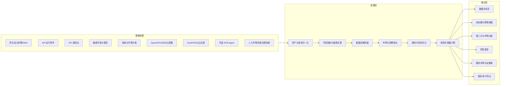

# 九章 WDSP 数据流向与跨境分析开发设计方案

> 文档状态：开发设计稿  
> 适用系统：九章 WDSP / API 安全治理平台  
> 建议模块名称：数据流向与跨境分析（Data Flow & Cross-border Analysis）  
> 说明：本文中的新增表、接口、任务和页面均为待开发设计，不代表当前系统已经实现。

## 1. 建设背景

现有 API 安全能力通常能够回答“接口是否包含敏感数据”，但在数据治理和跨境合规场景中，仅识别敏感字段远远不够。系统还需要回答以下问题：

- 数据从哪个系统、接口或用户产生？
- 数据经过了哪些应用、服务、接口、消息队列或数据库？
- 哪个调用方发起了传输？最终由哪个服务接收？
- 是否流向第三方厂商？第三方是谁、用途是什么？
- 数据实际落在哪个国家或地区？是否发生跨境或境外转存？
- 传输了哪些数据类型、字段和敏感级别？
- 传输和存储过程中是否加密、脱敏？
- 是否存在有效授权、业务依据或合规依据？
- 接收方得到的字段是否超过最小必要范围？
- 实际数据流向是否与系统登记的“用途分类”一致？

目标是把离散的接口资产、敏感字段、调用关系、应用服务、第三方、地域、环境、用途和授权信息连接起来，形成可追溯的数据流图，并持续识别数据流转风险。

典型链路如下：

```text
用户身份信息
  → 订单服务
  → 营销服务
  → 第三方短信平台
  → 境外节点
```

系统不仅要展示这条链路，还要自动判断：

- 是否属于未声明跨境；
- 是否存在敏感数据流向未知；
- 是否在测试环境使用生产数据；
- 第三方是否获得超出业务需要的字段；
- 实际流向是否与“用途分类”不一致；
- 是否缺少加密、脱敏、授权或其他保护措施；
- 是否存在未登记第三方、目的地漂移、二次转移等衍生风险。

## 2. 建设目标

### 2.1 核心目标

1. 建立覆盖“数据来源—处理—传输—接收—落地”的全链路数据流模型。
2. 同时支持无 Agent 和有 Agent 两种采集模式。
3. 基于现有 API 资产、调用拓扑、敏感数据、身份、用途分类和 GeoIP 能力，优先完成无 Agent 的可用版本。
4. 在接入 APM Agent 后，将分析范围扩展到函数、SQL、缓存、消息队列和完整分布式调用链。
5. 建立“声明流向”和“实际流向”双模型，自动发现差异。
6. 支持字段级最小必要性判断，而不仅是数据类型级判断。
7. 为每个风险结论保留来源、时间、证据和置信度，保证结果可解释、可复核。
8. 与现有风险发现、弱点、工单、审计和安全图谱能力衔接。

### 2.2 非目标

首期不承担以下职责：

- 不替代企业主数据、CMDB、合同管理或同意管理系统；
- 不在 WDSP 中保存完整业务报文、身份证号、手机号等原始敏感值；
- 不直接给出不可配置的法律结论；
- 不承诺在无 Agent、无链路标识且流量加密不可见时还原全部应用内部流向；
- 不自动阻断生产流量，阻断能力应在独立审批和策略灰度后建设。

## 3. 当前能力基线与主要缺口

### 3.1 可复用能力

当前系统已经具备或部分具备以下基础能力：

- API 应用、域名、接口资产和运行事件；
- API 调用边，可表达部分接口到接口的调用关系；
- 敏感数据类型、敏感字段发现和敏感级别；
- 用途、数据类型、环境、调用方向、认证方式、合规范围、跨境等分类维度框架；
- 脱敏规则和字段级保护配置；
- 客户端 IP 的国家识别及现有跨境事件聚合；
- 身份画像、权限、对象归属、字段权限和运行时风险；
- 安全图谱和攻击路径分析所需的基础节点与边。

### 3.2 现有跨境识别的边界

当前跨境事件主要根据敏感数据运行事件和客户端 IP 所在国家判断：

- 境外客户端提交敏感数据，可识别为入境方向；
- 向境外客户端返回敏感数据，可识别为出境方向；
- 私网、内部地址或无法定位的地址通常无法形成明确跨境结论；
- 当前主要是单跳、国家级观察，不等同于完整数据血缘。

### 3.3 需要补齐的能力

- 服务到服务的多跳数据传播；
- 第三方厂商、云区域、部署节点和实际接收主体；
- 字段从源接口到目标接口的映射；
- 声明用途、实际用途和最小必要字段集合；
- 授权、处理依据、加密、脱敏、保留期限等控制信息；
- 生产、预发布、测试和开发环境之间的数据流；
- 已声明流向与实际观察流向的自动核对；
- MQ 异步链路、批量导出、文件传输、对象存储和离线任务；
- 风险发现的证据链、置信度、生命周期和误报治理。

## 4. 设计原则

### 4.1 声明与观察分离

系统必须同时保存两类事实：

- **声明流向**：由业务、数据安全、法务或系统负责人登记和批准的预期流向；
- **观察流向**：由流量、日志、调用链、网关、Agent、配置或其他证据推导出的实际流向。

风险判断以二者的差异为核心。不得用观察结果自动覆盖声明，也不得把人工声明直接当成已验证事实。

### 4.2 证据优先

所有数据流边和风险发现必须关联证据：

- 证据来源；
- 采集时间；
- 观察次数；
- 首次和最后出现时间；
- 数据类型或字段集合；
- 置信度；
- 原始事件引用或摘要哈希。

### 4.3 不保存原始敏感值

分析默认仅保存：

- 结构化字段路径；
- 数据类型和敏感级别；
- 字段签名或不可逆 HMAC；
- 长度、格式、出现次数等元数据；
- 脱敏后的证据摘要。

禁止将完整请求体、响应体、SQL 参数、消息体或原始敏感值写入数据流分析表和普通日志。

### 4.4 渐进式可信

数据流边应根据证据质量分级：

- `DECLARED`：人工或外部治理系统声明；
- `OBSERVED`：运行时直接观察；
- `CORRELATED`：通过 trace、request ID、字段签名等关联；
- `INFERRED`：根据时间窗口、结构相似度和调用关系推断；
- `SIMULATED`：用于 What-if，不代表真实发生。

系统界面必须显式展示证据类型和置信度，避免把推断结果包装成确定事实。

## 5. 关键业务场景

### 5.1 敏感数据全链路追踪

从某个数据类型、字段、接口、服务或用户身份出发，展示数据经过的全部节点：

```text
手机号
  → POST /orders
  → order-service
  → marketing-service
  → POST sms-vendor.example/send
  → 第三方短信平台
  → Singapore
```

### 5.2 跨境流向识别

识别以下情况：

- 境内系统直接向境外 IP、域名、云区域或第三方传输敏感数据；
- 境内服务先发送到境内第三方入口，但第三方实际处理或存储区域在境外；
- 境外调用方提交数据进入境内系统；
- 数据先出境、再回流或继续转移到其他国家；
- 配置的目的地区域与实际观察结果不一致；
- 目的地无法定位或接收主体未知。

### 5.3 第三方数据共享治理

针对短信、支付、物流、身份核验、客服、分析、广告等第三方，回答：

- 哪些接口向该第三方发送数据；
- 发送哪些字段；
- 用途和授权依据是什么；
- 允许接收的最小字段集合是什么；
- 第三方在哪些地区处理和存储；
- 实际字段、用途和地域是否超出登记范围。

### 5.4 环境间数据流识别

识别生产数据进入预发布、测试和开发环境的情况，包括：

- 直接接口调用；
- 数据库同步或备份恢复；
- 文件导入、导出；
- 消息队列转发；
- 对象存储复制；
- 测试工具抓取生产报文。

### 5.5 用途一致性治理

对比数据来源用途、接口用途分类、接收服务用途、第三方登记用途和实际调用行为。例如：

- 订单履约采集的手机号被营销服务使用；
- 身份认证数据流向广告分析服务；
- 仅用于通知的第三方同时收到身份证号和详细地址；
- 声明为内部使用的数据被外部集成接口发送给第三方。

## 6. 总体架构



### 6.1 组件建议

后端建议新增独立领域包，例如 `internal/apiflow`，职责包括：

- 数据流资产归一化；
- 字段传播关联；
- 声明和观察流向核对；
- 跨境目的地判定；
- 规则执行和风险评分；
- 图查询、快照和报告接口。

现有 GeoIP 能力应作为共享基础设施复用，避免数据流模块重复加载地址库。现有跨境事件保留兼容，通过适配层逐步纳入新的数据流分析模型。

## 7. 数据流图模型

### 7.1 节点类型

| 节点类型 | 说明 | 示例 |
| --- | --- | --- |
| `DATA_CATEGORY` | 数据类型或数据分类 | 身份信息、手机号、认证凭证 |
| `DATA_FIELD` | 结构化字段 | `request.customer.phone` |
| `SYSTEM` | 来源或目标业务系统 | 订单系统、会员系统 |
| `APPLICATION` | WDSP 应用资产 | 商城应用 |
| `SERVICE` | 微服务或工作负载 | `order-service` |
| `ENDPOINT` | API 接口 | `POST /orders` |
| `DATABASE` | 数据库实例或逻辑库 | `customer-db` |
| `TABLE` | 表或逻辑数据集 | `customer_profile` |
| `MESSAGE_TOPIC` | 消息队列主题 | `order.created` |
| `FILE_CHANNEL` | 文件或对象存储通道 | SFTP、OSS Bucket |
| `THIRD_PARTY` | 第三方处理者或接收方 | 短信服务商 |
| `DEPLOYMENT` | 实例、集群或云资源 | `sms-gateway-prod` |
| `LOCATION` | 国家、地区或云区域 | CN、SG、`ap-southeast-1` |
| `ENVIRONMENT` | 运行环境 | PROD、STAGING、TEST、DEV |
| `PURPOSE` | 处理目的 | 订单履约、消息通知、营销 |
| `AUTHORIZATION_REF` | 授权或处理依据引用 | 同意版本、合同条款编号 |
| `CONTROL` | 安全控制 | TLS、字段脱敏、签名、mTLS |

### 7.2 边类型

| 边类型 | 起点 → 终点 | 语义 |
| --- | --- | --- |
| `ORIGINATES_FROM` | 数据 → 系统/接口 | 数据最初从何处产生 |
| `RECEIVED_BY` | 数据/接口 → 服务 | 接收并处理数据 |
| `CALLS` | 接口/服务 → 接口/服务 | 同步调用关系 |
| `PUBLISHES_TO` | 服务 → Topic | 发布消息 |
| `CONSUMED_BY` | Topic → 服务 | 消费消息 |
| `READS_FROM` | 服务 → 数据库/表 | 读取数据 |
| `WRITES_TO` | 服务 → 数据库/表 | 写入数据 |
| `TRANSFERS_TO` | 节点 → 节点 | 发生数据传输 |
| `SHARED_WITH` | 系统/服务 → 第三方 | 向外部主体共享数据 |
| `HOSTED_IN` | 服务/第三方/部署 → 地域 | 处理或存储位置 |
| `PROCESSED_FOR` | 数据流 → 用途 | 数据处理目的 |
| `AUTHORIZED_BY` | 数据流 → 授权引用 | 处理依据或授权证明 |
| `PROTECTED_BY` | 数据流 → 控制 | 使用的加密、脱敏等控制 |
| `DERIVED_FROM` | 数据 → 数据 | 数据转换或派生关系 |

### 7.3 数据流边属性

每条实际数据流边至少包含：

- 源节点和目标节点；
- 方向；
- 首次和最后观察时间；
- 数据类型、敏感级别和字段集合；
- 调用次数、样本数量和估算数据量；
- 环境；
- 来源地域和目标地域；
- 用途；
- 接收主体及是否第三方；
- 传输加密、内容加密、脱敏状态；
- 授权引用状态；
- 证据类型和证据引用；
- 置信度；
- 声明匹配状态。

### 7.4 方向定义

必须统一方向语义：

- `INBOUND`：外部主体向受保护系统传入数据；
- `OUTBOUND`：受保护系统向外部主体传出数据；
- `EAST_WEST`：企业内部服务间流动；
- `THIRD_PARTY_CALLBACK`：第三方回调企业接口；
- `REPLICATION`：数据库、对象存储或数据集复制；
- `IMPORT` / `EXPORT`：文件或批量数据导入导出。

方向是相对于 WDSP 管理边界定义，而不是简单依赖 HTTP 请求方向。

## 8. 字段级数据传播识别

### 8.1 字段标识

字段统一标识建议由以下信息组成：

```text
application_id + endpoint_key + direction + normalized_field_path + data_type
```

字段路径需要标准化：

- 数组下标统一为 `[]`；
- 动态对象键按规则归一化；
- 大小写和命名风格可配置归一；
- 请求、响应、Header、Cookie、Path、Query、消息体分别保留位置类型；
- 字段别名通过字典维护，例如 `mobile`、`phoneNo`、`telephone` 可映射到手机号类型。

### 8.2 字段传播匹配方法

按可信度从高到低使用：

1. **Trace 直接关联**：同一分布式 Trace 中，源响应字段进入目标请求字段。
2. **请求关联标识**：request ID、correlation ID、消息 ID 或业务流水号关联。
3. **不可逆字段指纹**：使用带租户隔离密钥的 HMAC 判断同一值是否传播，不保存原值。
4. **Schema 映射**：OpenAPI、消息 Schema、DTO 或配置声明的字段映射。
5. **字段路径和类型相似度**：字段名、结构、数据类型、长度和时间窗口推断。
6. **人工确认**：管理员确认或修正推断关系，并保留审计记录。

### 8.3 置信度计算

建议采用可解释的加权评分：

```text
confidence =
  trace_match       × 0.35 +
  request_link      × 0.20 +
  field_fingerprint × 0.20 +
  schema_match      × 0.10 +
  topology_match    × 0.10 +
  time_match        × 0.05
```

其中每项取值为 `0..1`。建议分级：

- `0.85–1.00`：高可信，可用于自动生成高等级发现；
- `0.65–0.84`：中可信，需要结合其他证据；
- `0.40–0.64`：低可信，仅作为调查线索；
- `< 0.40`：不写入正式流向图，可保留短期候选数据。

权重必须可配置，并通过真实样本校准。

### 8.4 数据转换和派生

数据经过加密、哈希、分词、聚合或脱敏后仍可能形成派生流。建议支持：

- 原值 → 掩码值；
- 身份证号 → 年龄、地区；
- 手机号 → 哈希用户标识；
- 订单明细 → 用户消费画像；
- 多字段 → 风险评分或标签。

派生关系使用 `DERIVED_FROM` 表达，并区分可逆、不可逆和匿名化。仅凭名称不得认定已经匿名化，必须有控制配置或验证证据。

## 9. 数据采集方案

### 9.1 无 Agent 模式

无 Agent 模式适用于大部分 API 边界和服务间调用治理，数据来源包括：

- WAF、API 网关、Ingress 和反向代理的请求元数据；
- WDSP 已有 API 运行事件和调用边；
- 敏感字段扫描结果；
- OpenAPI、AsyncAPI、JSON Schema；
- 服务注册、CMDB、Kubernetes、云负载均衡和域名配置；
- DNS、证书、IP、GeoIP 和云区域映射；
- 数据库审计、消息队列审计、对象存储访问日志；
- 第三方接口域名、合同和数据处理声明；
- 人工维护的数据流声明。

无 Agent 模式的优点是部署快、侵入小；限制是难以准确还原应用内部函数、SQL、内存处理和无公共链路标识的异步传播。

### 9.2 有 Agent / APM 模式

只有在需要看到应用内部数据流时启用 Agent，补充采集：

- 完整分布式 Trace 和 Span 关系；
- HTTP/RPC 客户端调用；
- SQL 执行目标、表名和耗时；
- 消息发布、消费、等待和重试；
- 缓存读写；
- 函数或方法级关键处理节点；
- 线程阻塞、GC 等性能上下文。

Agent 默认不得采集原始参数值。字段传播识别应在进程内完成摘要或 HMAC 后上传。采集范围、采样率、字段白名单和保留期必须可配置。

### 9.3 声明数据来源

声明数据可以来自：

- WDSP 页面人工登记；
- CMDB、数据目录或数据资产平台同步；
- 第三方管理台账；
- 合同或数据处理协议的结构化字段；
- 授权/同意系统的引用和状态；
- IaC、Kubernetes、云账户和地域配置。

WDSP 只保存授权和合同的引用、版本、状态和有效期，原则上不保存完整法律文件或用户授权原文。

## 10. 数据流声明模型

### 10.1 声明内容

每条声明至少包含：

- 声明名称和负责人；
- 来源系统、应用、服务或接口；
- 接收系统、服务、第三方或地域；
- 数据类型和允许字段；
- 敏感级别；
- 处理用途；
- 调用方向；
- 来源和目标环境；
- 来源和目标国家/地区；
- 是否允许跨境；
- 是否允许第三方继续转移；
- 处理依据或授权引用；
- 传输加密、内容加密和脱敏要求；
- 最小必要字段集合；
- 保存期限；
- 生效时间、失效时间和审批状态；
- 适用条件和例外范围。

### 10.2 声明状态

建议状态：

- `DRAFT`：草稿；
- `PENDING_REVIEW`：待审核；
- `APPROVED`：已批准且生效；
- `REJECTED`：已拒绝；
- `EXPIRED`：已过期；
- `REVOKED`：已撤销。

只有在观察时间点有效的 `APPROVED` 声明可以匹配实际数据流。

### 10.3 匹配逻辑

观察流向与声明流向匹配时，应同时比较：

```text
来源范围
AND 接收范围
AND 数据类型/字段范围
AND 用途范围
AND 环境范围
AND 地域范围
AND 生效时间
AND 第三方身份
AND 必需保护措施
```

不允许仅凭“存在一条跨境声明”就认定所有跨境流量合规。

## 11. 第三方台账

### 11.1 第三方基础信息

- 厂商名称、统一标识和状态；
- 服务类型，例如短信、支付、物流、身份核验、分析；
- 接口域名、IP 段、证书主体和云账户标识；
- 实际运营主体和分包商；
- 数据处理和存储国家/地区；
- 是否允许继续转移；
- 合同/数据处理协议引用；
- 安全评估、到期时间和负责人。

### 11.2 第三方接收范围

按业务用途维护允许的数据范围：

| 第三方 | 用途 | 允许字段 | 禁止字段 | 地域 | 控制要求 |
| --- | --- | --- | --- | --- | --- |
| 短信平台 A | 消息通知 | 手机号、模板 ID、验证码 | 身份证号、银行卡号、订单明细 | CN | TLS、日志脱敏 |
| 物流平台 B | 订单配送 | 姓名、手机号、收货地址、订单号 | 认证凭证、支付卡信息 | CN | TLS、签名 |

实际观察字段超出允许集合时，生成“第三方超范围字段”发现。

## 12. 地域与跨境判定

### 12.1 地域证据优先级

目标地域按以下优先级确认：

1. 已验证的云账号、Region、集群或部署配置；
2. 第三方登记的处理和存储地域；
3. 服务发现、CMDB 或 Kubernetes 节点地域；
4. IP GeoIP 结果；
5. 域名解析和证书主体推断；
6. 人工声明；
7. 无法确认时标记为 `UNKNOWN`。

IP 所在国家不一定等于数据最终处理或存储地点，因此必须显示地域证据来源。

### 12.2 本地地域配置

系统应允许租户配置：

- 主要经营地域；
- 本地国家/地区集合；
- 允许目的地；
- 禁止目的地；
- 需审批目的地；
- 特定数据类型的本地化要求。

不得将“境外”硬编码为仅相对于中国。跨境规则应以租户的本地地域和规则包为准。

### 12.3 跨境状态

- `DOMESTIC`：来源和目标均属于本地地域；
- `OUTBOUND`：从本地地域流向非本地地域；
- `INBOUND`：从非本地地域流向本地地域；
- `FOREIGN_TO_FOREIGN`：两个非本地地域之间流转；
- `MULTI_REGION`：同一服务或第三方跨多个地域处理；
- `UNKNOWN`：至少一端地域无法确认。

## 13. 核心风险检测规则

### 13.1 未声明跨境

**规则编码：** `DF-CB-001`

**触发条件：**

```text
观察到敏感或受管控数据跨越本地地域边界
AND 不存在与来源、接收方、数据范围、用途、地域和时间均匹配的有效声明
```

**必要证据：**

- 数据类型或字段；
- 源和目标节点；
- 来源和目的地域及其证据；
- 首次/最后观察时间；
- 调用或传输证据；
- 声明匹配失败原因。

**排除条件：**

- 仅地域未知，不应直接认定为未声明跨境，应生成地域未知类发现；
- 已批准声明完整覆盖该流向；
- 配置的内部多地域架构被规则明确允许；
- 仅健康检查、无业务数据的调用。

**严重度建议：**

- 核心/重要数据：严重；
- 敏感数据流向未登记第三方：高；
- 一般个人信息且保护措施完整：中；
- 低可信推断：仅线索或低等级。

### 13.2 敏感数据流向未知

**规则编码：** `DF-LN-001`

**触发条件之一：**

- 敏感数据从已知源节点离开，但目标服务、第三方或地域无法识别；
- 数据进入中间服务后，在合理时间窗口内无法关联后续接收或存储节点；
- 接收域名/IP 未归属任何应用、服务或第三方；
- 异步消息的生产者已知，但 Topic 或消费者未知；
- 文件导出已观察，但下载主体或接收位置未知。

**误报控制：**

- 正常终止于最终用户响应的数据流不应被视为“丢失”；
- 聚合、删除或不可逆匿名化应允许声明为合法终点；
- 低采样率、Trace 中断和日志缺失需要显示“可观测性不足”，不能直接定性为违规。

### 13.3 测试环境使用生产数据

**规则编码：** `DF-ENV-001`

**触发条件：**

```text
source_environment = PROD
AND destination_environment IN (STAGING, TEST, DEV)
AND observed_data_set contains sensitive or production-classified data
AND no approved masked-test-data exception
```

**识别方法：**

- 直接生产接口到测试接口调用；
- 生产数据库快照导入测试库；
- 生产对象存储复制到测试 Bucket；
- 生产消息被测试消费者订阅；
- 使用租户隔离 HMAC 判断同一敏感值集合出现在生产和测试，不保存原值；
- 通过数据集标签、备份任务和导入任务识别来源。

**合法例外：**

- 已完成不可逆匿名化；
- 经批准的受控验证环境，具备时间范围和责任人；
- 合成数据或专用测试数据；
- 仅结构 Schema，不含真实记录。

### 13.4 第三方获得超范围字段

**规则编码：** `DF-TP-001`

定义：

```text
observed_fields = 实际发送给第三方的字段集合
allowed_fields  = 声明中该第三方、用途和接口允许的最小字段集合
excess_fields   = observed_fields - allowed_fields
```

当 `excess_fields` 非空时触发。系统还应计算：

```text
excess_ratio = count(excess_fields) / max(count(observed_fields), 1)
```

**严重度因素：**

- 超范围字段的敏感级别；
- 字段数量和调用量；
- 第三方类型和地域；
- 是否存在明文传输；
- 是否包含凭证、身份号码、金融或位置数据；
- 是否已持续发生。

### 13.5 与“用途分类”不一致

**规则编码：** `DF-PUR-001`

比较以下用途：

- 数据采集时声明用途；
- 源接口用途分类；
- 中间服务用途分类；
- 目标接口或第三方登记用途；
- 数据流声明用途；
- 从调用行为推断的实际用途。

示例冲突：

- `ORDER_FULFILLMENT` 数据流向 `MARKETING` 服务；
- `IDENTITY_AUTH` 数据流向广告分析第三方；
- `MESSAGE_NOTIFICATION` 场景发送与通知无关的身份证、银行卡字段；
- 标记为 `INTERNAL` 的接口将数据发送到 `EXTERNAL_INTEGRATION`。

用途推断属于辅助证据。仅通过服务名称或 URL 关键词推断时，不能直接生成严重级结论，应要求人工复核。

## 14. 扩展风险规则

为了尽可能覆盖数据流治理场景，建议增加以下规则：

| 规则编码 | 风险 | 主要判断 |
| --- | --- | --- |
| `DF-LOC-001` | 目的地域未知 | 敏感数据目标地域无法确认 |
| `DF-LOC-002` | 目的地域漂移 | 实际 Region/国家超出声明范围 |
| `DF-CB-002` | 未声明继续转移 | 第三方或下游又将数据转给其他主体/地域 |
| `DF-CB-003` | 禁止地域传输 | 数据流向租户规则配置的禁止地域 |
| `DF-TP-002` | 未登记第三方 | 外部域名、证书或 IP 无法匹配第三方台账 |
| `DF-TP-003` | 第三方协议过期 | 流量仍在发生，但合同/处理协议已失效 |
| `DF-ENC-001` | 敏感数据未加密传输 | 未使用 TLS/mTLS 或存在协议降级 |
| `DF-MASK-001` | 第三方数据未脱敏 | 声明要求脱敏但观察到未脱敏字段 |
| `DF-AUTH-001` | 缺少授权或处理依据 | 无有效授权引用，或授权范围不覆盖用途/字段 |
| `DF-AUTH-002` | 授权撤销后继续使用 | 授权状态失效后仍有新流量 |
| `DF-MIN-001` | 内部服务超范围使用 | 内部目标服务接收超过最小必要的字段 |
| `DF-RET-001` | 超过保留期限 | 已过期数据仍被读取、传输或处理 |
| `DF-ENV-002` | 测试数据回流生产 | 未经验证的测试/开发数据进入生产 |
| `DF-LOG-001` | 敏感数据写入日志 | 敏感字段流向日志或可观测平台 |
| `DF-URL-001` | 敏感数据出现在 URL | 敏感值位于 Query/Path，可能进入日志和 Referer |
| `DF-EXP-001` | 高风险批量导出 | 大规模敏感数据导出到文件、邮箱或外部存储 |
| `DF-VOL-001` | 数据传输量异常 | 数据类型、目标或地域的传输量显著偏离基线 |
| `DF-SHADOW-001` | 影子数据通道 | 未纳管接口、域名、Topic 或文件通道传输敏感数据 |
| `DF-CLASS-001` | 分类缺失 | 关键节点缺少用途、环境或数据级别分类 |
| `DF-CTRL-001` | 控制与声明不一致 | 声明要求加密/脱敏/签名，实际证据不满足 |

规则包应支持按租户、业务线、数据级别和环境启停，阈值、例外和严重度不得全部硬编码。

## 15. 声明与观察核对算法

### 15.1 集合核对

对每条观察流向执行：

```text
1. 找到时间有效、来源范围匹配的候选声明
2. 按接收主体、地域、环境、用途继续过滤
3. 计算字段集合：observed - allowed
4. 检查必需控制：TLS、mTLS、脱敏、签名等
5. 检查授权引用及有效期
6. 生成 MATCHED、PARTIAL、UNDECLARED 或 UNKNOWN 结果
```

匹配状态建议：

- `MATCHED`：完整覆盖；
- `PARTIAL`：存在声明，但字段、用途、地域或控制不完整；
- `UNDECLARED`：无有效声明；
- `AMBIGUOUS`：多条声明冲突，无法唯一匹配；
- `UNKNOWN`：观察证据不足。

### 15.2 路径级核对

单条边合法不代表完整路径合法。系统需要检查：

- 数据源用途是否允许下游用途；
- 每一跳是否均在声明范围；
- 中间节点是否改变敏感级别或数据类型；
- 第三方是否继续转移；
- 最终地域是否在允许范围；
- 任一跳是否丢失加密、脱敏或授权约束。

路径遍历应限制最大深度、时间窗口和循环次数，避免消息重试或服务环路造成图爆炸。

## 16. 风险评分

建议风险分数范围为 `0–100`：

```text
risk_score =
  data_sensitivity     × 0.25 +
  destination_risk     × 0.15 +
  declaration_gap      × 0.20 +
  control_gap          × 0.15 +
  authorization_gap    × 0.10 +
  exposure_volume      × 0.10 +
  evidence_confidence  × 0.05
```

修正项：

- 涉及核心/重要数据：上调；
- 认证凭证、金融数据、精确位置等高敏感字段：上调；
- 未登记第三方或禁止地域：上调；
- 仅推断、样本不足：降低结论置信度，但不一定降低潜在影响；
- 已有效脱敏、匿名化且经过验证：降低；
- 已批准例外且未过期：抑制或转为合规观察。

风险严重度建议：

- `CRITICAL`：85–100；
- `HIGH`：70–84；
- `MEDIUM`：45–69；
- `LOW`：1–44；
- `INFO`：0 或仅信息提示。

风险分数与证据置信度必须分别展示，不能混成一个数字。

## 17. 数据库设计建议

以下均为新增设计，正式开发前应结合现有迁移编号和命名规范确认。

### 17.1 数据流快照

`api_data_flow_snapshots`

| 字段 | 类型建议 | 说明 |
| --- | --- | --- |
| `id` | bigint | 主键 |
| `tenant_id` | bigint/uuid | 租户隔离键 |
| `window_start` | timestamptz | 分析窗口开始 |
| `window_end` | timestamptz | 分析窗口结束 |
| `status` | varchar | BUILDING/READY/FAILED |
| `source_watermarks` | jsonb | 各数据源水位 |
| `node_count` | bigint | 节点数 |
| `edge_count` | bigint | 边数 |
| `created_at` | timestamptz | 创建时间 |

### 17.2 数据流节点

`api_data_flow_nodes`

- `id`、`tenant_id`、`snapshot_id`；
- `node_type`、`external_key`、`display_name`；
- `application_id`、`environment`、`owner`；
- `country_code`、`region_code`、`location_confidence`；
- `attributes jsonb`；
- 唯一约束：`tenant_id + snapshot_id + node_type + external_key`。

### 17.3 数据流边

`api_data_flow_edges`

- `id`、`tenant_id`、`snapshot_id`；
- `source_node_id`、`target_node_id`、`edge_type`；
- `direction`、`first_seen_at`、`last_seen_at`；
- `observation_count`、`estimated_records`、`estimated_bytes`；
- `data_types jsonb`、`max_sensitivity_level`；
- `purpose_codes jsonb`；
- `encrypted_in_transit`、`content_encrypted`、`masked`；
- `evidence_type`、`confidence`、`evidence_refs jsonb`；
- `declaration_match_status`；
- `source_environment`、`target_environment`；
- `source_country`、`target_country`；
- `third_party_id`。

### 17.4 边字段明细

`api_data_flow_edge_fields`

- `edge_id`；
- `source_field_key`、`target_field_key`；
- `normalized_path`、`data_type`、`sensitivity_level`；
- `transform_type`；
- `masked`、`encrypted`；
- `match_method`、`confidence`；
- `first_seen_at`、`last_seen_at`、`observation_count`。

高基数字段明细需要按时间分区或独立存储，并设置保留期限。

### 17.5 数据流声明

`api_data_flow_declarations`

- 名称、描述、负责人和审批状态；
- 来源/目标范围；
- 第三方、用途、环境和地域范围；
- 是否允许跨境、是否允许继续转移；
- 控制要求；
- 授权引用；
- 生效/失效时间；
- 版本号、审批人、审批时间；
- 创建和更新时间。

声明字段建议放入 `api_data_flow_declaration_fields`，支持允许字段、禁止字段和条件字段。

### 17.6 第三方台账

建议表：

- `api_third_parties`：主体、服务类别、负责人和状态；
- `api_third_party_endpoints`：域名、IP 段、证书、API 标识；
- `api_third_party_locations`：处理和存储地域、证据与有效期；
- `api_third_party_agreements`：协议引用、允许用途和到期时间。

### 17.7 授权引用

`api_data_authorization_refs`

- 外部授权/同意/合同系统类型；
- 外部引用 ID；
- 适用数据、用途、主体和接收方范围；
- 状态、版本、生效/失效时间；
- 最近同步时间。

此表只保存引用和范围，不保存敏感授权原文。

### 17.8 风险发现

可选择扩展现有运行时发现模型，或增加 `api_data_flow_findings`。无论采用哪种方式，都需支持：

- 规则编码和版本；
- 关联快照、路径、边和字段；
- 风险分、严重度和置信度；
- 声明差异详情；
- 证据摘要；
- 状态、负责人、处置意见和审计日志；
- 首次/最后发现时间和重复次数；
- 抑制条件及到期时间。

不建议为数据流风险建立完全孤立的处置体系，应复用现有风险工作流和权限模型。

## 18. 后端任务设计

### 18.1 增量构图任务

职责：

- 按水位读取新增运行事件、调用边和敏感字段；
- 归一化资产和第三方身份；
- 计算字段传播候选；
- 更新边的观察次数和时间范围；
- 幂等写入快照或增量表。

### 18.2 地域解析任务

- 解析 IP、域名、云 Region、集群和第三方登记地域；
- 保存地域证据及可信度；
- 对地域变化生成漂移事件；
- GeoIP 数据库不可用时进入降级状态，并在页面显示数据新鲜度。

### 18.3 声明核对任务

- 每次新边或边属性变化时增量核对；
- 声明新增、审批、过期或撤销时重算受影响范围；
- 保留规则版本和声明版本，保证历史结果可复现。

### 18.4 规则扫描任务

- 高频规则按增量事件触发；
- 全量一致性规则按小时或每天执行；
- 重发现进行聚合，避免同一调用产生大量重复告警；
- 批量数据流量采用时间桶和基线比较。

### 18.5 数据保留与压缩任务

- 原始关联候选短期保存；
- 聚合边和快照长期保存；
- 字段指纹按策略删除或轮换；
- 过期快照压缩，保留审计所需摘要；
- 删除时不得破坏仍处于处置中的发现证据。

## 19. API 设计建议

建议统一前缀：`/api/v1/api-security/data-flows`。

### 19.1 查询接口

| 方法 | 路径 | 用途 |
| --- | --- | --- |
| GET | `/summary` | 总览指标、趋势和风险分布 |
| GET | `/graph` | 按过滤条件查询数据流子图 |
| GET | `/paths` | 查询从数据、接口或服务出发的路径 |
| GET | `/paths/{id}` | 路径详情、字段和证据 |
| GET | `/cross-border` | 跨境流向列表与聚合 |
| GET | `/cross-border/map` | 国家/地区流向聚合 |
| GET | `/findings` | 风险发现列表 |
| GET | `/findings/{id}` | 发现详情与声明差异 |
| GET | `/unknown-destinations` | 未归属目标和地域 |

### 19.2 声明和第三方接口

| 方法 | 路径 | 用途 |
| --- | --- | --- |
| GET/POST | `/declarations` | 查询或创建声明 |
| GET/PUT | `/declarations/{id}` | 查看或更新声明草稿 |
| POST | `/declarations/{id}/submit` | 提交审批 |
| POST | `/declarations/{id}/approve` | 审批通过 |
| POST | `/declarations/{id}/revoke` | 撤销声明 |
| GET/POST | `/third-parties` | 第三方台账 |
| GET/PUT | `/third-parties/{id}` | 第三方详情维护 |
| POST | `/third-parties/{id}/verify` | 验证域名、地域和协议状态 |

### 19.3 分析和导出接口

| 方法 | 路径 | 用途 |
| --- | --- | --- |
| POST | `/analyze` | 触发指定范围重算 |
| POST | `/compare` | 对比声明和观察流向 |
| POST | `/simulate` | 模拟修改声明或控制后的风险变化 |
| POST | `/exports` | 创建审计报告导出任务 |
| GET | `/exports/{id}` | 查询导出结果 |

图查询必须设置最大节点数、最大路径深度、时间范围和超时，防止大图拖垮数据库。

## 20. 前端页面设计

### 20.1 数据流总览

展示：

- 敏感数据流总数；
- 跨境流向、未声明跨境和地域未知数量；
- 涉及第三方数量；
- 测试环境使用生产数据数量；
- 用途不一致和超范围字段数量；
- 按数据类型、敏感级别、环境、地域和业务线的趋势；
- 最近新增和风险最高的数据流。

### 20.2 数据流图

支持从以下对象开始查询：

- 数据类型或字段；
- 应用、服务或接口；
- 第三方；
- 国家和地区；
- 用途；
- 风险发现。

交互要求：

- 逐层展开，默认不一次加载全图；
- 用颜色表达风险，用线型表达证据类型；
- 声明流向和实际流向可叠加或切换；
- 点击边展示字段、用途、加密、脱敏、授权和证据；
- 支持仅显示跨境、第三方或异常边；
- 支持时间回放和快照对比；
- 显示“观察”“推断”“声明”“模拟”标签。

### 20.3 路径详情

示例：

```text
[身份信息/手机号]
  └─ POST /orders
      └─ order-service (PROD, CN)
          └─ marketing-service (PROD, CN)
              └─ sms-vendor.example/send
                  └─ 第三方短信平台
                      └─ Singapore
```

右侧详情建议分为：

- 路径摘要；
- 每一跳的数据字段；
- 来源与目标环境；
- 来源与目的地域；
- 第三方身份；
- 声明用途与观察用途；
- 加密、脱敏和授权；
- 声明匹配结果；
- 证据时间线；
- 风险和修复建议。

### 20.4 跨境地图

当前若只有国家级数据，应使用国家级连线或表格，不展示虚假的城市精度。页面支持：

- 来源国家/地区与目标国家/地区；
- 数据类型和敏感级别；
- 第三方；
- 声明状态；
- 时间、环境和业务线过滤；
- 入境、出境、境外间流转区分；
- 地域证据来源和置信度。

### 20.5 声明与第三方管理

- 声明列表、版本和审批状态；
- 图形化选择来源、目标、数据、用途和地域；
- 最小字段集合配置；
- 控制要求配置；
- 影响预览：提交前显示历史实际流向是否可被覆盖；
- 第三方域名/IP/证书和地域管理；
- 到期提醒和变更审计。

### 20.6 风险发现页面

过滤维度：

- 风险类型；
- 严重度；
- 数据类型和级别；
- 来源/目标应用；
- 第三方；
- 国家/地区；
- 环境；
- 用途；
- 证据置信度；
- 状态和负责人。

发现详情必须展示“为什么命中”“哪些字段超范围”“哪一条声明不匹配”，不能只显示笼统结论。

## 21. 权限与审计

建议权限拆分：

- `api_data_flow.read`：查看汇总和脱敏后的流向；
- `api_data_flow.evidence.read`：查看详细字段与证据；
- `api_data_flow.declaration.write`：维护声明草稿；
- `api_data_flow.declaration.approve`：审批或撤销声明；
- `api_data_flow.third_party.write`：维护第三方台账；
- `api_data_flow.finding.manage`：处置风险；
- `api_data_flow.export`：导出报告；
- `api_data_flow.admin`：规则和系统配置。

必须审计：

- 查看高敏感证据；
- 创建、修改、审批和撤销声明；
- 修改第三方允许字段和地域；
- 抑制、接受或关闭发现；
- 导出数据流和风险报告；
- 修改地域、用途映射和规则阈值。

## 22. 安全与隐私设计

### 22.1 数据最小化

- 默认不采集原始敏感值；
- 字段匹配使用租户隔离 HMAC，不使用普通无盐哈希；
- 不同租户的同一值不能产生可关联指纹；
- 指纹密钥可轮换；
- 字段路径、样本证据和导出内容按权限脱敏。

### 22.2 多租户隔离

- 所有新增表必须包含租户隔离键；
- 图查询、任务水位和缓存键必须包含租户；
- 后台任务不得跨租户聚合字段指纹；
- 第三方公共资产可共享基础信息，但租户声明和风险必须隔离。

### 22.3 证据安全

- 证据引用使用内部 ID，不直接拼接原始日志；
- 日志禁止打印报文和字段指纹密钥；
- 导出文件设置过期时间、权限校验和下载审计；
- 高敏感证据可采用二次授权；
- 数据保留策略与风险处置状态联动。

## 23. 性能和容量设计

### 23.1 建议性能目标

- 总览查询 P95 小于 2 秒；
- 常用过滤列表 P95 小于 2 秒；
- 100 个节点以内的图查询 P95 小于 3 秒；
- 单条路径详情 P95 小于 2 秒；
- 新观察边在 5 分钟内进入增量分析；
- 严重跨境风险在 10 分钟内形成发现；
- 日级全量核对在下一工作日开始前完成。

实际指标需根据部署规模压测后确定。

### 23.2 优化策略

- 边按租户、时间窗口和源节点分区；
- 对国家、环境、第三方、敏感级别建立组合索引；
- 字段集合使用去重表或压缩编码；
- 总览使用预聚合快照；
- 路径查询限制深度和节点数；
- 热点子图缓存并携带快照版本；
- 大批量导出使用异步任务；
- 规则计算按变化范围增量执行。

## 24. 风险发现生命周期

建议状态：

- `NEW`：新发现；
- `CONFIRMED`：已确认；
- `IN_PROGRESS`：处置中；
- `ACCEPTED`：已批准接受风险；
- `RESOLVED`：已修复并验证；
- `FALSE_POSITIVE`：误报；
- `ARCHIVED`：归档。

处置动作：

- 补充或纠正数据流声明；
- 删除超范围字段；
- 修改服务用途或数据处理逻辑；
- 启用 TLS/mTLS、字段加密或脱敏；
- 停止向未登记第三方传输；
- 将测试数据替换为合成或脱敏数据；
- 补齐授权或停止处理；
- 纠正地域配置；
- 创建有到期时间的例外。

风险关闭后应通过新观察证据自动验证，而不是仅靠手工点击关闭。

## 25. 测试方案

测试只在测试环境运行，不依赖生产数据。

### 25.1 单元测试

- 地域和跨境方向计算；
- 声明有效期和范围匹配；
- 字段集合差异；
- 用途兼容矩阵；
- 风险评分；
- 字段路径归一化；
- 置信度计算；
- 环境流向判断；
- 多租户隔离过滤。

### 25.2 集成测试

#### 场景 A：未声明跨境

```text
CN/订单服务 → SG/第三方短信平台
数据：手机号、姓名
声明：无
预期：生成 DF-CB-001，高风险
```

#### 场景 B：敏感数据流向未知

```text
营销服务 → 未登记外部域名
数据：手机号
目标地域：UNKNOWN
预期：生成 DF-LN-001 和 DF-LOC-001，不直接断言特定国家跨境
```

#### 场景 C：测试环境使用生产数据

```text
PROD/customer-db → TEST/customer-db
数据：身份信息、联系方式
脱敏：否
预期：生成 DF-ENV-001
```

#### 场景 D：第三方超范围字段

```text
允许：手机号、模板 ID
实际：手机号、模板 ID、身份证号、订单金额
预期：生成 DF-TP-001，并列出身份证号、订单金额
```

#### 场景 E：用途不一致

```text
来源用途：订单履约
目标用途：营销推广
授权范围：仅订单履约
预期：生成 DF-PUR-001；如缺授权同时生成 DF-AUTH-001
```

#### 场景 F：合法声明覆盖

```text
声明完整覆盖来源、第三方、数据、用途、地域、时间和控制
实际使用 TLS 且字段未超范围
预期：不生成风险，状态为 MATCHED
```

#### 场景 G：地域未知

```text
目标使用私网地址且无 CMDB/云 Region 信息
预期：标记 UNKNOWN，提示补充资产，不误判为境外
```

### 25.3 端到端测试

测试脚本应覆盖：

- 创建第三方台账；
- 创建、提交和审批声明；
- 注入模拟 API 调用事件；
- 触发数据流分析；
- 查看总览、图、跨境地图、路径和发现；
- 验证字段差异、用途差异和证据链；
- 处置发现并验证状态；
- 导出带截图的测试报告。

### 25.4 安全测试

- 越权查看流向和证据；
- 跨租户图查询；
- 通过字段指纹反推原值；
- 导出链接复用和过期校验；
- 声明审批绕过；
- 图查询深度/节点数 DoS；
- 恶意字段路径和 JSON 属性注入；
- 日志中敏感值泄漏。

### 25.5 性能测试

至少覆盖：

- 千万级边增量聚合；
- 高基数字段传播；
- 复杂多跳路径；
- 大量声明重新核对；
- 并发总览和图查询；
- 批量导出。

## 26. 分阶段实施计划

### 阶段 0：数据标准和基础治理

- 统一应用、服务、接口、环境和地域标识；
- 补齐用途、数据类型、环境、调用方向和跨境分类；
- 清理重复或无法归属的应用、域名和接口；
- 定义第三方和声明的数据标准；
- 明确租户本地地域配置。

**交付物：** 数据字典、用途兼容矩阵、地域策略、第三方模板。

### 阶段 1：无 Agent 数据流 MVP

- 复用 API 运行事件、调用边和敏感字段；
- 建立应用—服务—接口—第三方—地域数据流图；
- 建设第三方台账和数据流声明；
- 实现未声明跨境、地域未知和未登记第三方规则；
- 提供总览、流向图、跨境列表和路径详情。

**建议周期：** 4–6 周，视现有资产数据质量调整。

### 阶段 2：字段级治理

- 字段传播和字段集合核对；
- 最小必要范围；
- 用途一致性；
- 加密、脱敏和授权引用；
- 测试环境使用生产数据；
- 规则处置和报告。

**建议周期：** 4–6 周。

### 阶段 3：Agent/APM 深度血缘

- 接入 Trace、SQL、MQ、缓存和函数级处理证据；
- 补齐同步和异步完整调用链；
- 数据库表和消息 Topic 级血缘；
- 关联性能问题与数据流风险。

**建议周期：** 6–10 周，可按语言和框架分批接入。

### 阶段 4：持续治理和智能分析

- 目的地域漂移和流量异常；
- What-if 模拟；
- 修复收益排序；
- 声明到期和第三方变更监控；
- 数据流影响面和攻击路径联合分析；
- 合规规则包和审计报告模板。

## 27. 验收标准

### 27.1 功能验收

- 可从任意敏感数据类型、接口、服务、第三方或地域查看多跳流向；
- 可区分声明、观察、推断和模拟关系；
- 可呈现来源系统、调用方、接收服务、第三方、地域、用途、数据类型/级别、加密、脱敏、授权和最小必要性；
- 五项核心规则均能稳定检出并给出可解释证据；
- 可列出第三方超范围的具体字段；
- 可展示声明与实际流向的差异；
- 风险支持确认、处置、例外、验证和审计；
- 支持测试环境自动化测试和带截图报告。

### 27.2 准确性验收

- 高可信流向边准确率目标不低于 95%；
- 关键五类规则在标准测试集上的召回率目标不低于 90%；
- 地域未知不得自动等同于跨境；
- 合法且完整覆盖的声明不得重复产生未声明跨境；
- 字段集合差异与测试数据完全一致；
- 多租户数据泄漏为零容忍。

准确率指标应由真实标注样本校准，不能仅用合成用例证明。

### 27.3 可解释性验收

每条发现必须能够回答：

1. 哪些数据发生了流动？
2. 从哪里到哪里，经过哪些节点？
3. 为什么认为涉及第三方或跨境？
4. 哪条声明未匹配，具体差异是什么？
5. 证据来自哪里，可信度是多少？
6. 应优先修改字段、用途、控制、声明还是部署地域？

## 28. 兼容、迁移与回滚

### 28.1 兼容策略

- 保留现有跨境查询接口和数据表；
- 新模块先通过适配器读取现有跨境事件；
- 新旧页面并行验证一段时间；
- 旧事件可异步回填为单跳观察边；
- 不改变已有敏感字段、用途分类和风险接口语义。

### 28.2 数据迁移

1. 创建新表和索引；
2. 回填应用、接口、敏感字段和现有跨境事件；
3. 建立第三方域名初始候选清单；
4. 生成初始快照，但首轮风险仅观察不告警；
5. 人工确认数据质量后启用规则；
6. 分业务线逐步放量。

### 28.3 回滚

- 后台任务和规则支持独立开关；
- 新页面可通过功能开关关闭；
- 新表只读回填期间不影响现有业务；
- 回滚应用代码时保留新增表，避免破坏审计数据；
- 如需删除数据，应使用单独迁移并经过备份和审批。

## 29. 与其他能力的联动

### 29.1 与用途分类联动

- 数据流声明直接引用用途分类代码；
- 接口、服务和第三方均可配置用途；
- 用途兼容矩阵由治理人员维护；
- 用途变化触发受影响流向重新核对。

### 29.2 与攻击路径分析联动

数据流图提供“数据去向”，攻击路径提供“攻击者如何到达”。二者联合后可回答：

```text
公网暴露接口
  → 无认证访问
  → 获取用户身份信息
  → 订单服务
  → 营销服务
  → 第三方短信平台
  → 境外节点
```

可进一步计算：

- 被攻击后数据可能传播到哪些系统和第三方；
- 哪个节点同时是攻击路径和数据流路径的关键节点；
- 修复某个接口、身份权限或数据流控制后，爆炸半径降低多少。

### 29.3 与 APM 联动

- 数据流风险路径可跳转到对应 Trace；
- Trace 可显示 SQL、MQ 和第三方调用耗时；
- 性能异常可以解释数据流中断、重试或重复发送；
- 数据流分析只引用必要的 Trace 元数据，不复制完整 APM 数据。

### 29.4 与测试报告联动

- 每次升级在测试环境运行固定的数据流测试集；
- 自动生成用例结果、风险详情和页面截图；
- 与上一个版本对比新增、消失和变化的流向；
- 将关键规则漏报和误报作为发布门禁。

## 30. 需要产品和治理侧确认的问题

开发前需要确认：

1. 租户“本地地域”的定义以及是否支持多本地地域；
2. 哪些数据级别强制要求声明、授权、加密和脱敏；
3. 用途分类之间的允许、条件允许和禁止矩阵；
4. 第三方最小字段由谁维护和审批；
5. 授权/同意信息由哪个系统作为事实源；
6. 是否需要保存合同、评估报告，还是只保存引用；
7. 无 Agent 首期能够获得哪些网关、CMDB、云和审计数据；
8. Agent 支持的语言和框架优先级；
9. 风险发现是否复用现有工单和审批流程；
10. 数据流证据、指纹和快照的保留期限。

## 31. 推荐开发顺序

建议按以下顺序实施，避免先做复杂图形页面但底层事实不可靠：

1. 统一资产、环境、用途、地域和第三方标识；
2. 建立声明模型和第三方台账；
3. 将现有跨境事件和 API 调用边投影为数据流边；
4. 完成声明与观察核对；
5. 实现未声明跨境和地域未知；
6. 实现字段级最小必要和用途一致性；
7. 实现生产数据进入测试环境；
8. 上线流向图、路径详情和证据链；
9. 接入 APM Agent 扩展到 SQL、MQ 和应用内部；
10. 联动攻击路径、What-if 和修复收益分析。

## 32. 最终交付形态

完成后，WDSP 应能够针对任意敏感数据生成如下结论：

```text
数据：用户身份信息（手机号、姓名、身份证号）
来源：订单系统 / POST /orders
路径：订单服务 → 营销服务 → 第三方短信平台 → Singapore
环境：PROD → PROD → 第三方生产环境
用途：订单履约 → 营销推广 → 消息通知
保护：TLS 已启用；身份证号未脱敏
授权：仅覆盖订单履约，不覆盖营销推广
声明：仅允许手机号用于消息通知，目的地域登记为 CN

自动结论：
1. 未声明跨境：是
2. 敏感数据流向未知：否，路径已确认
3. 测试环境使用生产数据：否
4. 第三方超范围字段：身份证号、姓名
5. 用途分类不一致：订单履约数据被用于营销推广
6. 地域漂移：声明 CN，实际 Singapore
7. 脱敏控制不满足：身份证号未脱敏
```

该结果必须可以逐项展开到具体节点、字段、声明差异、证据来源和时间范围，从而真正形成“可发现、可解释、可处置、可验证”的数据流向与跨境治理闭环。

