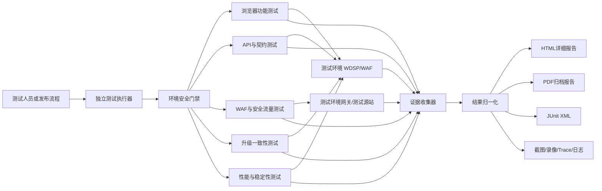
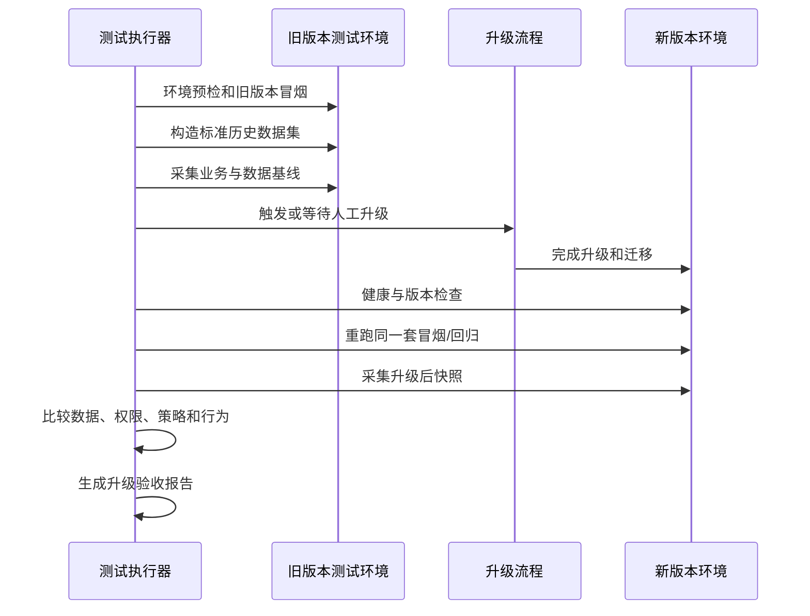

# 九章 WAF / WDSP 独立测试环境自动化回归与报告方案

> 文档状态：设计方案  
> 适用产品：九章 WAF、九章 WDSP 及其组合部署  
> 执行范围：仅测试环境  
> 核心约束：测试系统独立部署，不嵌入、不改造 WDSP/WAF 产品功能  
> 修订：2026-08-30 评审修订——环境指纹口径裁决（§2.2/§6.2/§7.1）、可清理资源边界（§12.3）、升级专项准入硬门（§23 阶段 4）、数据比较与迁移登记挂钩（§10.4）、CI 现状同步（§4）、测试矩阵能力映射（§9.7）等

## 1. 执行摘要

本方案建设一套独立于九章 WAF/WDSP 产品的自动化回归测试工程，用于解决版本升级后旧功能被意外破坏、人工回归耗时、测试证据不完整、失败难以复现等问题。

测试工程部署在专用测试机或 GitHub Actions Self-hosted Runner 上，通过浏览器、HTTP API 和测试流量访问测试环境中的九章系统。测试完成后自动生成 HTML、PDF、Markdown 和 JUnit XML 报告，并保留关键步骤截图、失败截图、浏览器录像、Playwright Trace、接口请求摘要和相关服务日志。

方案明确不在 WDSP/WAF 中增加“测试中心”、测试菜单、测试接口、测试数据表或定时任务。被测系统只提供其正常产品能力；测试执行、用例管理、证据采集、报告生成和历史归档均由外部测试工程完成。

最终形成以下能力：

- 每次升级前执行基线测试，确认升级前环境健康。
- 升级后自动重跑同一套回归用例，识别新增失败。
- 对登录、权限、WAF、访问控制、安全运营、API 资产和 WDSP 核心流程进行端到端验证。
- 对数据库迁移、历史配置、账号权限、策略、审计记录等进行升级前后数据一致性检查。
- 每条自动化脚本都关联正式测试用例编号、操作步骤、预期结果和证据。
- 自动输出适合研发定位、测试验收和版本归档的多层次报告。
- 通过环境白名单、生产环境指纹阻断和破坏性测试开关，防止测试误打生产。

## 2. 设计决策

### 2.1 已确定的范围

1. 测试只允许在专用测试环境中执行。
2. 测试工程与 WDSP/WAF 产品运行时完全分离。
3. 测试报告由外部工程生成，不使用 WDSP 内置安全运营报告模块。
4. 测试账号、地址和密钥只能通过测试机环境变量或密钥管理系统注入。
5. 破坏性安全测试必须显式启用，并且只能对已登记的测试目标执行。
6. 每次运行使用唯一 `run_id`，实现测试数据隔离、证据关联和自动清理。
7. 已有 Playwright、Go、Shell、go-ftw、安全和性能测试优先复用，不重复建设同类能力。

### 2.2 明确不做的事项

- 不在 WDSP/WAF 前端新增测试管理页面。
- 不在 WDSP/WAF 后端新增测试用例、测试计划或报告接口。
- 不在产品数据库中保存自动化测试历史。
- 不要求生产环境安装测试 Agent 或浏览器运行时。
- 不直接在生产环境执行 SQL 注入、XSS、CC、账号锁定、删除、恢复等测试。
- 不把偶发重试成功视为正式通过；重试结果必须在报告中单独标记。
- 不以截图替代断言；截图是证据，自动断言才是判定依据。
- 唯一例外（产品配合项 P-T1，**已实现**）：产品内建只读环境指纹——全部 API 响应携带 `X-Jiuzhang-Environment` 头（取值 `APP_ENV`），`GET /api/v1/health` 返回 `environment`/`product` 字段，无需登录。部署层注入仍可作为网关侧的补充手段（见 §6.2、§7.1）。

## 3. 建设目标与成功标准

### 3.1 目标

| 目标 | 说明 |
|---|---|
| 回归自动化 | 将重复性高、业务关键、升级风险高的用例自动化 |
| 升级保护 | 升级前后运行相同基线并对关键数据做一致性比较 |
| 自动报告 | 每次执行自动生成汇总、明细、截图和故障证据 |
| 快速定位 | 失败时能够回放页面、查看请求、控制台和服务日志 |
| 安全隔离 | 从技术上阻止测试误跑到生产环境 |
| 可持续维护 | 用例编号、脚本、需求、缺陷和报告之间可追踪 |

### 3.2 验收指标

- P0 核心用例自动化覆盖率达到 100%。
- P1 高频业务用例自动化覆盖率达到 80% 以上。
- 冒烟测试在 15 分钟内完成。
- 标准全量功能回归在 60 分钟内完成；安全、性能和升级测试可分批运行。
- 每个失败用例至少具有失败截图、错误堆栈和接口/浏览器上下文。
- UI 关键流程具有开始、关键提交和最终结果三个层次的截图证据。
- 测试报告可以离线查看，并能定位到用例编号和自动化脚本。
- 对非白名单环境、生产指纹或未确认的目标，测试在发送破坏性请求前终止。
- 测试退出码能够被本地脚本和 CI 正确识别。
- 升级回归能够明确给出“允许发布”“风险通过”或“禁止发布”结论。

## 4. 当前基础与主要缺口

当前项目已经具有较完整的测试资产：

- `web/e2e/` 下已有 Playwright 场景，覆盖三类管理员、登录锁定、应用接入、WAF、访问控制、安全运营和 API 安全。
- 后端和网关已有 Go 单元测试、集成测试及 Race/并发相关测试基础。
- `test/waf/` 下已有 go-ftw、自定义 WAF、协议和多网络模式测试脚本。
- `test/security/`、`test/performance/`、`test/stability/` 已有安全、性能和稳定性脚本。
- `Makefile` 已有多个阶段组合测试入口。

当前缺口主要包括：

1. 测试入口分散，尚无统一的冒烟、全量、升级和安全执行器。
2. GitHub Actions 已具备提交级门禁（编译、单元/集成测试含 Postgres/Valkey 服务、compose 级 `smoke-waf`/`smoke-wdsp` 双形态冒烟），但仍无浏览器级验收回归与统一证据归档；本工程定位为验收级回归，不与产品仓提交级门禁重复建设。
3. Playwright 当前以 HTML 报告和失败截图为主，缺少统一 JSON/JUnit 汇总、失败录像、报告 PDF 和跨测试类型聚合。
4. 用例描述散落在脚本中，缺少正式用例目录以及用例编号到脚本的追踪关系。
5. 缺少升级前后同一数据集的自动比较和迁移完整性用例。
6. 测试初始化存在默认测试凭据和固定恢复配置值的风险，需要改为强制环境变量和原值恢复。
7. 缺少生产环境阻断、目标指纹校验和破坏性测试二次确认。
8. 缺少稳定的测试数据构造、运行级隔离和失败后清理机制。

## 5. 总体架构



### 5.1 组件职责

| 组件 | 职责 |
|---|---|
| 测试控制器 | 解析执行参数、生成 `run_id`、选择套件、控制并发和退出码 |
| 环境门禁 | 校验目标白名单、产品指纹、环境标识和破坏性测试授权 |
| Playwright 执行器 | 执行浏览器端到端流程，采集截图、录像、Trace 和控制台日志 |
| API 执行器 | 执行 REST API、鉴权、参数校验、并发和契约测试 |
| 安全流量执行器 | 运行 go-ftw、自定义攻击、误报、协议和 WAF 模式测试 |
| 升级验证器 | 采集升级前基线、执行升级后验证、比较关键数据与行为 |
| 性能执行器 | 执行接口、网关和管理面性能基线，不与普通功能回归混跑 |
| 证据收集器 | 收集测试结果、截图、录像、Trace、日志和环境元数据 |
| 报告生成器 | 聚合多种结果格式并生成 HTML、PDF、Markdown 和 JUnit XML |
| 归档器 | 按运行编号保存报告，执行压缩、哈希和保留策略 |

### 5.2 独立部署边界

测试工程推荐作为独立 Git 仓库和独立运行目录存在。它只依赖测试环境的公开管理地址、网关测试地址以及经过授权的日志读取方式。

测试工程不得：

- 挂载 WDSP/WAF 产品源代码目录作为运行依赖。
- 直接修改产品数据库以制造“测试通过”。
- 绕过产品鉴权调用内部函数。
- 读取生产 `.env`、私钥或许可证文件。
- 将测试依赖安装进产品容器。

现有产品仓库中的测试脚本可以经过清理后迁移或由独立工程调用，但测试运行时仍保持外部黑盒边界。

## 6. 测试环境设计

### 6.1 推荐拓扑

```text
测试控制机 / Self-hosted Runner
├── Node.js + Playwright 浏览器
├── API 测试运行时
├── go-ftw 与安全测试工具
├── 报告生成器
└── 只读日志采集权限
        │
        ├── 管理地址：https://wdsp-test.example.internal
        ├── 网关地址：https://waf-test.example.internal
        └── 测试源站：https://origin-test.example.internal

测试环境
├── WDSP/WAF 管理面
├── PostgreSQL 测试实例
├── Valkey 测试实例
├── 测试网关节点
├── 可控测试源站
└── 独立测试账号、租户、证书和数据
```

### 6.2 环境要求

- 测试环境应尽量复刻生产部署方式、组件版本和关键配置。
- 数据、域名、证书、IP、账号和许可证必须与生产隔离。
- 测试环境必须提供明确的环境标识。首选实现：**产品内建指纹（P-T1，已实现）**——管理面全部 API 响应携带 `X-Jiuzhang-Environment` 头（取值 `APP_ENV`），`GET /api/v1/health` 无需登录返回 `environment`/`product` 字段；网关侧环境标识由部署层注入（测试环境编排/前置代理附加同名头）。两者皆缺失时门禁按 §7.1 降级口径执行并记录残余风险。
- 网关后方必须配置可控测试源站，用于构造正常、延迟、错误、流式、上传和大响应场景。
- 测试环境日志必须带 `request_id`，便于自动化脚本关联浏览器、API、网关和后端日志。
- 升级专项环境需要支持快照、备份恢复或可重复重建。
- 性能测试环境不得与其他测试任务共享关键资源。

### 6.3 环境配置模板

独立测试工程仅提交无敏感信息的配置模板：

```dotenv
TEST_ENVIRONMENT=test
TEST_BASE_URL=https://wdsp-test.example.internal
TEST_GATEWAY_URL=https://waf-test.example.internal
TEST_ORIGIN_URL=https://origin-test.example.internal
TEST_ALLOWED_HOSTS=wdsp-test.example.internal,waf-test.example.internal
TEST_EXPECTED_PRODUCT=wdsp
TEST_EXPECTED_ENV_HEADER=test

TEST_SYSADMIN_USER=
TEST_SYSADMIN_PASSWORD=
TEST_SECURITY_ADMIN_USER=
TEST_SECURITY_ADMIN_PASSWORD=
TEST_AUDIT_ADMIN_USER=
TEST_AUDIT_ADMIN_PASSWORD=

TEST_ALLOW_DESTRUCTIVE=false
TEST_RUN_ID=
TEST_REPORT_DIR=
```

真实密码、Token、数据库连接和日志访问凭据只允许通过测试机环境变量或 CI Secret 注入，不得写入仓库、报告、截图或控制台日志。

## 7. 防误跑生产的安全门禁

环境门禁必须先于登录、数据创建和攻击流量执行。

### 7.1 四层校验

1. **环境声明校验**：`TEST_ENVIRONMENT` 必须严格等于 `test`。
2. **目标白名单校验**：URL 的协议、主机和端口必须在批准列表内，禁止通配域名。
3. **产品环境指纹校验**：目标必须返回测试环境标识（产品内建：`X-Jiuzhang-Environment: test` 响应头或 `GET /api/v1/health` 的 `environment` 字段，无需登录；网关侧由部署层注入同名头）；缺失、未知或为生产时立即退出。降级口径：若环境标识机制整体不可用，第 3 层由带外证据组合替代（白名单 + DNS 网段 + 证书主体 + 生产资产清单四者全部通过），且必须在报告门禁章节显式记录「指纹层降级」及残余风险，不得静默跳过。
4. **破坏性测试授权**：安全攻击、账号锁定、删除、恢复、限速和压力测试必须额外设置 `TEST_ALLOW_DESTRUCTIVE=true`。

### 7.2 阻断条件

遇到以下任一情况，测试必须在发送破坏性请求前终止：

- 主机名包含 `prod`、`production` 或命中生产资产清单。
- 目标解析到生产网段或未登记网段。
- HTTPS 证书主体与测试环境登记信息不一致。
- 环境标识缺失或值不是 `test`。
- 当前测试计划包含破坏性标签但未显式授权。
- 测试账号不是约定的自动化账号。
- 测试数据库/租户标识不符合测试前缀规则。

### 7.3 审计记录

每次运行在本地报告中记录：

- 操作者或触发来源。
- `run_id`、开始和结束时间。
- 目标域名、解析 IP 和证书指纹摘要。
- Git Commit、测试工程版本和用例集版本。
- 门禁检查项及结果。
- 是否启用破坏性测试。

报告不得记录密码、Cookie、Authorization、CSRF Token、私钥和完整数据库连接串。

## 8. 测试分层与执行套件

### 8.1 分层模型

| 层级 | 类型 | 主要工具 | 目标 |
|---|---|---|---|
| L0 | 环境预检 | Shell/HTTP | 确认目标、版本、健康和测试条件 |
| L1 | API 功能 | Playwright API/HTTP 客户端 | 快速验证接口、权限、参数和数据 |
| L2 | 浏览器功能 | Playwright | 验证真实用户流程和前端行为 |
| L3 | WAF/安全 | go-ftw/自定义脚本 | 验证攻击拦截、误报和策略行为 |
| L4 | 升级一致性 | API/SQL只读快照/Playwright | 验证迁移和历史功能 |
| L5 | 性能稳定性 | 独立压测脚本 | 验证延迟、吞吐、错误率和资源趋势 |

### 8.2 标准套件

| 套件 | 标签 | 内容 | 建议耗时 | 触发时机 |
|---|---|---|---:|---|
| 环境预检 | `preflight` | 门禁、健康、版本、账号、源站 | 1～3 分钟 | 所有运行 |
| 核心冒烟 | `smoke` | 登录、首页、应用、策略、事件、API资产 | 10～15 分钟 | 每次构建部署后 |
| 完整功能 | `regression` | 全部 P0/P1 功能和异常流程 | 30～60 分钟 | 合并、升级、发布前 |
| 权限专项 | `rbac` | 三类管理员和接口越权 | 10～20 分钟 | 权限相关变更 |
| WAF 安全 | `waf-security` | 攻击、误报、模式、规则、访问控制 | 30～90 分钟 | 发布前/夜间 |
| WDSP 专项 | `wdsp` | API发现、模型、分类、风险、拓扑、策略 | 30～60 分钟 | WDSP 变更后 |
| 升级专项 | `upgrade` | 升级前基线、迁移、升级后回归、回滚 | 60～180 分钟 | 每次版本升级 |
| 性能基线 | `performance` | 管理面和网关性能 | 独立执行 | 发布前/夜间 |
| 稳定性 | `soak` | 长稳、恢复和资源趋势 | 4～24 小时 | 里程碑版本 |

## 9. 详细功能测试矩阵

### 9.1 身份认证与会话

| ID 前缀 | 测试项 | 优先级 |
|---|---|---|
| AUTH-LOGIN | 正确登录、错误密码、验证码错误、空字段、禁用账号 | P0 |
| AUTH-SESSION | 登录态保持、退出失效、会话过期、多标签页行为 | P0 |
| AUTH-LOCK | 连续失败锁定、锁定提示、解锁、限速恢复 | P0 |
| AUTH-CSRF | 缺失、错误和过期 CSRF Token 时写操作被拒绝 | P0 |
| AUTH-PASSWORD | 修改密码、复杂度、旧密码失效、首次登录要求 | P1 |
| AUTH-TOTP | 绑定、验证、恢复和异常码（启用时） | P1 |
| AUTH-LOG | 登录成功、失败、锁定、退出均产生正确审计 | P1 |

### 9.2 用户、角色与权限

| 角色 | 必须验证的能力 | 必须验证的禁止项 |
|---|---|---|
| 系统管理员 | 用户、系统配置、节点、备份、升级、许可证 | 不默认获得安全策略处置权限 |
| 安全管理员 | 应用、WAF、访问控制、事件、API安全策略 | 不得管理系统管理员或系统级敏感配置 |
| 审计管理员 | 审计、登录日志、只读报表 | 不得修改策略、用户和系统配置 |

每项权限同时验证菜单可见性、路由保护、按钮状态和直接调用 API 的服务端鉴权，不能只验证前端隐藏。

### 9.3 应用接入与配置发布

- 新增、编辑、查看和删除应用。
- 域名格式、重复域名、国际化域名和通配域名校验。
- 单源站、多源站、权重、健康检查、不可达源站。
- HTTP/HTTPS、证书上传、证书过期、私钥不匹配和证书替换。
- 请求头代理、真实客户端 IP、可信代理和路径级转发。
- 草稿、配置差异、发布成功、发布失败、并发发布和回滚。
- 网关不可用、部分节点失败和旧配置持续生效。
- 配置发布后的真实业务访问与源站响应验证。

### 9.4 WAF 策略与攻击防护

- WAF 开启、观察、关闭三种模式。
- CRS 规则集和九章自定义规则包加载。
- SQL 注入、XSS、命令执行、路径穿越、LFI/RFI、XXE、SSRF、SSTI、反序列化和 WebShell 特征。
- 请求体、JSON、表单、XML、GraphQL、文件上传和异常协议。
- 规则命中、事件生成、风险等级、规则编号和请求关联。
- 规则例外、参数排除、误报解除和例外失效。
- 合法中文内容、富文本、代码片段、Base64、长 URL 和特殊字符误报集。
- 阻断页、响应码、请求 ID 和事件到页面详情的关联。

### 9.5 访问控制与 CC 防护

- IP 白名单、黑名单、CIDR、IPv4、IPv6 和优先级。
- 人工临时封禁、自动封禁、过期解除和审计记录。
- L7 访问控制首中规则、路径、方法、请求头和组合条件。
- CC 阈值、统计窗口、突发流量和规则边界。
- 真实客户端 IP、可信代理和伪造转发头。
- 白名单与 WAF、API 动态防护之间的处理顺序。
- 并发请求下限速一致性和多节点场景。

### 9.6 安全事件与运营

- 安全事件列表、分页、过滤、排序和时间范围。
- 事件详情、原始请求脱敏、规则信息和关联请求。
- 告警产生、确认、处置、忽略、重新打开和批量操作。
- 误报标记、例外创建和后续请求验证。
- 首页统计、趋势图、攻击类型、来源和应用分布。
- 报告任务创建、生成、下载、失败和权限。
- 审计日志完整性、筛选、导出及敏感字段脱敏。
- 数据为空、数据量大、后端超时和部分接口失败时的页面状态。

### 9.7 WDSP API 资产与动态安全

本节矩阵条目以产品能力清单为准：阶段 0 必须完成「矩阵条目 ↔ 产品能力」映射核对（对照 docs/API_MICRO_MODELS.md 与现行分类词表种子），产品不具备能力的条目（如调用方向、环境分类等超出词表的维度）不得进入正式套件，只能列入「产品能力缺口」跟踪清单。

#### API 资产发现

- 从真实网关流量发现 REST、GraphQL、gRPC 和其他已支持协议。
- 路径归一化、动态参数、版本路径和重复接口合并。
- 新接口、已知接口、影子接口、僵尸接口和废弃接口状态。
- 入站、出站、东西向和第三方回调方向识别。
- 生产、预发布、测试和开发环境分类。

#### API 模型与学习

- 学习任务启动、暂停、恢复、停止和失败处理。
- 模型版本创建、成熟度变化、冻结、切换和回滚。
- 参数位置、类型、必填性、取值范围和响应模型。
- 数据不足、突变、漂移、长期无流量和重新学习。
- 旧模型和新模型对同一请求的判定一致性。

#### 用途与敏感数据分类

- 业务用途、数据类型、操作类型、生命周期、调用方向、认证方式、环境、合规范围和跨境范围。
- 新增、编辑、删除、重复值、非法编码和说明长度校验。
- 内置值保护与自定义值生命周期。
- 身份信息、联系方式、认证凭证、财务、位置、设备和交易数据识别。
- 请求参数、响应字段、嵌套对象、数组和文件内容分类。
- 分类结果在资产、模型、风险、图谱和策略中的一致性。

#### 身份、认证与授权风险

- 无认证、Session、API Key、OAuth2、JWT、签名和 mTLS。
- 身份主体、角色、资源、动作和租户边界。
- BOLA/IDOR、BFLA、批量越权、关系越权和跨租户访问。
- Token 过期、签名错误、重放、权限变化和会话撤销。
- 风险发现的证据、严重度、状态流转和处置闭环。

#### 运行时策略与拓扑

- 观察、告警、阻断和例外模式。
- 策略编译、发布、回滚和网关同步。
- 服务、接口、身份和数据之间的拓扑关系。
- 调用链缺失、循环、未知节点和大规模图谱展示。
- 运行时事件、策略命中和 API Finding 的统一关联。

### 9.8 系统管理与运维

- 系统设置读取、修改、并发版本冲突和恢复原值。
- 许可证导入、过期、功能边界和授权容量。
- 节点、网卡、网络模式和主备状态。
- 存储状态、清理策略、磁盘不足和告警。
- 备份创建、校验、下载、恢复、确认和失败回退。
- 升级包登记、预检、备份、迁移、验证和回滚。
- 系统健康、组件不可用、恢复和告警解除。

### 9.9 前端通用质量

- 导航菜单、面包屑、路由刷新和返回行为。
- 加载、空状态、错误状态、无权限和 404 页面。
- 表单校验、重复提交、按钮防抖和保存反馈。
- 表格分页、筛选、排序、列宽和大数据量渲染。
- 弹窗关闭、未保存提醒和危险操作确认。
- 中文文案、超长文本、特殊字符和时区。
- 主流桌面分辨率；移动端不作为管理系统的默认 P0 范围。

## 10. 升级专项回归设计

升级测试不是单纯验证“服务能启动”，必须比较升级前后业务和数据。

### 10.1 标准流程



### 10.2 升级前标准数据集

- 三类管理员及权限基线。
- 多个应用、域名、源站和证书状态。
- WAF 策略、规则例外、IP 规则、CC 规则和发布历史。
- 安全事件、访问日志、系统告警和审计记录。
- API 资产、参数模型、敏感字段、分类、身份和策略。
- 影子/僵尸接口、API Finding 和处置状态。
- 报告模板、报告任务和归档记录。
- 备份记录、系统设置和节点配置。

### 10.3 升级后必须验证

- 数据库迁移版本达到目标且无脏迁移。
- 账号可以登录，角色和权限无扩大或丢失。
- 应用、域名、源站、证书和策略数量与关键字段一致。
- 已发布配置继续生效，真实请求转发和 WAF 防护正常。
- 历史事件、日志、Finding 和审计记录可查询。
- API 模型版本、分类、身份关系和拓扑未丢失。
- 新版本新增默认数据采用幂等方式写入，不产生重复项。
- 原有报告和备份元数据可访问。
- 页面路由、菜单、接口返回结构保持兼容。
- 升级失败时能够恢复旧镜像和升级前数据。
- 审计记录哈希链完整性校验通过（审计表为哈希链结构，升级后必须逐行可验，不止字段可查）。

### 10.4 数据比较策略

比较时区分三类字段：

1. **必须完全一致**：业务 ID、角色、策略内容、规则条件、资源关系。
2. **允许变化但需满足规则**：更新时间、迁移版本、密码哈希、内部序号。
3. **升级后应新增**：新内置分类、新权限、新系统设置或新默认模板。

比较规则与迁移登记挂钩：产品迁移会预期改写存量值（如状态词表升级、统计口径重算），每次数据库迁移必须同步登记「预期差异说明」（迁移号、表、字段、改写规则），比较器消费该登记——登记外的字段值变化一律视为数据丢失/损坏，不得人工豁免带过。

快照内容必须经过脱敏和字段白名单过滤，禁止把密码哈希、Token、私钥、完整 Cookie 或用户敏感信息写入报告。

## 11. 测试用例规范

### 11.1 用例字段

每条正式用例至少包含：

| 字段 | 说明 |
|---|---|
| `id` | 永久唯一编号，例如 `WDSP-CLASS-001` |
| `title` | 面向业务的测试标题 |
| `product` | WAF、WDSP、COMMON |
| `module` | 所属功能模块 |
| `priority` | P0、P1、P2 |
| `type` | UI、API、SECURITY、UPGRADE、PERFORMANCE |
| `preconditions` | 环境、账号、权限和数据条件 |
| `steps` | 可人工复现的操作步骤 |
| `expected` | 每一步或最终预期结果 |
| `automation` | 自动化脚本和测试名称 |
| `cleanup` | 清理动作与恢复要求 |
| `tags` | 套件、风险、功能和部署模式标签 |
| `evidence` | 要求采集的截图、日志或快照 |
| `owner` | 维护责任人或团队 |

### 11.2 示例

```yaml
id: WDSP-CLASS-001
title: 新增用途分类并在接口资产中使用
product: WDSP
module: API用途分类
priority: P0
type: UI
preconditions:
  - 测试环境通过安全门禁
  - 使用具有分类管理权限的安全管理员
  - 本次运行不存在相同编码的分类
steps:
  - 打开“API防护 / 用途分类”
  - 点击“新增分类”
  - 输入运行级唯一名称、编码和说明
  - 保存并刷新列表
  - 通过查询接口读取新增分类
expected:
  - 保存操作成功
  - 列表显示新增分类且字段正确
  - 查询接口返回相同分类
  - 审计日志记录创建操作且不含敏感信息
automation:
  spec: browser/wdsp/api-classifications.spec.ts
  test: WDSP-CLASS-001
cleanup:
  - 删除本次运行创建的分类
tags:
  - smoke
  - regression
  - wdsp
evidence:
  - before-submit
  - saved-list
  - audit-record
owner: QA
```

### 11.3 编号规则

推荐格式：`产品-模块-三位序号`。

- `COMMON-AUTH-001`：公共认证。
- `WAF-POLICY-001`：WAF 策略。
- `WDSP-ASSET-001`：API 资产。
- `UPGRADE-DATA-001`：升级数据一致性。
- `PERF-GATEWAY-001`：网关性能。

用例编号一旦进入正式报告不得复用。废弃用例保留编号并标记 `deprecated`，避免历史报告无法追溯。

## 12. 测试数据与隔离

### 12.1 运行级命名

每次运行生成：

```text
run_id = YYYYMMDD-HHMMSS-短随机值
```

所有可创建资源使用统一前缀，例如：

```text
e2e-20260830-153000-a1b2-app
e2e-20260830-153000-a1b2-policy
e2e-20260830-153000-a1b2-classification
```

### 12.2 数据分类

| 数据类型 | 处理方式 |
|---|---|
| 固定基线数据 | 环境初始化时创建，只读使用 |
| 运行级数据 | 每次运行创建，结束后清理 |
| 破坏性数据 | 仅隔离租户或专用环境创建 |
| 升级历史数据 | 升级前固定种子创建，升级后保留至报告完成 |
| 性能数据 | 独立环境批量生成，不能污染功能测试 |

### 12.3 清理原则

- 优先通过产品正常 API 清理，以同时验证删除和审计能力。
- 清理失败不得掩盖主测试结果，应作为单独告警写入报告。
- 测试修改系统设置前必须读取并保存原值，结束时恢复原值。
- 不允许在 teardown 中把设置恢复成硬编码默认值。
- 测试中断后提供按 `run_id` 扫描和清理的独立命令。
- 升级测试数据只有在快照比较和报告完成后才能清理。

可清理资源边界（避免实施期撞墙）：产品数据分两类——**可 API 清理**（配置面资源：应用、域名、策略、例外、访问控制规则、分类、扫描目标与授权、报告任务、运行时策略草稿等），**不可删/仅归档**（审计记录按设计禁改删、运行时事件/访问日志/学习观测为流量产物无删除接口、Finding 与弱点为归档状态机）。运行级清理只承诺配置面资源；流量产物依赖测试环境/租户隔离与到期数据保留策略，不得为清理目的调用任何库级直改手段。

## 13. 独立测试工程目录建议

以下为拟建独立测试工程的逻辑结构，不是 WDSP 产品模块：

```text
JiuZhang_Test_Automation/
├── README.md
├── package.json
├── playwright.config.ts
├── Makefile
├── config/
│   ├── test.env.example
│   ├── environments.schema.json
│   └── allowed-targets.example.yaml
├── cases/
│   ├── common/
│   ├── waf/
│   ├── wdsp/
│   └── upgrade/
├── browser/
│   ├── common/
│   ├── waf/
│   ├── wdsp/
│   ├── fixtures/
│   └── pages/
├── api/
│   ├── common/
│   ├── waf/
│   └── wdsp/
├── security/
│   ├── ftw/
│   ├── attacks/
│   └── false-positive/
├── upgrade/
│   ├── seed/
│   ├── snapshot/
│   └── compare/
├── performance/
├── runner/
│   ├── preflight/
│   ├── orchestrator/
│   ├── collectors/
│   └── cleanup/
├── reporting/
│   ├── schema/
│   ├── templates/
│   ├── renderers/
│   └── assets/
├── scripts/
│   ├── run-regression.sh
│   ├── clean-run-data.sh
│   └── verify-environment.sh
└── test-results/
```

`test-results/` 必须加入忽略规则，不提交截图、录像、Trace、日志或可能包含环境信息的报告。

## 14. 自动化实现规范

### 14.1 Playwright 浏览器测试

- 页面测试以角色和业务流程拆分，避免单个文件包含过多无关场景。
- 使用稳定的可访问性角色、标签和测试标识定位元素，减少依赖易变化的 CSS 层级。
- 每条正式测试标题包含用例编号。
- 使用 `test.step` 表达报告中的业务步骤。
- 登录态可按角色缓存，但登录功能本身必须有独立测试。
- 禁止测试之间依赖执行顺序；确需共享的升级场景必须由显式状态机控制。
- API 构造数据优先于通过 UI 重复创建大量前置数据，但最终业务动作必须按用例类型验证。
- 页面操作之后同时验证 UI 状态和关键 API/数据结果。
- 网络、控制台和页面异常自动附加到失败结果。

### 14.2 API 测试

- 覆盖正常、缺失参数、非法参数、越权、资源不存在、重复提交和并发冲突。
- 验证状态码、响应结构、业务错误码、关键字段和副作用。
- 验证未授权、低权限和跨租户请求，不能只验证管理员成功路径。
- 对 OpenAPI 中已声明接口进行契约覆盖统计。
- 对分页、过滤、排序、时间范围和边界值建立通用用例。
- 响应日志统一脱敏，不输出 Token、Cookie 和敏感字段原文。

### 14.3 WAF 与安全测试

- 优先复用 go-ftw 和项目已有自定义规则测试集。
- 攻击样本必须存放在受控测试目录并标记测试用途。
- 每条攻击用例记录请求类型、预期动作、状态码、规则编号和事件验证结果。
- 同一类攻击同时包含阻断样本和合法相似样本，防止只提高拦截率却引入误报。
- CC、锁定、批量请求和资源消耗型用例必须独立限流，不能与功能回归并行。
- 禁止使用能传播、自复制或访问外部互联网的恶意载荷。

### 14.4 重试与不稳定用例

- P0 用例默认不以重试成功覆盖首次失败。
- CI 可对浏览器偶发失败重试一次，但报告标记为 `FLAKY_PASS`。
- 同一用例最近 20 次运行中出现 2 次以上非业务失败，应进入不稳定用例清单。
- 不稳定用例仍保留在回归中，除非有明确责任人、原因和修复期限。
- 禁止用固定长时间等待掩盖同步问题，应等待业务可观察状态。
- 实测经验：慢速/高负载机器上 antd Drawer/Modal 类交互常超测试库默认 1s 异步等待（本仓 vitest 套件已将 testing-library `asyncUtilTimeout` 全局放宽到 10s）。执行器应统一放宽异步等待上限（Playwright `expect` timeout 建议 10s 级）——只允许放大等待窗口，不得放宽任何断言。

## 15. 统一执行入口

推荐提供以下命令：

```bash
make preflight
make test-smoke
make test-regression
make test-rbac
make test-waf-security
make test-wdsp
make test-upgrade
make test-performance
make report RUN_ID=<run_id>
make cleanup RUN_ID=<run_id>
```

也可以通过一个脚本统一运行：

```bash
./scripts/run-regression.sh \
  --suite regression \
  --environment test \
  --product wdsp \
  --target https://wdsp-test.example.internal
```

破坏性测试必须额外声明：

```bash
TEST_ALLOW_DESTRUCTIVE=true \
./scripts/run-regression.sh --suite waf-security --environment test
```

执行器的标准退出码：

| 退出码 | 含义 |
|---:|---|
| 0 | 全部必需用例通过 |
| 1 | 存在功能测试失败 |
| 2 | 环境预检或安全门禁失败 |
| 3 | 测试框架、依赖或报告生成失败 |
| 4 | 测试完成但数据清理失败 |
| 5 | 达到取消、超时或人工终止条件 |

## 16. 执行生命周期

每次运行必须按以下顺序执行：

1. 加载非敏感配置和 Secret。
2. 生成 `run_id` 和结果目录。
3. 执行环境白名单、DNS、证书和产品指纹检查。
4. 查询产品版本、部署模式、健康状态和关键依赖状态。
5. 验证测试账号和角色，禁止使用个人管理员账号。
6. 构造或确认基线数据。
7. 按套件执行 API、UI、安全或升级测试。
8. 实时写入标准化结果，单个执行器异常不能丢失已完成结果。
9. 收集截图、录像、Trace、控制台、请求摘要和相关服务日志。
10. 执行运行级数据清理和原配置恢复。
11. 聚合所有结果并生成 HTML、PDF、Markdown、JUnit XML。
12. 计算报告文件哈希，压缩并归档。
13. 根据质量门禁输出最终退出码。

## 17. 截图、录像与 Trace 策略

### 17.1 截图等级

| 等级 | 采集策略 |
|---|---|
| P0 关键流程 | 开始状态、关键提交、最终结果 |
| 普通成功用例 | 只保留最终关键页面或不保留 |
| 失败用例 | 自动保存失败瞬间全页截图和可视区域截图 |
| 升级对比 | 升级前后相同页面各保存一张 |
| 视觉基线 | 仅稳定页面使用，不把动态图表直接作为像素基线 |

截图文件名应包含 `run_id`、用例编号、步骤序号和时间，不能包含账号、Token 或业务敏感值。截图**内容**同样受控：许可证、授权、密钥、审计详情等敏感页面默认不截图或做区域遮罩；测试账号的可用权限设计应使敏感值不出现在常规页面上。

### 17.2 录像策略

- 默认只保留失败用例录像。
- 重试时保留首次失败和最后一次执行录像。
- 录像保留浏览器可见操作，不录制密码输入值和系统桌面其他区域。
- 成功录像默认不保留，降低存储成本。

### 17.3 Trace 策略

- 首次失败自动保存 Playwright Trace。
- Trace 包含 DOM 快照、步骤、网络摘要和截图，用于本地回放。
- 报告提供 Trace 文件相对链接和查看说明。
- 归档前对请求头、Cookie 和敏感响应内容进行审查与脱敏。

## 18. 自动报告设计

### 18.1 输出目录

```text
test-results/regression/<run_id>/
├── report.html
├── report.pdf
├── summary.md
├── junit.xml
├── manifest.json
├── results/
│   ├── playwright.json
│   ├── api.json
│   ├── security.json
│   ├── upgrade.json
│   └── performance.json
├── screenshots/
├── videos/
├── traces/
├── browser-logs/
├── service-logs/
└── attachments/
```

### 18.2 报告首页

报告首页必须包含：

- 报告编号和 `run_id`。
- 产品线、被测版本、Git Commit、部署模式和测试环境。
- 测试开始时间、结束时间、持续时间和触发来源。
- 用例总数、通过、失败、跳过、阻塞和不稳定通过。
- 按 P0/P1/P2、模块和测试类型统计。
- 升级前版本、升级后版本及数据比较结论。
- 本次新增失败、历史遗留失败和已恢复用例。
- 最终结论：允许发布、风险通过或禁止发布。

### 18.3 用例详情

每条用例显示：

- 用例编号、标题、优先级、模块和标签。
- 前置条件、操作步骤和预期结果。
- 实际结果、持续时间和重试次数。
- 失败步骤、错误堆栈和可能原因分类。
- 关键截图、失败录像、Trace 和日志链接。
- 关联请求 ID、接口状态码和经过脱敏的错误响应。
- 自动化脚本路径、测试工程 Commit 和执行浏览器版本。

### 18.4 汇总报告示例

```markdown
# 九章 WDSP 2.3.0 升级回归报告

- 运行编号：20260830-153000-a1b2
- 环境：TEST
- 升级路径：2.2.0 → 2.3.0
- 总用例：428
- 通过：420
- 失败：5
- 跳过：2
- 不稳定通过：1
- P0 失败：1
- 结论：禁止发布

## 阻断问题

1. WDSP-CLASS-014：升级后自定义数据类型说明丢失。
2. COMMON-RBAC-008：审计管理员可调用策略更新接口。
```

### 18.5 PDF 与 HTML 分工

- HTML 报告用于研发定位，包含可展开步骤、图片、附件和 Trace 链接。
- PDF 报告用于测试验收和版本归档，保留汇总、用例结果、主要截图和缺陷列表。PDF 生成选型定为 Playwright print-to-PDF（Chromium 内置 `page.pdf()`，对 HTML 报告渲染页直接出 PDF，零新增依赖）；产品侧 Go PDF 组件（go-chart/freetype）与测试工程无复用关系。
- Markdown 摘要用于发布记录、邮件或合并请求说明。
- JUnit XML 用于 CI 平台展示和质量门禁。

### 18.6 报告完整性

`manifest.json` 记录所有报告文件的相对路径、大小和 SHA-256，用于确认归档后未被修改。报告生成失败必须使运行状态为失败，不能只保留终端输出。

## 19. 日志与故障证据

### 19.1 浏览器侧

- JavaScript Error 和未处理 Promise。
- 关键 Console Warning。
- 请求失败、5xx、超时和 CORS 错误。
- 页面崩溃、白屏和未捕获异常。

### 19.2 服务侧

按测试时间窗口和 `request_id` 收集：

- 管理 API 错误日志。
- 网关访问日志和安全事件。
- 配置发布错误。
- 数据库迁移和升级日志。
- 组件健康变化。

测试账号原则上只授予读取测试环境日志所需的最小权限。若无法直接读取日志，报告仍应保留 `request_id`，供运维侧检索。

### 19.3 脱敏规则

以下信息在写入任何报告前必须替换：

- Authorization、Cookie、Set-Cookie、CSRF Token。
- 密码、验证码、API Key、JWT、签名和私钥。
- 数据库连接串和对象存储凭据。
- 身份证号、银行卡号、完整手机号和其他测试数据中的敏感字段。

## 20. 质量门禁与发布结论

### 20.1 结论规则

| 结论 | 条件 |
|---|---|
| 允许发布 | P0/P1 全部通过，环境和清理正常，无新增高风险失败 |
| 风险通过 | 无 P0 失败；少量已评估 P1/P2 失败且有书面豁免 |
| 禁止发布 | 任一 P0 失败、权限扩大、数据丢失、升级不可回滚或安全门禁异常 |

### 20.2 必须阻断的失败

- 登录或核心管理页面不可用。
- 服务端权限校验失效或角色权限扩大。
- 升级导致业务数据、策略、用户或审计记录丢失。
- WAF 关键攻击从阻断退化为放行。
- 配置发布失败后旧配置不能继续工作。
- 备份恢复、升级回滚或迁移完整性失败。
- 测试环境身份不确定或疑似指向生产。

### 20.3 豁免要求

风险通过必须记录：失败用例、影响范围、临时措施、责任人、修复版本和批准人。豁免只适用于当前被测版本，不能自动沿用。

## 21. CI 与人工执行方式

### 21.1 GitHub Actions Self-hosted Runner

Runner 部署在可访问测试环境的内网测试机，仅在以下事件触发：

- 测试环境部署完成后手工触发冒烟。
- 发布候选版本创建后运行完整回归。
- 升级演练开始时运行升级专项。
- 夜间运行 WAF 安全和 WDSP 完整回归。

工作流只负责调用独立测试工程，不修改 WDSP/WAF 产品容器。测试完成后上传报告压缩包和 JUnit XML。

### 21.2 完全离线执行

在不允许 GitHub Runner 的环境中，由测试机执行同一命令，并将报告写入内部文件服务器。自动化脚本的行为、退出码和报告格式保持一致。

### 21.3 并发策略

- 只读页面和 API 查询可以并行。
- 修改同一系统设置、配置发布、账号锁定、备份恢复和升级必须串行。
- WAF 攻击测试与性能测试不得和普通功能回归共享执行窗口。
- 同一环境同一时间只允许一个升级套件运行。

## 22. 报告归档与保留

建议策略：

| 报告类型 | 保留周期 |
|---|---:|
| 普通成功冒烟 | 30 天 |
| 普通失败冒烟 | 90 天 |
| 完整回归 | 180 天 |
| 正式版本验收 | 长期保留 |
| 升级与回滚报告 | 长期保留 |
| 性能基线 | 至少保留最近 12 个版本 |

归档包按 `产品/版本/日期/run_id` 分类。到期清理只删除测试报告存储，不触碰产品数据。正式归档报告应保留 SHA-256 清单。

## 23. 实施阶段

### 阶段 0：资产盘点与基线冻结

预计 2～3 个工作日。

- 盘点现有 Playwright 用例（2026-08-30 实数：`web/e2e/` 15 个 spec / 69 条用例）及其他脚本。
- 建立功能—用例—脚本映射。
- 完成 §9 测试矩阵条目与产品能力清单的映射核对（docs/API_MICRO_MODELS.md、现行分类词表种子、openapi 路由对账），超产品能力条目列入缺口跟踪而非套件。
- 标记可直接复用、需要重构、缺失和不适合自动化的用例。
- 确定测试环境地址、账号、部署模式和日志获取方式。
- 冻结第一版 P0/P1 用例清单。

交付物：资产清单、覆盖矩阵、缺口清单、环境接入清单。

### 阶段 1：独立工程与统一报告

预计 5～8 个工作日。

- 建立独立测试工程和环境配置规范。
- 实现安全门禁、`run_id`、结果目录和统一退出码。
- 迁移现有核心 Playwright 冒烟用例。
- 接入 HTML、JUnit、失败截图、录像和 Trace。
- 实现 Markdown/PDF 汇总报告和文件哈希清单。
- 实现基础数据清理和原设置恢复。

交付物：可运行的冒烟套件、第一版自动报告、执行手册。

### 阶段 2：核心功能与 WDSP 全量回归

预计 10～15 个工作日。

- 补齐认证、RBAC、应用、策略、访问控制和运营 P0/P1 用例。
- 补齐 WDSP 资产、模型、分类、敏感数据、身份、Finding、策略和拓扑用例。
- 建立 API 契约和直接越权测试。
- 完成正式测试用例 YAML 和自动化关联。
- 引入失败日志自动关联和历史结果比较。

交付物：完整功能回归、详细用例库、模块覆盖报告。

### 阶段 3：WAF 安全与误报回归

预计 5～10 个工作日。

- 整合 go-ftw 和现有 WAF 测试脚本。
- 建立攻击类型、规则包、模式和结果归一化。
- 建立合法业务请求误报集。
- 验证事件、规则编号、风险和阻断行为闭环。
- 完成破坏性测试门禁和专用执行窗口。

交付物：WAF 安全回归、误报回归、规则覆盖报告。

### 阶段 4：升级、回滚和数据一致性

预计 8～12 个工作日。

**准入硬门**：环境快照回滚演练实测通过（镜像 + 数据卷级恢复）后方可执行升级套件；产品侧 `ops/upgrade/apply.sh`/`rollback.sh` 仅为应用层回滚，不能替代环境级恢复能力。未通过准入的升级套件结果一律无效。

- 建立旧版本标准数据种子。
- 实现升级前后业务快照和字段级比较（比较规则消费 §10.4 的迁移预期差异登记）。
- 验证迁移、配置、权限、事件、模型和报告数据。
- 接入失败回滚和恢复验证。
- 生成正式升级验收 PDF。

交付物：升级回归套件、数据一致性报告、回滚验收报告。

### 阶段 5：性能、稳定性和持续维护

预计 5～10 个工作日完成首版，之后持续维护。

- 归一化现有性能和稳定性结果。
- 建立版本间基线比较和退化阈值（首版阈值锚定实测基线文档 docs/evidence/api-security-performance-baseline.md，不凭空定义百分比）。
- 建立不稳定用例治理和用例健康指标。
- 接入夜间计划任务和历史归档。

交付物：性能基线报告、稳定性报告、测试健康看板数据文件。

## 24. 交付物清单

最终交付至少包括：

1. 独立自动化测试工程源码。
2. 测试环境配置模板与安全门禁。
3. 冒烟、全量、RBAC、WAF、WDSP、升级和性能执行入口。
4. 正式测试用例库及编号规范。
5. Playwright 页面对象、Fixtures 和角色登录态管理。
6. API、WAF、安全、升级和数据一致性脚本。
7. HTML、PDF、Markdown、JUnit XML 报告生成器。
8. 截图、录像、Trace、日志和哈希清单归档。
9. 测试数据初始化、运行级隔离和清理工具。
10. 本地测试机与 Self-hosted Runner 执行手册。
11. 用例维护、失败处理和版本验收流程。
12. 一次完整的基线测试报告和一次升级演练报告。

## 25. 验收清单

### 环境与安全

- [ ] 非测试环境无法执行。
- [ ] 未登记目标无法执行。
- [ ] 破坏性测试需要独立开关。
- [ ] 仓库和报告中不存在密码、Token 和私钥。
- [ ] 测试数据和生产数据完全隔离。
- [ ] 环境标识机制可用，或降级口径与残余风险已在报告中显式记录。
- [ ] 可清理资源清单按 §12.3 边界执行，不可清理数据依赖环境隔离与保留策略。

### 功能与用例

- [ ] 所有 P0 用例具有唯一编号和自动化脚本。
- [ ] UI、API 和服务端权限形成交叉验证。
- [ ] WAF 同时验证攻击拦截和合法请求误报。
- [ ] WDSP 核心资产、模型、分类、身份和策略流程覆盖。
- [ ] 升级前后关键数据可自动比较。

### 证据与报告

- [ ] 失败用例自动产生截图、错误和 Trace。
- [ ] 关键 P0 流程具有步骤截图。
- [ ] HTML 和 PDF 报告可离线打开。
- [ ] JUnit XML 可被 CI 正确识别。
- [ ] 报告能够追踪到测试用例和脚本 Commit。
- [ ] 报告附件具有 SHA-256 清单。

### 运行与维护

- [ ] 冒烟、全量、升级和安全套件可独立运行。
- [ ] 中断后可以保留已完成结果并执行清理。
- [ ] 系统设置恢复原值而不是固定默认值。
- [ ] 不稳定用例有统计、责任人和处理周期。
- [ ] 新功能交付时同步新增测试用例和自动化脚本。

## 26. 风险与控制措施

| 风险 | 影响 | 控制措施 |
|---|---|---|
| 误指向生产 | 可能造成业务和安全影响 | 四层门禁、资产白名单、生产网段阻断 |
| 环境标识机制不可用 | 指纹层失效，误指风险上升 | 部署层注入为基线、产品指纹 P-T1 为增强；降级须经带外四证据组合并在报告显式记录 |
| 测试数据互相污染 | 用例偶发失败 | `run_id`、独立租户、串行资源锁、自动清理 |
| UI 频繁变化 | 定位器失效 | 稳定测试标识、页面对象、业务断言 |
| 报告泄露敏感信息 | 安全风险 | 字段白名单、统一脱敏、截图内容管控、归档权限 |
| 测试耗时持续增长 | 发布反馈变慢 | 冒烟/全量分层、标签、合理并行 |
| 不稳定用例过多 | 团队忽视失败 | FLAKY 状态、历史统计、修复期限 |
| 升级测试不可重复 | 无法验证迁移 | 标准旧版本镜像、数据种子、环境快照（阶段 4 准入硬门） |
| 日志无法关联 | 故障定位慢 | `request_id`、时间窗口、统一附件索引 |
| 测试清理失败 | 后续运行受影响 | 清理告警、按 `run_id` 补偿清理工具、可清理资源边界（§12.3） |

## 27. 维护机制

- 每个新功能需求必须同时提交测试用例编号和自动化影响分析。
- 每个 Bug 修复至少新增一条能够复现该 Bug 的回归用例。
- 每次接口变更更新 API 契约测试和兼容性说明。
- 每次权限变更更新三类角色矩阵和直接 API 越权测试。
- 每次数据库迁移更新升级种子、快照白名单和数据比较规则。
- 每次新增 WAF 规则同时新增攻击样本和相似合法样本。
- 每个正式版本冻结一份用例集版本并与报告一起归档。
- 每月审查跳过、失败、无责任人和长期不稳定用例。

## 28. 推荐落地顺序

第一优先级不是立即补写大量新测试，而是先把现有测试资产放进安全、统一、可报告的执行框架。建议按以下顺序推进：

1. 建立独立测试工程和生产环境阻断。
2. 迁移现有核心 Playwright 冒烟用例。
3. 自动生成 HTML/PDF/JUnit 报告和失败证据。
4. 完成三类管理员、应用、策略、事件和 WDSP 核心 P0 回归。
5. 整合 WAF 安全、误报和已有 go-ftw 测试。
6. 最后建设升级前后数据一致性和性能长期基线。

这样可以最早获得一套可用于实际升级验收的测试基线，同时避免先投入大量时间重写已有脚本。

## 29. 最终边界确认

本方案中的“自动化测试系统”是测试环境基础设施，不是 WDSP/WAF 的产品功能。其部署、依赖、账号、数据、结果和报告均独立管理。

WDSP/WAF 只作为被测对象接受正常页面操作、API 请求和经授权的测试流量。除发现产品 Bug 后单独进入修复流程外，建设该测试体系不要求修改产品版本号，也不要求在产品中增加任何测试相关功能。
