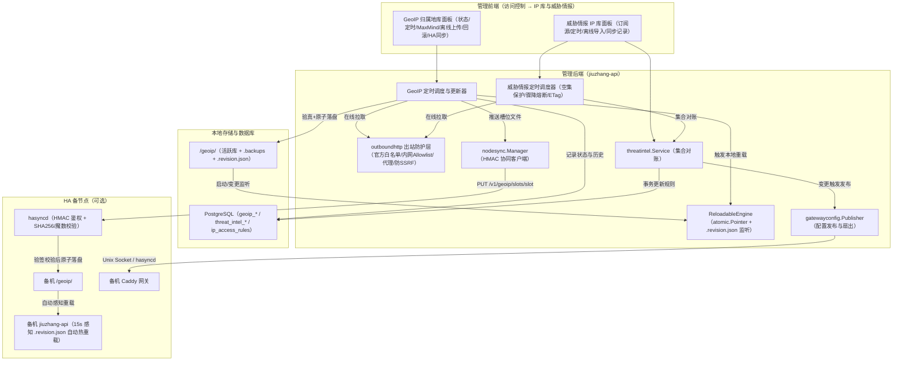

# IP 库（GeoIP 归属地库 + 威胁情报 IP 黑名单库）更新与热加载设计方案

> 状态：**定稿 v1.1**（2026-11-28，已评审确认）
> 适用范围：Docker Compose 单机、Docker Compose / 裸机 HA 主备双机（`hasyncd`）、全裸机部署（`ops/baremetal/package/`）。
> 网络适配：**同时支持纯离线环境与可连外网/内网镜像环境**（所有在线定时更新任务默认关闭，确保纯离线环境零外连、零报错）。

---

## 一、背景、目标与核心决策

### 1.1 现状盘点

1. **GeoIP 归属地库（`server/internal/apigeo/engine.go`）**
   - 后端已有零外部依赖的纯内存融合引擎，支持 `ip2region`（XDB v2/v3，国内省市与运营商精准）和 `DB-IP Lite / MaxMind GeoLite2`（MMDB，海外城市、经纬度与 IPv6 精准），按目录优先级从 `<dataDir>/geoip` → `/app/assets/geoip` 加载。
   - **现有缺口**：
     - `server/internal/app/app.go` 仅在进程启动时加载一次，替换文件后必须重启 `jiuzhang-api` 才能生效；
     - 启动时若无库文件，向出境看板（`apigeo/handler.go`）、出境清扫（`apigeo/sweep.go`）、态势分析（`apisecurity/handler.go`）和报告生成（`reports/collect.go`）注入的是 `nil`，即使后续补齐文件也无法动态激活；
     - 缺少在线定时拉取、Web 离线上传、版本备份回滚以及 HA 备节点文件同步机制。
2. **威胁情报 IP 黑名单库（`server/internal/threatintel/service.go`）**
   - 已有集合对账导入核心与 `POST /api/v1/threat-intel/import`（支持纯文本 IP 清单与 Feodo CSV）：按 `feed` 命名空间隔离对账，新增 `ACTIVE` 全局黑名单、在册刷新 TTL、本批消失标 `EXPIRED`、保护人工黑名单/人工停用/保护地址，生效集变化自动触发网关配置发布。
   - **现有缺口**：缺少多情报源订阅管理、在线定时拉取调度、上游异常防误清空/熔断保护、同步历史与 Web 管理界面（`docs/WAF_RULE_ENRICHMENT_DESIGN.md` §3 P2-C1 预留工作）。

### 1.2 已确认的核心架构决策

| 决策项 | 选型 | 理由 |
|---|---|---|
| 网络模式 | **离线优先 + 在线可选**（定时开关默认 `false`） | 纯离线/网闸客户零出站请求；有网或内网镜像客户按需开启定时更新 |
| GeoIP 官方源范围 | **`ip2region` + `DB-IP Lite` + `MaxMind GeoLite2`（Account ID + License Key）** | 覆盖国内精准归属地与海外/IPv6 城市库；全部符合宽松许可/合规要求 |
| 威胁情报官方源范围 | **`abuse.ch Feodo` + `abuse.ch SSLBL`（CC0）+ 自定义订阅源/内网镜像** | 严守 `AGENTS.md` 宽松许可证原则，明确排除 GPL-2.0 的 FireHOL |
| GeoIP 生效方式 | **`ReloadableEngine`（`atomic.Pointer[Engine]`）+ `.revision.json` 目录监听** | 零锁竞争、零重启切换；本机更新、离线上传、HA 同步或手工落盘均可 15 秒内热生效 |
| 威胁情报生效方式 | **复用 `threatintel.Service.Import` + 批量去重发布** | 写入 PostgreSQL `ip_access_rules` 后经现有发布通道扇出至所有网关节点，天然兼容 HA |
| 出站安全策略 | **内置官方源白名单 + 可选内网镜像/正向代理（复用 `outboundhttp`）** | 拨号期 DNS 重绑定复检、每跳重定向复检、跨 Host 剥离敏感头、硬阻断云元数据网段 |
| HA GeoIP 同步 | **复用 `hasyncd` HMAC 通道推送文件 + 备机 `.revision.json` 自动重载** | 不新增备机 API 端口或额外凭据，复用现有 HMAC-SHA256 防重放与非 root 隔离边界 |
| 前端入口与权限 | **「访问控制 → IP 库与威胁情报」（`/ip-libraries`）** | 遵循 000232 三权边界：运维管理员（`SECURITY_ADMIN`）全量读写、审计管理员（`AUDIT_ADMIN`）只读 |

---

## 二、总体架构与数据流



---

## 三、GeoIP 归属地库更新设计

### 3.1 槽位模型与文件布局

将 `<dataDir>/geoip/` 划分为 5 个确定性槽位（`slot` 白名单），完全向下兼容 `apigeo.OpenEngine` 的搜索顺序：

| 槽位 ID (`slot`) | 规范活跃文件名 | 格式 | 解压体积上限 | 支持的官方预置源 (`official_preset`) |
|---|---|---|---|---|
| `ip2region_v4` | `ip2region_v4.xdb` | XDB v2/v3 (IPv4) | 64 MiB | `ip2region_v4`（Apache-2.0 / MIT） |
| `ip2region_v6` | `ip2region_v6.xdb` | XDB v3 (IPv6) | 128 MiB | `ip2region_v6`（Apache-2.0 / MIT） |
| `dbip_city` | `city.mmdb` | MMDB (City) | 256 MiB | `dbip_city_lite`（CC BY 4.0）、`maxmind_geolite2_city`（MaxMind GeoLite2 EULA，需 Account ID + License Key） |
| `city_ipv6` | `city-ipv6.mmdb` | MMDB (IPv6 City) | 128 MiB | 离线上传 / 内网镜像（当 `dbip_city` 为双栈库时自动覆盖 IPv6） |
| `country` | `country.mmdb` | MMDB (Country) | 32 MiB | `dbip_country_lite`（CC BY 4.0）、`geo_country_mmdb`（CC0-1.0）、`maxmind_geolite2_country`（MaxMind GeoLite2） |

**MaxMind GeoLite2 认证与解包规范**：
- 使用 MaxMind 官方推荐的 HTTP Basic Auth 端点：
  - City：`https://download.maxmind.com/geoip/databases/GeoLite2-City/download?suffix=tar.gz`
  - Country：`https://download.maxmind.com/geoip/databases/GeoLite2-Country/download?suffix=tar.gz`
- 凭据管理：`maxmind_account_id` 存于 `system_settings (geoip)`，`maxmind_license_key_encrypted` 经 `encryption.Service` 加密落库并登记 `settings.SensitiveSettingKeys`（API 仅返回 `has_maxmind_license_key: true`，绝不明文回显或打日志，绝不将密钥拼入 URL Query）。
- 跨 Host 重定向安全：MaxMind 下载接口会 302 跳转至 R2/S3 预签名地址，`outboundhttp` 跨 Host 重定向自动剥离 `Authorization` 头，避免凭据泄露给第三方对象存储。
- `.tar.gz` 归档安全提取：仅接受流式限流解压（上限同槽位上限），校验每个 tar entry 拒绝绝对路径/`..`/符号链接，仅提取目标 `GeoLite2-*.mmdb` 文件并立即走 `ParseMMDB` 验真。

**DB-IP 月度 URL 回退**：
- DB-IP Lite 官方按月发布 `https://download.db-ip.com/free/dbip-city-lite-{YYYY-MM}.mmdb.gz` 与 `dbip-country-lite-{YYYY-MM}.mmdb.gz`。下载器优先请求当月 `{YYYY-MM}`，若在月初 1–3 日返回 `404`，自动回退尝试上月 `{PREV_YYYY-MM}`，并通过 SHA-256 去重避免重复落盘。

**目录结构（`<dataDir>/geoip/`）**：
```text
<dataDir>/geoip/
├── ip2region_v4.xdb                   # 活跃槽位文件（优先覆盖 /app/assets/geoip）
├── city.mmdb                          # 活跃槽位文件（激活时自动将旧 dbip-city-lite*.mmdb / GeoLite2-City.mmdb 归档至 .backups/）
├── country.mmdb                       # 活跃槽位文件（激活时自动将旧 dbip-country-lite*.mmdb / GeoLite2-Country.mmdb 归档至 .backups/）
├── .revision.json                     # 原子写入的目录版本元数据（供本机与 HA 备机热重载感知）
├── .staging/                          # 同文件系统临时解包/验真目录，保证 os.Rename 原子性
└── .backups/
    └── <slot>/
        └── <unixts>-<sha256_12>.<ext> # 每个槽位保留最近 3 份历史可用文件，用于一键回滚
```

### 3.2 零重启热重载引擎（`ReloadableEngine`）

1. **并发安全与无锁查询**：`ReloadableEngine` 内部持有 `atomic.Pointer[Engine]` 与串行化重载锁 `sync.Mutex`，所有读查询走无锁原子读；`Reload()` 先完整加载新 `Engine`，成功后再原子切换指针。
2. **全消费者动态启用**：
   - 新增 `apigeo.IsLookupEnabled(lookup CountryLookup) bool`（安全处理 typed-nil 并调用 `Enabled()`）。
   - `app.go` 始终注入非 `nil` 的 `*ReloadableEngine` 至安全事件、访问日志、归属地查询接口、安全报告、数据出境看板、数据出境清扫器和 API 态势统计全部 7 处消费者；节点即使无库启动，后续上传或同步后立即无缝激活。
3. **后台目录感知（`Watch`）**：每 15 秒检测 `<dataDir>/geoip/.revision.json` 与槽位文件指纹变化，自动触发 `Reload()`，同时满足 HA 备机无感热更新与运维手工拷盘生效。

### 3.3 校验、原子切换与回滚流程

所有文件来源（在线下载、MaxMind `.tar.gz`、Web 离线上传 `.xdb`/`.mmdb`/`.gz`/`.tar.gz`）统一经 `SlotManager` 处理：
1. 流式写入 `.staging/` 并计算原始 SHA-256（若提供 `expected_sha256` 则比对原始或解压后文件，不匹配即拒绝）；
2. 自动识别 `.tar.gz` / `.gz` / 原始二进制，使用 `io.LimitReader(r, maxBytes+1)` 严格拦截解压炸弹；
3. 调用 `OpenXDB` / `OpenMMDB` 校验结构、IP 版本与探针查询（`1.1.1.1` / `114.114.114.114` / `2400:3200::1`）；
4. 与当前活跃文件 SHA-256 比对：完全一致则短路返回 `SKIPPED_UNCHANGED`；
5. 备份当前活跃文件及同目录可能抢占优先级的旧命名文件到 `.backups/<slot>/`（最多保留 3 份）；
6. `fsync` + `os.Rename` 原子替换活跃文件 → 原子写入 `.revision.json` → 立即调用 `ReloadableEngine.Reload()`；
7. 回滚时严格校验 `backup_id` 正则（防路径穿越），重新验真备份文件，互换前同时备份当前版本（回滚可逆）。

---

## 四、威胁情报 IP 黑名单库更新设计

### 4.1 预置源与许可证基线

每个订阅源拥有独立 `feed_key`（`^[a-z0-9][a-z0-9_-]{0,31}$`），复用于 `threatintel.Service.Import` 的 `reason LIKE '威胁情报 <feed_key> 批次%'` 命名空间隔离对账。

| `feed_key` | 展示名称 | 格式 | 上游地址 | 许可证 | 默认 TTL |
|---|---|---|---|---|---|
| `feodo` | abuse.ch Feodo C2 IP 清单 | `text` / `csv` | `https://feodotracker.abuse.ch/downloads/ipblocklist_recommended.txt` | **CC0-1.0** | 30 天 |
| `sslbl` | abuse.ch SSLBL 恶意 C2 IP 清单 | `text` | `https://sslbl.abuse.ch/blacklist/sslipblacklist.txt` | **CC0-1.0** | 30 天 |

- 明确排除 FireHOL（GPL-2.0）；客户可通过 `CUSTOM_URL`（内网镜像/商业情报/SOC 导出）或 `OFFLINE_ONLY` 扩展。

### 4.2 解析器增强与自动化安全护栏

1. **解析增强**：兼容 `;` 行尾注释；源级可选开启 `allow_cidr`（仅公网 IPv4 CIDR，硬限制前缀 `/16`–`/32`，拒绝私网/回环/保留段与宽网段自断网风险）。
2. **条件请求短路**：持久化 `etag` / `last_modified` / `last_content_sha256`，上游 `304` 或摘要未变时跳过对账与网关发布。
3. **空集保护（`min_entries_guard`，默认开启）**：解析出 0 条有效 IP 时中止对账、不清空在册黑名单，记录 `GUARD_ABORTED` 并触发 `THREAT_INTEL_SYNC_FAILED` 告警。
4. **骤降比例保护（`max_drop_ratio`，默认 `0.80`）**：在册 `ACTIVE >= 20` 且新批次缩水超过 80% 时中止对账并告警（支持管理员手动「强制同步」确认跳过）。
5. **连续失败熔断**：连续失败达阈（默认 5 次）自动 `circuit_open = true` 并触发 `THREAT_INTEL_CIRCUIT_OPEN`（`HIGH`）告警，手动同步成功后自动闭合恢复。
6. **合并发布**：同轮调度多个 Feed 变更时合并触发一次网关配置发布。

---

## 五、统一出站安全与 SSRF / 代理防护

复用 `server/internal/outboundhttp`（拨号期 DNS 重绑定复检 + 每跳重定向复检 + 硬阻断云元数据网段）：
- `OFFLINE_ONLY`：零出站；
- `OFFICIAL`：仅允许硬编码官方域名白名单（`download.db-ip.com`、`download.maxmind.com`、`raw.githubusercontent.com`、`github.com`、`feodotracker.abuse.ch`、`sslbl.abuse.ch`），强制 HTTPS，允许最多 5 跳重定向且跨 Host 剥离敏感头；
- `CUSTOM_URL`：默认仅公网 HTTPS；指向内网镜像须显式登记 `ip_library.outbound_allowlist`（CIDR 或精确主机名），且仅开启 `allow_insecure_http_mirror` 才对 allowlist 内网目标放宽 HTTP；云元数据网段永远硬拦截；
- 可选正向代理（`ip_library.proxy_url` + 加密存储 `ip_library.proxy_auth_encrypted`）：校验代理地址合法性并阻断元数据网段，同时对目标 URL 独立做方案与主机检查。

---

## 六、HA 主备协同设计（`hasyncd` + `nodesync`）

- **威胁情报黑名单**：规则落 PostgreSQL 后经现有 `gatewayconfig.Publisher` 发布并扇出到所有网关节点，天然一致。
- **GeoIP 归属地库**：
  - `hasyncd` 新增 `--geoip-dir` / `HASYNC_GEOIP_DIR`（Docker 复用已有 `stage5-runtime` 卷内 `/app/runtime/geoip`；裸机加入 `jiuzhang-hasyncd.service` `ReadWritePaths`）；
  - 新增 HMAC 鉴权端点 `GET /v1/geoip/status` 与 `PUT /v1/geoip/slots/{slot}`（`X-GeoIP-SHA256`、`X-GeoIP-Revision` 校验 + 体积上限 + XDB/MMDB 魔数验真 + 原子替换与更新 `.revision.json`）；
  - 备机 `jiuzhang-api` 的 `ReloadableEngine.Watch` 在 15 秒内自动检测 `.revision.json` 变更并零重启热重载；
  - 推送失败不阻断主节点生效，记入 `ha_results_json` 并触发 `GEOIP_NODE_DRIFT` 系统告警，提供「重新同步备节点」手动恢复入口。

---

## 七、数据库、权限、API 与前端入口

### 7.1 迁移 `000256_ip_library_sync`

- 新增 4 张表：`geoip_slot_configs`、`geoip_sync_runs`、`threat_intel_feeds`、`threat_intel_sync_runs`（均纳入 `backups/tables.go` 备份清单）。
- `system_settings` 新增 `ip_library`、`geoip`、`threat_intel` 三组默认设置（全部在线自动更新默认 `false`），敏感密钥键登记 `settings.SensitiveSettingKeys`。
- 权限点（遵循 000232 三权边界）：
  - `geoip.read`、`geoip.manage`、`threat_intel.read`、`threat_intel.manage`
  - 运维管理员（`SECURITY_ADMIN`）：全量读写；审计管理员（`AUDIT_ADMIN`）：只读；系统管理员（`SYSTEM_ADMIN`）：不授业务访问控制权限。
- 系统告警（注册至 `systemalerts/rules.go`、`systemalerts/handler.go`、`notify/notify.go`）：
  - `GEOIP_SYNC_FAILED`（`MEDIUM`）、`GEOIP_NODE_DRIFT`（`MEDIUM`）、`THREAT_INTEL_SYNC_FAILED`（`MEDIUM`）、`THREAT_INTEL_CIRCUIT_OPEN`（`HIGH`）。

### 7.2 REST API 契约

- `GET/PUT /api/v1/ip-libraries/outbound-settings`
- `GET /api/v1/geoip/status`、`PUT /api/v1/geoip/settings`、`POST /api/v1/geoip/sync`、`POST /api/v1/geoip/upload`、`POST /api/v1/geoip/rollback`、`POST /api/v1/geoip/ha-resync`、`GET /api/v1/geoip/runs`
- `GET/POST /api/v1/threat-intel/feeds`、`PUT/DELETE /api/v1/threat-intel/feeds/{id}`、`POST /api/v1/threat-intel/feeds/{id}/sync`、`POST /api/v1/threat-intel/import`、`GET /api/v1/threat-intel/runs`

### 7.3 前端入口

- 位于左侧导航 **「访问控制 → IP 库与威胁情报」**（路由 `/ip-libraries`），可见权限要求 `geoip.read` 或 `threat_intel.read`，双页签布局：
  - **GeoIP 归属地库**：槽位状态、在线定时/MaxMind 凭据/出站代理配置、立即同步、离线上传（`.xdb`/`.mmdb`/`.gz`/`.tar.gz`）、历史版本回滚、HA 节点同步与运行日志；
  - **威胁情报 IP 黑名单库**：订阅源管理（内置 Feodo/SSLBL + 自定义源）、定时/TTL/CIDR/防误清保护、立即拉取（支持人工确认忽略保护）、离线快照导入（接入现有 `/threat-intel/import`）与对账历史。

---

## 八、分阶段实施路线

1. **阶段 1（当前实施）**：设计文档落库 + `000256_ip_library_sync` 迁移 + `ReloadableEngine` 与全消费者动态启用 + `SlotManager`（校验/gzip & tar.gz 解包/原子切换/备份回滚/`.revision.json` 监听）+ GeoIP 状态/离线上传/回滚/历史 API + 单元测试与接口测试。
2. **阶段 2**：基于 `outboundhttp` 的带代理/白名单/MaxMind Basic Auth/ETag 下载器 + GeoIP 在线定时更新器 + 威胁情报多源 CRUD/CIDR/空集与骤降保护/熔断/定时调度器 + OpenAPI + 单测/接口测试。
3. **阶段 3**：HA `hasyncd` `/v1/geoip/*` 端点 + `nodesync` 客户端 + Docker/裸机 systemd 适配 + 双节点同步测试。
4. **阶段 4**：前端「访问控制 → IP 库与威胁情报」页面 + Vitest + Playwright E2E + 真实环境联调验收。
