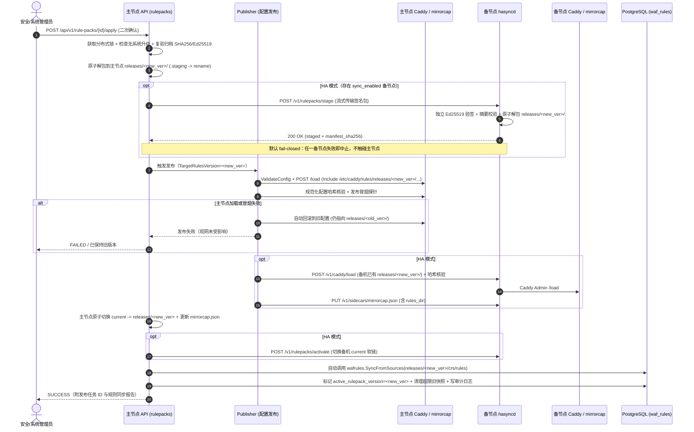

# 纯离线 WAF 规则包热更新设计（Offline Rule Pack Update）

> 状态：**定稿 v1.0**（2026-11-28，评审通过，§十一决策已锁定）
> 适用范围：Docker Compose 单机、Docker Compose / 裸机 HA 主备双机（`hasyncd`）、全裸机部署（`ops/baremetal/package/`）、混合裸机网关 + 容器管理面（`docs/BARE_METAL_GATEWAY_DESIGN.md`）。
> 交付约束：**100% 纯离线更新**，不引入任何外网拉取、在线订阅或遥测回传；严守 `AGENTS.md` 安全底线与 `docs/tasks/UPGRADE_INCIDENT_2026-11-17.md` 升级交付门槛。

---

## 一、背景、目标与核心决策

### 1.1 现状痛点

当前 WAF 规则集（OWASP CRS 主包、CRS 插件、`THIRD_PARTY`、`CUSTOM_PACK`、九章内置规则）位于仓库 `gateway/rules/`，在生产环境中以只读方式随系统发布目录挂载到 `/etc/caddy/rules:ro`（参见 `ops/offline-package/build.sh`、`deployment/docker-compose.stage5.yml`、`ops/baremetal/package/install.sh`）：

1. **「同步CRS规则」仅做本地元数据入库**：前端按钮 `POST /api/v1/waf-rules/sync` 仅解析本地磁盘 `.conf` 写入 PostgreSQL `waf_rules` 表，不更新规则文件，也不重新加载网关。
2. **`update-full` 完整升级包过重**：虽可连同新 release 的 `./gateway/rules` 一并替换，但整包数百 MB 至数 GB、需宿主机 CLI 与容器重建，不适合每周 / 每两周一次的高频规则更新。
3. **Web 端 `upgrade` 差量包不更新规则目录**：`ops/upgrade/build-upgrade-pack.sh` 与宿主机执行器只替换 Docker 镜像，而 `gateway/Dockerfile` 不内置规则文件、生产编排又以宿主机目录只读挂载覆盖 `/etc/caddy/rules`，无法用于常规规则更新。

### 1.2 设计目标与非目标

**目标**：

1. 建立独立于系统版本的**轻量纯离线签名规则包**（通常 300 KB–5 MB），支撑研发侧每 1–2 周常态化发包、客户侧纯离线高频更新。
2. 覆盖全部部署形态：**Docker Compose 单机、HA 双机（`hasyncd`）、全裸机部署、混合裸机网关**。
3. 实现 **「上传即校验 → 确认后一键生效（自动发布 + 自动同步元数据） → 一键回滚」** 的完整 Web 闭环，**不重启容器/网关进程、不断业务流、无需宿主机 SSH**。
4. 保持现有零信任边界：沿用二进制硬编码 Ed25519 发布公钥、不给 `api`/`hasyncd` 挂载 `docker.sock`、网关与 `mirrorcap` 始终只读访问规则目录。

**非目标**：

- 不实现任何在线拉取、定时联网检查、云端规则订阅或数据回传；
- 不支持通过规则包替换 Caddy / Coraza 二进制、Go 代码或数据库 Schema（仍走 `upgrade` / `update-full`）；
- 不自动修改客户已配置的自定义规则（`custom_rules`）、例外策略（`exceptions`）或规则覆盖（`rule_overrides`），仅在预检报告中给出影响提示。

### 1.3 已确认的核心架构决策

| 决策项 | 选型 | 理由 |
|---|---|---|
| 更新模式 | **100% 纯离线** | 客户现场普遍无外网或隔离网闸环境，消除一切出站依赖与 SSRF 面 |
| 交付内容 | **全量规则快照**（非增量补丁） | 整个 `gateway/rules/` 压缩后仅数百 KB；全量快照杜绝跳版缺文件漂移，天然支撑原子回滚 |
| 信任根与签名 | 复用 `upgrades/artifact.go` 内嵌 Ed25519 公钥 + 包内 `manifest.sig` | 单文件上传即可完成链式验签（`manifest.sig → manifest.json → files_manifest_sha256 → 逐文件 SHA-256`），与系统升级包同口径 |
| 生效机制 | **版本目录隔离 + 显式版本号 `Include`** | `generator.go` 输出 `Include /etc/caddy/rules/releases/<ver>/...`；解包不碰运行中旧版，借 Caddy `/load` + 冒烟探针实现原生原子验证与失败零中断回滚 |
| 跨挂载软链 | 卷/目录内使用**相对软链** `current -> releases/<ver>` | `api`（`/app/runtime/rules`）与 `gateway`/`mirrorcap`（`/etc/caddy/rules`）挂载点不同，相对软链在两端及裸机均一致可用 |
| 交互方式 | **两步式：上传即校验 → 确认后一键生效** | 上传仅做验签、静态门禁、差异与客户策略影响预览，零现网副作用；管理员核对后确认生效，自动串联发布与同步 |
| HA 协同 | **先备后主落盘（Stage）+ 备机独立验签** | 主备共享 `hasyncd` HMAC 通道分发归档，备机二次验签并解包到 `releases/<ver>/` 后主节点才切换发布，防止主备规则分裂导致配置扇出失败 |
| `mirrorcap` 联动 | `mirrorcap.json` 增可选 `rules_dir` 字段触发在线重建 | 复用 `mirrorcap/supervisor.go` 15 秒轮询机制，实现旁路检测规则零重启热更新 |

---

## 二、纯离线规则包规范与链式信任契约

### 2.1 文件命名与交付物

- 主文件：`jiuzhang-wdsp-rulepack-<RULEPACK_VERSION>.tar.gz`
  - `<RULEPACK_VERSION>` 采用单调递增格式 `YYYYMMDD.N`（如 `20261201.1`，当日紧急加发递增 `.2`），正则约束：`^[0-9]{8}\.[0-9]{1,3}$`；内置基线种子使用 `builtin-<SYSTEM_VERSION>`（仅本地初始化使用，不接受外部上传）。
- 旁车文件：`jiuzhang-wdsp-rulepack-<RULEPACK_VERSION>.tar.gz.sha256`（供客户离线摆渡前人工核验；Web 上传仅需主 `.tar.gz`，签名已内嵌 `manifest.sig`）。
- 与系统交付物严格区分命名：`install`（安装）、`update-full` / `upgrade`（系统升级）、`rulepack`（规则包）。

### 2.2 归档目录布局

```text
jiuzhang-wdsp-rulepack-20261201.1.tar.gz
├── manifest.json                              # 规则包清单（不进 files[]）
├── manifest.sig                               # base64 单行 Ed25519 签名（对 manifest.json 原始字节）
└── rules/                                     # 完整规则快照根目录
    ├── coraza.conf                            # 必备锚点
    ├── crs/
    │   ├── VERSION.txt
    │   ├── crs-setup.conf                     # 必备锚点
    │   ├── plugins/...                        # CRS 官方插件（含 empty-*.conf 占位）
    │   └── rules/*.conf + *.data              # OWASP CRS 主规则及关联 .data 文件
    ├── contrib/
    │   ├── THIRD_PARTY/*.conf + PINNED-*.txt
    │   └── CUSTOM_PACK/*.conf
    ├── exclusions/
    │   ├── before-crs.conf                    # 必备锚点
    │   └── after-crs.conf                     # 必备锚点
    └── jiuzhang/
        ├── jiuzhang-custom.conf               # 必备锚点
        └── post-contrib-blocking.conf         # 必备锚点（二次阻断评估）
```

### 2.3 `manifest.json` 契约

```json
{
  "schema_version": 1,
  "product": "wdsp",
  "package_type": "rulepack",
  "rulepack_version": "20261201.1",
  "crs_version": "4.28.0",
  "min_system_version": "1.20.0",
  "coraza_compat": ">=3.7.0 <4.0.0",
  "released_at": "2026-12-01T10:00:00Z",
  "changelog": [
    "新增 CVE-2026-XXXXX 应急防护规则（CUSTOM_PACK/cve-emergency.conf）",
    "更新 AI 爬虫与扫描器 UA 指纹（OBSERVE 轨道）"
  ],
  "rule_summary": {
    "total_rules": 3120,
    "by_source": {
      "OWASP_CRS": 622,
      "CRS_PLUGIN": 18,
      "THIRD_PARTY": 186,
      "CUSTOM_PACK": 2289,
      "JIUZHANG_BUILTIN": 5
    },
    "highlighted_cves": ["CVE-2026-109618", "CVE-2026-109619"]
  },
  "files": [
    {
      "path": "rules/coraza.conf",
      "sha256": "<64-hex>",
      "size": 3416
    }
  ],
  "files_manifest_sha256": "<sha256(compact JSON of files[])>"
}
```

### 2.4 链式信任与安全门禁（全量 fail-closed）

校验器实现在新建包 `server/internal/rulepacks/artifact.go`（与 `gateway/hasyncd` 共用或同口径抽取到共享模块，避免双份漂移）：

1. **包类型强隔离**：
   - `rulepacks` 仅接受 `product == "wdsp"` 且 `package_type == "rulepack"`；
   - 同步加固 `server/internal/upgrades/artifact.go`，明确拒绝 `package_type == "rulepack"`，防止误传到「系统升级」页面。
2. **资源上限（防压缩炸弹）**：
   - 压缩包大小 ≤ **64 MiB**；解压总字节 ≤ **256 MiB**；归档成员数 ≤ **10,000**；`manifest.json` ≤ **4 MiB**；`manifest.sig` ≤ **4 KiB**；单文件 ≤ **16 MiB**。
3. **归档路径与类型白名单**：
   - 仅允许 `tar.TypeDir`、`tar.TypeReg`、`tar.TypeRegA`，**拒绝符号链接、硬链接、FIFO、设备文件**；
   - 路径字符白名单 `^[A-Za-z0-9._/-]+$`，拒绝绝对路径、`..` 穿越、反斜杠、重复路径；
   - 除根目录保留文件 `manifest.json` 与 `manifest.sig` 外，**所有普通文件必须位于 `rules/` 前缀下**，且扩展名白名单仅限 `.conf`、`.data`、`.txt`、`.md`、`LICENSE`、`.example`、`.gitkeep`（拒绝任意 `.sh`/`.so`/可执行体混入规则包）。
4. **Ed25519 链式验签**：
   - 仅接受内嵌 `manifest.sig`（不引入旧版无内嵌签名旁车回退）；
   - 使用编译期硬编码的 `releasePublicKeyPEM`（与 `server/internal/upgrades/artifact.go` 同一把公钥）对 `manifest.json` 归档内原始字节验签；
   - `files_manifest_sha256 == sha256(json.Marshal(manifest.Files))`，且 `manifest.Files` 与归档实际 `rules/*` 文件**精确一一对应**（逐项比对 `size` 与 `sha256`，多余或缺失均拒绝）。
5. **版本与兼容性门禁**：
   - `min_system_version <= current_system_version`（语义化版本比较），防止旧引擎加载依赖新语法的规则包；
   - **防降级与防重复上传**：新上传包的 `rulepack_version` 必须严格大于当前激活版本（回滚历史版本走独立「回滚」接口，不通过重新上传旧包绕过防降级）；若同版本包已登记且 SHA-256 相同，幂等返回已有预检记录；同版本但哈希不同直接拒绝（防篡改重放）。
6. **规则内容静态门禁**：
   - 必备锚点文件全部存在且非空：`rules/coraza.conf`、`rules/crs/crs-setup.conf`、`rules/exclusions/before-crs.conf`、`rules/exclusions/after-crs.conf`、`rules/jiuzhang/jiuzhang-custom.conf`、`rules/jiuzhang/post-contrib-blocking.conf`，以及 `rules/crs/rules/*.conf` 非空；
   - 禁止 Coraza 不兼容或高危操作符：`@inspectFile`、`SecRuleScript`、`@rbl`、`SecComponentSignature` 外链命令、`Include` 指向 `rules/` 目录之外的绝对/穿越路径；
   - 规则解析校验：调用 `wafrules.ParseCRSRules` 解析全部来源目录，要求 `ParseFailed == 0` 且**跨文件无重复 Rule ID**（沿用 `WAF_RULE_ENRICHMENT_DESIGN.md` §4.1 查重口径）；
   - **禁止 `@pmFromFile` 越界**：扫描所有 `@pmFromFile` 引用路径，确认对应 `.data` 文件存在于同目录或 `rules/` 相对路径下，防止运行时 Coraza 加载报错。

---

## 三、全部署形态统一存储、挂载与权限模型

### 3.1 统一版本化目录布局

无论在哪种部署形态下，规则存储根 `<RULES_STORE>` 均采用完全一致的目录结构：

```text
<RULES_STORE>/
├── releases/
│   ├── builtin-1.20.0/           # 首次初始化从镜像/安装包种子复制的基线快照
│   ├── 20261201.1/               # 离线规则包 20261201.1 解包快照（只读权限 0750/0640）
│   └── 20261215.1/               # 离线规则包 20261215.1 解包快照
├── current -> releases/20261215.1  # 相对符号链接（原子 rename 切换）
├── .staging/                     # 临时解包校验区（完成后原子 rename 进 releases/，异常清扫）
└── .archives/                    # 可选/仅在 api 侧 runtime 保留签名原始 .tar.gz（供 HA 补发与备份）
```

> **关键设计：相对符号链接 `current -> releases/<ver>`**
> 在 Docker Compose 中，同一命名卷在 `api`/`hasyncd` 容器内挂载于 `/app/runtime/rules`，在 `gateway`/`mirrorcap` 容器内挂载于 `/etc/caddy/rules`。使用相对路径 `releases/<ver>`，使 `current` 在所有容器和宿主机视角下都能正确解析，且创建/切换方式固定为 `symlink(target, "current.tmp.<id>")` + `rename("current.tmp.<id>", "current")`（POSIX 原子替换）。

### 3.2 四种部署形态映射表

| 部署形态 | 规则存储载体 | `api` 挂载/权限 | `gateway` 挂载/权限 | `mirrorcap` 挂载/权限 | `hasyncd` 挂载/权限 | 环境变量 |
|---|---|---|---|---|---|---|
| **1. Docker Compose 单机**（`build.sh`、`stage5.yml`） | 独立命名卷 `gateway-rules`（类比 `gateway-certs`） | `gateway-rules:/app/runtime/rules`（RW，UID/GID `1000:1000`，`read_only: true` + `cap_drop: ALL`） | `gateway-rules:/etc/caddy/rules:ro`（RO，`1000:1000`） | `gateway-rules:/etc/caddy/rules:ro`（RO，`1000:1000`） | 未启用 | `WAF_RULES_STORE_DIR=/app/runtime/rules`<br>`WAF_RULES_SEED_DIR=/app/gateway/rules`<br>`GATEWAY_RULES_ROOT=/etc/caddy/rules`<br>`MIRROR_RULES_DIR=/etc/caddy/rules/current` |
| **2. Docker Compose HA 双机**（`--profile ha-sync`） | 各节点本地独立命名卷 `gateway-rules` | 同上（主节点写本地卷，经 `hasyncd` 推备机） | 同上（RO） | 同上（RO） | `gateway-rules:/app/runtime/rules`（**RW**，`1000:1000`，`read_only: true` + `cap_drop: ALL`） | `hasyncd` 新增 `HASYNC_RULES_DIR=/app/runtime/rules` |
| **3. 全裸机部署**（`ops/baremetal/package/`） | 宿主机目录 `__ROOT__/data/rules`（`__USER__:__USER__` `0750`），软链 `/etc/caddy/rules -> __ROOT__/data/rules` | `jiuzhang-api.service` 已有 `ReadWritePaths=__ROOT__/data`（RW） | `jiuzhang-gateway.service` 显式加 `ReadOnlyPaths=__ROOT__/data/rules`（RO） | `jiuzhang-mirrorcap.service` 仅读 `/etc/caddy/rules`（RO，不在 `ReadWritePaths`） | `jiuzhang-hasyncd.service` `ReadWritePaths` 追加 `__ROOT__/data/rules`（RW） | `WAF_RULES_STORE_DIR=__ROOT__/data/rules`<br>`WAF_RULES_SEED_DIR=__ROOT__/gateway/rules`<br>`MIRROR_RULES_DIR=/etc/caddy/rules/current` |
| **4. 混合裸机网关 + 容器管理面**（`install-gateway-baremetal.sh`） | 宿主机目录 `/etc/caddy/rules`（`root:jiuzhang-waf` `2770` setgid） | Compose bind mount `/etc/caddy/rules:/app/runtime/rules` + 已有 `group_add: ["${JIUZHANG_WAF_GID}"]`（RW，产出文件 `0640`/目录 `0750`） | `jiuzhang-gateway.service` 已有 `ReadOnlyPaths=/etc/caddy`（RO，凭组 `jiuzhang-waf` 读取） | 若启用则同网关只读 | 若部署于宿主/容器则同组 RW | SELinux 用 `semanage fcontext` 标记共享目录（遵循 `BARE_METAL_GATEWAY_DESIGN.md` §4.10，**严禁 `setenforce 0`**） |

### 3.3 首次引导（Seed）与存量扁平目录兼容

1. **自动 Seed 引导**：`api` 启动时调用 `rulepacks.Store.EnsureInitialized(ctx)`：
   - 若 `<WAF_RULES_STORE_DIR>/releases/` 不存在或无有效 `current`，自动将 `<WAF_RULES_SEED_DIR>`（容器内置 `/app/gateway/rules` 或裸机 `__ROOT__/gateway/rules`）原子复制到 `releases/builtin-<CurrentVersion>/`，创建相对软链 `current -> releases/builtin-<CurrentVersion>`，并在数据库幂等登记一条状态为 `APPLIED`、`is_builtin = true` 的基线记录。
   - **Fail-closed**：若 `WAF_RULES_STORE_DIR` 不可写或种子目录缺少核心文件，记录明确错误日志并在 `/api/v1/rule-packs` 返回不可用诊断（不静默生成空目录）。
2. **向后兼容扁平布局（开发 / 旧单测零破坏）**：
   - `gatewayconfig/generator.go` 新增可选输入字段 `RulesBasePath`（默认 `/etc/caddy/rules`）：
     - 启用规则包版本管理时，传入 `/etc/caddy/rules/releases/<active_rulepack_version>`，生成的全部 10 条 `Include` 指令统一使用该前缀（例如 `Include /etc/caddy/rules/releases/20261201.1/crs/rules/*.conf`）；
     - 单元测试或未配置 `WAF_RULES_STORE_DIR` 的开发模式传入空串时，保持原有 `/etc/caddy/rules/...` 零变化。
   - 静态引导 `Caddyfile`：
     - 裸机网关 `Caddyfile.bootstrap` 仅开启 Admin Unix Socket、不加载 WAF 规则，零改动；
     - 容器网关默认 `gateway/configs/Caddyfile` 改为 `Include /etc/caddy/rules/current/...`（`apply.sh` 和首次启动会确保 `current` 软链在启动网关前已就位）。
3. **`mirrorcap` 零重启热重载联动**：
   - `gateway/mirrorcap/fileconfig.go` 的 `FileConfig` 新增可选字段 `RulesDir string `json:"rules_dir,omitempty"``（兼容旧版 `mirrorcap` 未知字段容忍契约）；
   - `gateway/mirrorcap/supervisor.go` 将 `cfg.RulesDir` 纳入检测代际指纹 `generation.key`（原为 `eventsLog|node` → 改为 `eventsLog|node|rulesDir`）；
   - 规则包切换并触发配置发布时，`Publisher` 同步写出更新后的 `mirrorcap.json`（含 `"rules_dir": "/etc/caddy/rules/releases/<ver>"`）；`mirrorcap` 在下一个 15 秒轮询周期自动重建 Coraza 检测器，新规则加载失败时保留 `last-good` 并发告警，不中断抓包句柄。
4. **`wafrules` 模块动态化改造**：
   - 将 `wafrules.Handler` 与启动同步逻辑从静态 `cfg.WAF.CRSDir` / `cfg.WAF.CRSVersion` 升级为读取 `ActiveRulesProvider`（返回当前激活快照的 `crs/rules` 路径、`crs_version`、`rulepack_version`）；未启用规则包存储时平滑回退到静态配置。

---

## 四、端到端交互与执行流程

### 4.1 规则包生命周期状态机

- **规则包（`waf_rule_packs.status`）**：
  - `VERIFIED`：上传验签 + 静态门禁 + 差异预检全部通过，等待管理员确认应用（不触碰现网）；
  - `REJECTED`：上传验签、完整性或静态门禁失败（保留记录用于审计追溯，清理临时文件）；
  - `APPLIED`：当前正在全网生效的唯一版本；
  - `SUPERSEDED`：曾生效、已被更新版本取代（若磁盘快照仍保留则可作为回滚目标）；
  - `ROLLED_BACK`：曾生效但已回滚退出的版本（保留审计记录，默认仍允许核查后再次选用或删除）。
- **执行任务（`waf_rule_pack_jobs.status`）**：
  - `PENDING → STAGING_LOCAL → STAGING_STANDBY → PUBLISHING → ACTIVATING → SYNCING_METADATA → SUCCESS`
  - 任意失败分支进入 `ROLLING_BACK → ROLLED_BACK` 或 `FAILED`（明确区分「已自动回滚现网无损」与「回滚异常需人工介入」）。

### 4.2 阶段一：上传即校验（零现网副作用）

管理员在控制台上传 `jiuzhang-wdsp-rulepack-YYYYMMDD.N.tar.gz` 后，后端 `POST /api/v1/rule-packs/upload` 同步（或大包流式读取，单端点放宽超时至 2 分钟，响应带真实上传进度）执行：

1. 流式接收归档并实时计算 SHA-256、强制 64 MiB 大小上限；
2. 执行 §2.4 全部门禁：Ed25519 验签 → `manifest.json` 校验 → 逐文件 SHA-256 → 路径/扩展名白名单 → 版本防降级 → `min_system_version` 校验；
3. 解压到临时隔离目录做规则解析与静态门禁（必备锚点、`@pmFromFile` 完整性、禁用操作符检查、全库 Rule ID 查重、`wafrules.ParseCRSRules` 零失败）；
4. **计算预检差异报告（`preview_report`）**：
   - 对比当前激活规则集，输出：`total_rules`、`added_count`、`updated_count`、`removed_count`、按来源与攻击类型的变化明细、新增/变更规则抽样清单、`changelog` 与 `highlighted_cves`；
   - **客户策略影响预警**（只提示，不自动改客户配置）：
     - 扫描 `rule_overrides`：列出已启用覆盖中指向的 `rule_id` 在新包中被移除或内容变化；
     - 扫描 `exceptions`：列出规则 ID 指向被移除/变化的例外，以及按标签冻结的例外（`resolved_rule_ids`）下是否有**新增规则携带相同标签**（提醒客户评估是否需要重新保存例外以纳入新规则）。
   - **集群就绪预检**：检查本机磁盘可用空间（至少 3 倍解压大小）、无活跃系统升级任务；若存在 `sync_enabled` 备节点，实时探查各备节点 `hasyncd` `/v1/health`（含 `rulepack_ready: true`）、`/v1/rulepacks/status` 及脑裂状态（`HasOpenSplitBrain`）。
5. 校验通过后，将签名原始归档持久化至 `<runtime>/rulepack-archives/<id>.tar.gz`（0600），落库 `waf_rule_packs(status='VERIFIED')`，删除临时解包目录，写操作审计（`action='upload'`），返回完整预检报告供管理员审阅。

### 4.3 阶段二：确认后一键生效（自动发布 + 自动同步）



**关键健壮性设计**：

1. **零业务站点（无应用）边界**：若系统刚部署尚未接入任何应用（现有 `Publisher` 会报 `ErrNoApps`），规则包生效流程**不阻断**——改为先用主节点 Caddy `ValidateConfig` 校验一份最小合成测试配置（加载新目录全量规则链）确保 Coraza 可编译通过，通过后直接切换 `current` 软链与 `active_rulepack_version`，执行 `wafrules.Sync`；之后接入首批应用时自动使用新版规则。
2. **并发互斥**：
   - 获取 Valkey 分布式锁 `lock:rulepack:apply`（TTL 5 分钟，带心跳续租）；
   - 启动前检查 `upgrades.HasActiveJob`（存在系统升级时返回 `409 Conflict`），同时系统升级预检也检查无活跃规则包任务；
   - 内部复用 `Publisher` 原有发布锁，确保同一时刻不会有人工「配置发布」与「规则包应用」并发竞争。
3. **HA 备节点离线应急降级（受控逃生门）**：
   - 默认严格模式（`allow_degraded_ha: false`）：存在脑裂告警（`HasOpenSplitBrain`）或任一 `sync_enabled` 备节点 `stage` 失败时直接拒绝切换主节点，防止主备不一致；
   - 应急场景（例如备机硬件维修断电、急需打 0day 规则）：管理员可显式勾选「允许备机离线降级生效」并填写必填原因（`degraded_reason`），主节点继续生效并立即产生 `HIGH` 级别 `RULEPACK_NODE_DRIFT` 系统告警与高风险审计；备机恢复上线后，管理员在界面点「重同步节点」（或普通配置发布自动重试）时，**系统先自动向备机执行 `POST /v1/rulepacks/stage` 补齐规则快照，再推送 Caddy 配置**，实现自愈闭环。

### 4.4 阶段三：一键回滚（Rollback）

- **入口**：`POST /api/v1/rule-packs/{id}/rollback`（仅允许回滚到状态为 `SUPERSEDED` 或 `ROLLED_BACK` 且 `verified` 的历史记录，禁止夹带新上传文件）。
- **执行流程**：
  1. 检查目标版本 `releases/<target_ver>/` 在主节点是否存在；若已被 GC 但原始签名归档仍在则重新验签解包，若归档也已缺失则 fail-closed 报错；
  2. HA 模式下检查全部备节点 `/v1/rulepacks/status` 是否已有 `target_ver` 且 `manifest_sha256` 一致，缺失则先经 `/v1/rulepacks/stage` 补发；
  3. 触发 `Publisher` 发布（`TargetRulesVersion = target_ver`）→ 校验 + 加载 + 冒烟 + HA 扇出；
  4. 原子回切 `current` 软链与 `mirrorcap.json`；
  5. 自动执行 `wafrules.SyncFromSources` 将管理台规则元数据、中文详述和版本号完整回退到 `target_ver`；
  6. 记录 `waf_rule_pack_jobs(job_type='ROLLBACK')` 与高风险操作审计。
- **快照保留与 GC 策略**：
  - 默认保留最近 **5 个**历史有效快照（`WAF_RULEPACK_RETENTION`，范围 2–20）；
  - **受保护不可删除集合**：当前激活版本、内置种子基线版本、最近一次配置发布及上一次配置发布（`config_versions` 当前版与上一版）所引用的 `rulepack_version`；
  - 若管理员在「配置发布」页面回滚非常早期的历史配置版本，而该版本引用的规则快照已被 GC，发布器 fail-closed 返回明确提示（「该历史配置依赖的规则包版本已清理，请先确认规则包版本或重新生成发布」），防止 Caddy 启动/加载报文件不存在。

---

## 五、HA 节点协同代理（`hasyncd`）与 `nodesync` 扩展设计

复用 `gateway/hasyncd` 现有安全边界（全部端点强制 HMAC-SHA256 + 60s 时间窗 + Nonce 防重放 + 可选 TLS，非 root 运行且无 `docker.sock`）：

### 5.1 新增 `hasyncd` HTTP 接口

| 方法与路径 | 用途 | 核心校验与安全行为 |
|---|---|---|
| `POST /v1/rulepacks/stage` | 接收并落盘离线规则包 | 请求头携带 `X-JiuZhang-RulePack-Version`、`X-JiuZhang-Package-SHA256`；大小上限 64 MiB；校验流式 SHA-256 后，**备机独立用内嵌 Ed25519 公钥复验 `manifest.sig` 与全量文件哈希**；原子解包至 `<rulesDir>/releases/<ver>/`（已存在且 `manifest_sha256` 一致则幂等返回 200；内容不一致返回 409） |
| `GET /v1/rulepacks/status` | 查询备机规则快照状态 | 返回 `rules_dir_writable`、`active_symlink`（`current` 指向）、已落盘 `releases[]`（版本号 + `manifest_sha256` + 落盘时间）及所在分区可用磁盘字节数 |
| `POST /v1/rulepacks/activate` | 切换备机 `current` 软链 | 校验目标 `releases/<ver>/` 存在且 `manifest_sha256` 匹配，原子切换 `current -> releases/<ver>`（供 `mirrorcap` 与重启恢复使用） |
| `DELETE /v1/rulepacks/releases/{version}` | 清理备机过期规则快照 | 拒绝删除 `current` 指向或内置基线快照，严格校验 `{version}` 正则，仅允许删除 `<rulesDir>/releases/` 下直属子目录 |

### 5.2 健康探测与向后兼容

- `GET /v1/health` 响应结构体 `HealthResponse` 新增布尔字段 `rulepack_ready`（仅当 `HASYNC_RULES_DIR` 配置有效且可写时为 `true`）；
- `server/internal/nodesync` 新增 `RulePackSyncClient` 接口（由 `nodesync.Manager` 实现，沿用现有 SSRF 内网地址 + DNS 重解析防重绑定校验）；
- 当主节点探测到某备节点 `hasyncd` 返回旧版响应（`rulepack_ready == false`）时，预检明确提示「备节点 `hasyncd` 版本过旧，需先通过 `update-full` 升级备节点基线」，严格 fail-closed。

---

## 六、数据模型、迁移与元数据同步演进

### 6.1 数据库迁移（顺延当前最大迁移号 `000254` → `000255`）

新建可逆迁移 `000255_waf_rule_packs.up.sql` / `.down.sql`：

1. **`waf_rule_packs`（规则包档案表）**
   - `id UUID PRIMARY KEY`
   - `rulepack_version VARCHAR(64) NOT NULL UNIQUE`（如 `20261201.1`、`builtin-1.20.0`）
   - `crs_version VARCHAR(32) NOT NULL`
   - `min_system_version VARCHAR(32) NOT NULL DEFAULT ''`
   - `is_builtin BOOLEAN NOT NULL DEFAULT FALSE`
   - `file_name VARCHAR(255) NOT NULL`
   - `file_size BIGINT NOT NULL`
   - `file_sha256 VARCHAR(64) NOT NULL`
   - `manifest_sha256 VARCHAR(64) NOT NULL`
   - `manifest_json JSONB NOT NULL`
   - `preview_report JSONB NOT NULL DEFAULT '{}'::jsonb`（规则差异、新增 CVE、例外/覆盖预警）
   - `archive_path TEXT NOT NULL DEFAULT ''`（主节点持久化签名归档路径，用于 HA 补发与备份）
   - `status VARCHAR(24) NOT NULL`（`VERIFIED` / `REJECTED` / `APPLIED` / `SUPERSEDED` / `ROLLED_BACK`）
   - `reject_reason TEXT NOT NULL DEFAULT ''`
   - `uploaded_by UUID REFERENCES users(id)`、`uploaded_at TIMESTAMPTZ NOT NULL DEFAULT now()`
   - `applied_by UUID REFERENCES users(id)`、`applied_at TIMESTAMPTZ`
   - 部分唯一索引：`UNIQUE (status) WHERE status = 'APPLIED'`（数据库级保证同一时刻最多一个激活规则包）。

2. **`waf_rule_pack_jobs`（应用 / 回滚执行任务表）**
   - `id UUID PRIMARY KEY`
   - `job_type VARCHAR(16) NOT NULL`（`APPLY` / `ROLLBACK`）
   - `target_pack_id UUID NOT NULL REFERENCES waf_rule_packs(id)`
   - `previous_pack_id UUID REFERENCES waf_rule_packs(id)`
   - `publish_task_id UUID REFERENCES publish_tasks(id)`（串联配置发布任务溯源）
   - `status VARCHAR(32) NOT NULL`
   - `current_step VARCHAR(64) NOT NULL DEFAULT ''`、`progress INT NOT NULL DEFAULT 0`
   - `allow_degraded_ha BOOLEAN NOT NULL DEFAULT FALSE`、`degraded_reason TEXT NOT NULL DEFAULT ''`
   - `sync_report JSONB NOT NULL DEFAULT '{}'::jsonb`（自动触发的 `wafrules.SyncReport`）
   - `failure_code VARCHAR(64) NOT NULL DEFAULT ''`、`failure_message TEXT NOT NULL DEFAULT ''`
   - `requested_by UUID REFERENCES users(id)`、`request_id VARCHAR(64) NOT NULL DEFAULT ''`
   - `started_at TIMESTAMPTZ`、`finished_at TIMESTAMPTZ`、`created_at TIMESTAMPTZ NOT NULL DEFAULT now()`。

3. **`waf_rule_pack_node_states`（HA 逐节点执行明细表）**
   - `id UUID PRIMARY KEY`
   - `job_id UUID NOT NULL REFERENCES waf_rule_pack_jobs(id) ON DELETE CASCADE`
   - `node_id UUID`（主节点可为空）、`node_name VARCHAR(128) NOT NULL`、`role VARCHAR(16) NOT NULL`（`PRIMARY` / `STANDBY`）
   - `stage_status VARCHAR(24) NOT NULL`（`PENDING` / `SUCCESS` / `FAILED` / `SKIPPED`）
   - `load_status VARCHAR(24) NOT NULL`、`activate_status VARCHAR(24) NOT NULL`
   - `error_code VARCHAR(64) NOT NULL DEFAULT ''`、`error_message TEXT NOT NULL DEFAULT ''`
   - `updated_at TIMESTAMPTZ NOT NULL DEFAULT now()`。

4. **`waf_rules` 表增量演进（解决跨 CRS 版本及删除规则残留问题）**
   - 新增列：`is_active BOOLEAN NOT NULL DEFAULT TRUE`、`last_rulepack_version VARCHAR(64) NOT NULL DEFAULT ''`；
   - 改造 `SyncService.SyncFromSources`：同步完目标规则包全部来源后，将本次未出现的旧规则（含旧 `crs_version` 行与同 `crs_version` 中已被移除的 `CUSTOM_PACK` 规则）标记为 `is_active = FALSE`（**不物理删除**，确保历史安全事件、漏洞档案和规则效果统计仍能反查规则名称）；
   - `waf_rules` 列表、分类统计（`Categories`）与版本查询（`Versions`）默认过滤 `is_active = TRUE`（同时保留可选查询参数 `include_inactive=true` 供溯源查询），彻底避免未来 CRS 从 `4.28.0` 升级到 `4.29.0` 时规则总数翻倍。

5. **`config_versions` 表补充关联列**
   - 新增可空列 `rulepack_version VARCHAR(64) NOT NULL DEFAULT ''`，每次配置发布固化记录当时所用的规则包版本号，供 GC 保护与配置回滚一致性校验使用。

6. **RBAC 权限种子（遵循三权分立）**
   - 新增权限码：`waf_rules.pack.manage`（「离线规则包更新管理」，module=`waf_rules`）；
   - 授予角色：`SECURITY_ADMIN`、`SYSTEM_ADMIN`；
   - `AUDIT_ADMIN` 仅保留已有只读权限 `waf_rules.read`（可查看规则包历史、差异预检与审计日志，禁止上传/应用/回滚）。

---

## 七、管理面 API 与前端交互设计

### 7.1 HTTP API 清单

全部挂载于现有 `authChain`（JWT/Cookie 认证 + CSRF 防护 + RBAC + 操作审计）：

| 方法与路径 | 权限 | 审计风险 | 说明 |
|---|---|---|---|
| `GET /api/v1/rule-packs/current` | `waf_rules.read` | — | 返回当前激活规则包版本、CRS 版本、上线时间、存储模式、最近任务状态及各 HA 节点规则版本对齐态 |
| `GET /api/v1/rule-packs` | `waf_rules.read` | — | 分页列出全部规则包历史记录（含状态、是否可回滚、预检摘要） |
| `GET /api/v1/rule-packs/{id}` | `waf_rules.read` | — | 获取单个规则包详情、完整 `manifest_json` 与 `preview_report`（含例外/覆盖影响提示） |
| `POST /api/v1/rule-packs/upload` | `waf_rules.pack.manage` | `MEDIUM` | 上传 `.tar.gz`（multipart，64 MiB 上限，2 分钟写入超时）并完成验签、门禁、差异预览与节点预检；**不改变现网** |
| `POST /api/v1/rule-packs/{id}/apply` | `waf_rules.pack.manage` | `HIGH` | 管理员确认后一键生效（可选 `allow_degraded_ha` + `degraded_reason`），异步创建任务并返回 `job_id` |
| `POST /api/v1/rule-packs/{id}/rollback` | `waf_rules.pack.manage` | `HIGH` | 一键回滚到指定历史规则包版本，异步创建任务并返回 `job_id` |
| `GET /api/v1/rule-packs/jobs/{job_id}` | `waf_rules.read` | — | 轮询应用/回滚任务实时进度、步骤状态、HA 逐节点明细、关联 `publish_task_id` 与 `sync_report` |
| `POST /api/v1/rule-packs/nodes/{node_id}/retry-sync` | `waf_rules.pack.manage` | `MEDIUM` | 备节点离线恢复后，手工触发补发当前激活规则包并重同步配置 |

### 7.2 前端交互设计（集成于「防护规则库」页）

不新增冗余一级菜单，直接增强现有 [WafRulesPage.tsx](file:///Users/zhanglei/Documents/JiuZhang_WAF/web/src/pages/waf-rules/WafRulesPage.tsx)：

1. **页头状态区**：
   - 展示：**规则包版本**（如 `20261201.1`）、**CRS 版本**（如 `4.28.0`）、**更新时间**、以及 HA 节点对齐徽标（存在备机漂移时醒目告警并提供「补齐同步」入口）；
   - 主按钮：**「更新离线规则包」**（权限 `waf_rules.pack.manage`）；
   - 次级按钮：**「版本历史与回滚」**，以及将原有 **「同步CRS规则」** 收纳为辅助运维动作（带 Tooltip 说明「仅在异常修复时用于重建本地规则索引，规则包更新已自动同步」）。
2. **「更新离线规则包」两步式抽屉**：
   - **Step 1 — 上传与预检**：拖拽/选择 `.tar.gz`（真实上传进度条，借鉴 `UPGRADE_INCIDENT_2026-11-17.md` #49）→ 校验完成后展示：
     - 信任验签结果（Ed25519 发布签名已验证、文件完整性校验通过、版本兼容性通过）；
     - 规则变更卡（新增 / 更新 / 移除数量、按来源分布、`changelog`、重点新增 CVE 标签）；
     - **策略影响提示**（若有受影响的 `rule_overrides` / `exceptions` 折叠面板列出明细）；
     - **节点就绪清单**（单机显示磁盘/锁就绪；HA 模式逐节点展示 `hasyncd` 在线、可写状态与版本对齐情况）。
   - **Step 2 — 确认一键生效**：点击「确认应用到网关」→ 实时展示 5 阶段进度条（主节点解包 → 备节点验签落盘 → 网关校验发布与冒烟 → 切换版本与刷新旁路 → 自动同步规则库元数据）→ 成功后展示汇总（新增/更新规则数、配置发布版本号）并自动刷新规则列表；任一步失败明确展示失败阶段、错误原因及「现网已保持原版本 / 已自动回滚」。
3. **「版本历史与回滚」抽屉**：
   - 表格展示所有历史上传/内置规则包，标记「当前生效」「可回滚」「已过期清理」「已拒绝」；
   - 对保留快照的历史版本提供「回滚到此版本」按钮（二次弹窗确认，复用同一进度展示组件）。

---

## 八、研发侧每 1–2 周离线规则包制作与质量门禁

### 8.1 打包脚本：`ops/rulepack/build-rulepack.sh`

用法：

```bash
WDSP_SIGNING_KEY=/path/to/ed25519-private.pem \
  bash ops/rulepack/build-rulepack.sh \
    --version 20261201.1 \
    --min-system-version 1.20.0 \
    --changelog-file release-notes/rulepack-20261201.1.txt
```

脚本内置强制自检流水线（任一步失败拒绝出包）：

1. 读取 `gateway/rules/crs/VERSION.txt` 自动确定 `crs_version`；校验版本号符合 `YYYYMMDD.N`；
2. 静态扫描 `gateway/rules/`：必备锚点存在性、扩展名白名单、禁用操作符检查、`@pmFromFile` 目标存在性、全库 Rule ID 查重；
3. 运行 `go test ./internal/wafrules/...` 验证全部规则可被解析器无错解析并产出中文详述；
4. 使用目标版本定制 Caddy 镜像（或本机构建的 `caddy`）对完整规则链执行真实 `caddy validate`（验证 Coraza 编译零报错）；
5. 产出规范化 `manifest.json`（按路径字典序排序，紧凑序列化与 Go `json.Marshal` 字节一致，复用 `ops/upgrade/build-upgrade-pack.sh` 同口径校验）→ 使用 `WDSP_SIGNING_KEY` 生成内嵌 `manifest.sig` → 打包 `dist/jiuzhang-wdsp-rulepack-<ver>.tar.gz` 与 `.sha256`；
6. 最后调用 Go 验签自检工具（与生产 `rulepacks.VerifyArtifact` 同一套代码）对产物做端到端复验；生产模式缺少有效签名私钥一律 fail-closed 拒绝出包（`--unsigned` 仅限本地开发自测且禁止传生产）。

### 8.2 每 1–2 周规则维护标准作业（SOP）

1. **情报策展**：执行 `go run ./tools/rulegen/cve-draft --since 14` 生成近两周高危 Web CVE 评审队列；按需刷新 `tools/rulegen/crawler-ua`、`tools/rulegen/ai-crawler` 并更新上游 `PINNED.txt` 与 `licenses/` NOTICE；
2. **双轨防护原则**（严控客户离线现场误报）：
   - 常规新规则、新指纹一律默认进 `OBSERVE` 轨道（仅记录告警、不累加阻断分）；
   - 仅确认存在明确公开在野利用的高危漏洞（如 PHP2Shell 类）才进入 `cve-emergency.conf` 阻断轨道，且必须附带正常业务负样本与攻击正样本测试；
3. **合规红线**：严禁复制任何商业 WAF 规则/文案，严禁引入 GPL/AGPL 规则源（见 `AGENTS.md`）。

---

## 九、系统升级迁移、裸机兼容与备份恢复（遵循 `UPGRADE_INCIDENT_2026-11-17.md`）

### 9.1 首次基线落地（Docker Compose：`update-full`）

由于首次引入 `gateway-rules` 命名卷涉及 Compose 编排与挂载变更，必须随**一次 `update-full` 完整升级**完成基线落地（不得仅靠纯镜像差量包）：

- 在 `ops/upgrade/apply.sh` 中参照 `1.10.1` 的 `gateway-certs` 跨卷迁移模式增加 `migrate_gateway_rules_volume`：
  1. 停容器前检测新 Compose 声明了 `gateway-rules` 命名卷而旧栈仍使用 `./gateway/rules` bind mount；
  2. 带正确 Compose 项目标签创建 `gateway-rules` 卷；
  3. 从新 release 目录 `./gateway/rules` 初始化 `releases/builtin-<to_version>/` 并创建相对软链 `current -> releases/builtin-<to_version>`，收敛目录权限为 `1000:1000`（`0750`/`0640`）；
  4. Fail-closed 校验必备锚点文件存在后才允许切换容器；升级失败回滚时旧栈仍挂载原 `./gateway/rules`，零影响。
- 基线落地之后，客户现场所有每周/双周规则更新全部走 Web 端「上传离线规则包」，彻底脱离 `update-full`。

### 9.2 后续系统升级防覆盖原则

当已具备规则包能力的环境再执行后续系统 `update-full` 升级（如 `1.20.0 → 1.21.0`）时：

- `apply.sh` 检查现有 `gateway-rules` 卷是否已激活客户上传的规则包：
  - 将新系统的内置规则种子以 `releases/builtin-<to_version>/` 写入卷内，**不覆盖**已有客户快照；
  - 若客户当前激活规则包的发布日期/版本**高于**新系统内置规则（对比 `manifest.json` 的 `rulepack_version`），**保留客户当前更新的规则包继续生效**，严禁因打系统补丁把客户最新防 0day 规则退回旧版；
  - 若新系统随附的内置规则更新（如升级了 OWASP CRS 主版本），则提示或在明确策略下切换并保留客户旧版作为回滚点。

### 9.3 裸机部署升级迁移

- **全裸机（`ops/baremetal/package/`）**：安装/升级脚本初始化 `__ROOT__/data/rules/releases/builtin-<ver>/` 与相对软链 `current`，将 `/etc/caddy/rules` 软链指向 `__ROOT__/data/rules`，更新 `jiuzhang-api.service`、`jiuzhang-gateway.service`、`jiuzhang-hasyncd.service` 的 `ReadOnlyPaths`/`ReadWritePaths` 并 `daemon-reload`。
- **混合裸机网关（`ops/install/install-gateway-baremetal.sh`）**：升级脚本将 `/etc/caddy/rules` 迁移为版本化目录布局、`root:jiuzhang-waf` + `2770` setgid + SELinux fcontext 标记，并同步更新管理面 Compose 挂载 `/etc/caddy/rules:/app/runtime/rules`。

### 9.4 全量备份与恢复（`backups` / `restores`）

- `FULL` 加密备份除数据库（含 `waf_rule_packs*` 元数据表）外，同步纳入**当前激活规则包的签名归档**（几百 KB，开销极低）；
- 灾难恢复时，若数据库记录的激活版本不是内置种子且目标机规则卷缺失对应快照，恢复流程自动从备份中的签名归档**重新验签并解包恢复**到 `releases/<active_ver>/` 与 `current` 软链，保证恢复后 `Publisher` 与 `gateway --resume` 路径完全一致。

---

## 十、分阶段实施计划与强制验收矩阵

严格遵循 `AGENTS.md`「一次一阶段」原则，拆分为 4 个顺序阶段：

| 阶段 | 范围 | 主要产出 |
|---|---|---|
| **阶段 R1：单机核心闭环 + 出包工具** | 数据库迁移 `000255`、`rulepacks` 校验/存储/状态机/回滚引擎、`generator.go` 版本化 Include、`wafrules` 动态源与 `is_active` 演进、`mirrorcap` `rules_dir` 热重载、API 路由与单测/集成测试、`ops/rulepack/build-rulepack.sh` | 单机全链路可验签、预览、一键生效、自动发布与同步、一键回滚 |
| **阶段 R2：HA 双机协同闭环** | `gateway/hasyncd` 新增 4 条 `/v1/rulepacks/*` 端点与独立 Ed25519 验签、`server/internal/nodesync` 适配、先备后主落盘 + 脑裂门禁 + 降级与恢复补发逻辑 + 双机联调测试 | 主备双机（Docker & 裸机）规则包强一致生效、失败中止与离线补齐 |
| **阶段 R3：全部署形态打包与升级迁移** | `ops/offline-package/build.sh`、`deployment/docker-compose.stage5.yml`、`ops/upgrade/apply.sh` 规则卷迁移与防覆盖、`ops/baremetal/package/*`、`ops/install/install-gateway-baremetal.sh`、备份恢复联动 | Docker 单机、HA 双机、全裸机、混合裸机四形态齐备 |
| **阶段 R4：前端 UI、E2E 与目标 Linux 真机验收** | `WafRulesPage.tsx` 上传预检/一键应用/进度轮询/历史回滚/HA 漂移补齐 UI、Vitest/Playwright E2E、目标 Linux 真机全场景实测 | 完整产品交付与真机证据归档 |

### 强制验收矩阵（未实测项一律标 `NOT_RUN`）

| 类别 | 验收项 | 通过标准 |
|---|---|---|
| **安全红线（单测/集成）** | 篡改包 / 未签名包 / 错误公钥 / 压缩炸弹 / 软链穿越 / 降级旧包 / 误传 `upgrade` 包 / 含 `@inspectFile` 或 Lua / 重复 Rule ID | 100% 在上传或备机 `stage` 阶段 fail-closed 拒绝，零现网变更 |
| **发布与回滚（集成 + 真机）** | 上传有效新包（含新增测试攻击规则）→ 查看预检差异 → 确认一键应用 → 外部客户端发测试攻击请求 | 网关无需重启立即拦截新规则对应攻击；「防护规则库」自动出现新规则与中文详述；点回滚后新规则立即失效、旧版本恢复、业务流量零中断 |
| **故障自动回滚** | 构造加载/冒烟失败场景 | 主节点自动回退旧配置，现有站点流量 200 正常，任务标 `FAILED`/已回滚且留审计 |
| **HA 双机真机** | 主备同时在线应用规则包；备机断网时默认 fail-closed 拦截；备机恢复后一键补发对齐 | 主备规则快照 `manifest_sha256` 与 Caddy 配置哈希一致；VIP 漂移到备机后新规则同样命中拦截 |
| **裸机真机** | 全裸机 & 混合裸机网关（含 SELinux enforcing）上传生效与回滚 | 网关以只读权限加载新版本规则，`systemctl status` 无重启、无 SELinux AVC 拒绝、外部客户端实测拦截生效 |
| **系统升级兼容真机** | 旧版（无 `gateway-rules` 卷）经 `update-full` 升基线 → 打离线规则包 `20261201.1` → 再经 `update-full` 升新系统版本 | 首次升级自动完成跨卷迁移；二次系统升级后客户 `20261201.1` 规则包不被旧内置种子覆盖 |

---

## 十一、已锁定评审决策（v1.0 定稿）

以下 4 项实现细节已确认并作为 R1–R4 实施基线：

1. **历史快照保留数量**：默认保留最近 **5 个** 规则包快照（`WAF_RULEPACK_RETENTION` 支持 2–20 可配），同时永久保护当前激活版本、内置种子基线以及 `config_versions` 当前版与上一版引用的快照。
2. **HA 备节点离线降级策略**：默认严格 **fail-closed**（备机不可达或脑裂时拒绝切换主节点）；保留受控应急逃生口（需管理员显式传入 `allow_degraded_ha=true` 并填写 `degraded_reason`，记录高风险审计并触发 `HIGH` 级别 `RULEPACK_NODE_DRIFT` 告警；备机恢复上线后支持一键补发或随配置重试自动补齐）。
3. **跨 CRS 主版本支持**：**启用**。允许离线规则包直接携带新版 OWASP CRS（如 `4.28.0 → 4.29.0`）；旧版本 `waf_rules` 记录通过 `is_active = FALSE` 软归档保留历史事件/漏洞档案溯源，列表与分类统计默认仅展示激活规则。
4. **「同步CRS规则」旧按钮处理**：**保留但降级为次级运维入口**（收纳至页面次级菜单，附提示说明规则包生效/回滚已自动完成元数据同步），页面主按钮位切换为「更新离线规则包」。

---

Copyright © 聚信得仁
All Rights Reserved.
