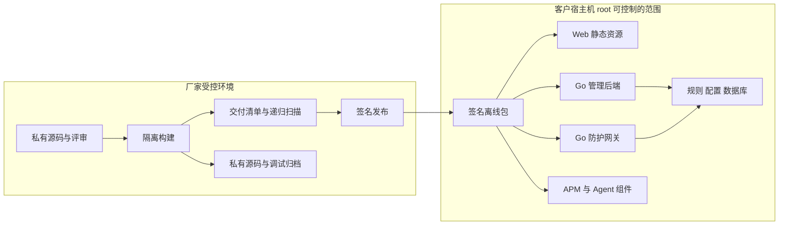
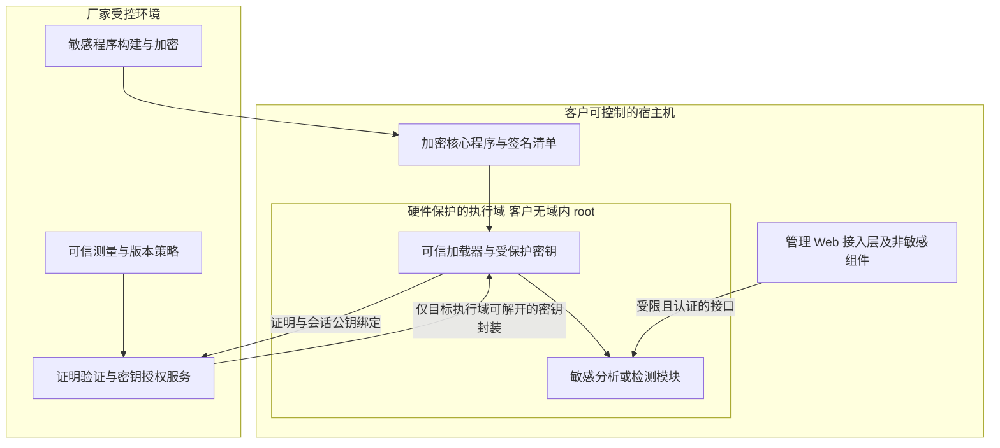

# 九章 WDSP 源码与知识产权保护详细方案

> 文档版本：1.0
>
> 编制日期：2026-09-07
>
> 状态：已进入实施与验收；标准离线版 IP-00～IP-09 已有代码、测试或可复现脚本证据，正式厂商授权材料、完整多架构生产包及 IP-10～IP-13 的真实硬件/TEE 证据仍按验收台账记录为 `BLOCKED`、`NOT_RUN` 或 `NOT_APPLICABLE`。
>
> 适用对象：产品负责人、架构师、研发、测试、发布与交付人员，以及承担开发任务的大模型。
>
> 适用产品：九章 WAF / WDSP / API 产品线，包含管理端、网关、APM 与分布式 Agent 的交付边界。
>
> 代码依据：读取时的工作区，HEAD 为 `3c73774da8bed0a36764a4eed29e511a7de85b4a`，包含大量未提交修改；不是干净的已发布版本快照。

## 1. 结论与实施方向

**如果客户拥有普通部署服务器的宿主机 root 权限，就不能仅靠软件加密、混淆、容器或授权校验，保证其永远无法提取或分析本机运行的核心程序。**

需要把目标拆成三层，分别建设和验收：

1. **避免直接交付原始源码**：生产包不包含第一方 Go / TypeScript 源文件、Git 历史、源码映射、构建缓存、测试素材或内部开发文档。正常使用必需的脚本、数据库迁移、接口定义和开源材料按照清单交付。
2. **提高复制、篡改和逆向的成本**：最小化交付、编译优化、生产信任根固定、签名发布、设备绑定和交付标识。这是标准离线版的现实目标，不能承诺抵御拥有宿主机控制权的专业逆向人员。
3. **在客户控制宿主机时保护运行中的核心代码**：采用经过验证的机密计算环境，将敏感程序及密钥置于受硬件保护的执行域；客户不得同时拥有该执行域内的管理权限。必须解决可信启动、证明验证、密钥交付和完整运维链路。

推荐顺序：**先完成标准离线版的交付和授权加固，再用独立 PoC 验证机密计算版。** 不建议为了“防源码泄漏”重写现有 Go 技术栈，也不建议把网关每次请求的判定改为访问厂家云服务。

### 1.1 本方案要解决的问题

| 问题 | 目标结果 | 能力边界 |
|---|---|---|
| 客户从交付包直接找到源码 | 交付清单与自动扫描阻止源码误入包 | 浏览器执行的 JS、必要运维脚本等仍可见 |
| 镜像最终目录干净，但历史层仍有源码 | 扫描所有实际交付层、归档及镜像元数据 | 不仅检查正在运行的容器文件系统 |
| 客户替换授权验签公钥 | 正式构建不接受运行时替换生产信任根 | root 仍可能修改普通本地校验程序 |
| 客户改数据库扩大配额、延长有效期 | 所有授权状态从厂家签名原文重建并核验 | 校验器本身必须可信；不解决本地二进制补丁 |
| 客户复制程序或授权到其他机器 | 增加设备绑定、交付标识与追溯证据 | 普通软件指纹不能构成强硬件边界 |
| root 读取进程内存和运行时规则 | 标准版承认边界；增强版通过硬件隔离保护选定资产 | 机密计算同样有可信计算基、漏洞和侧信道边界 |
| 加固后升级、排障、HA 不可用 | 提供迁移、受控诊断、回滚与双节点设计 | 不以牺牲安全防护和业务可用性作为反逆向手段 |

### 1.2 本次文档的范围

- 本文同时作为设计约束和实施基准；已实施内容以仓库代码、测试和验收文档中的可复现证据为准，未通过的项目不能从设计文字推断为完成。
- 不新增后台联网、遥测、上传流量、远程控制或远程停机机制。
- 不承诺“100% 无法破解”“永远不能逆向”或“离线软件授权绝对不可绕过”。
- 不采用删除客户数据、破坏环境、秘密植入后门等方式保护知识产权。
- 开源组件的源码、版权和许可证边界应尊重其授权条件；保护对象主要是第一方实现和商业资产。

## 2. 威胁模型与资产边界

### 2.1 必须区分的权限层级

| 对手能力 | 可以合理假设的操作 | 本方案的处理方式 |
|---|---|---|
| 普通浏览器用户 | 下载前端资源、调用已授权接口、观察交互 | 前端不存秘密；后端执行权限与授权校验 |
| 容器内 root，未突破宿主机边界 | 访问容器可见文件、配置和部分进程资源 | 最小镜像、非 root、能力约束用于缩小暴露面 |
| 宿主机 root / 内核控制权 | 导出镜像、替换程序、修改环境变量、数据库和时间，检查普通进程内存 | 标准版无法给出强代码保密保证 |
| 虚拟化宿主机管理员，无法管理受保护来宾系统 | 控制虚拟机调度、外部存储、网络、快照和启动输入 | 经过验证的 TDX / SEV-SNP 等方案可提供额外隔离 |
| 受保护来宾系统内 root | 访问该来宾系统允许访问的核心程序和运行时内存 | 敏感域采用机密虚拟机时，此权限不得交给客户 |
| 可接触硬件的人员 | 更换设备、干预固件、断电、离线复制存储 | 依赖具体硬件威胁模型和配置，不宣称覆盖所有物理攻击 |
| 厂家研发、构建或签名环境被攻陷 | 直接取得源码，或产生恶意签名版本 | 单独治理源码访问、构建隔离、签名密钥和发布流程 |

“客户有 root”在本文默认指**客户拥有部署宿主机的完整控制权**，不局限于物理接触服务器。Docker 的用户权限和隔离配置不能把宿主机所有者排除在信任边界之外。参见 [Docker 安全说明](https://docs.docker.com/engine/security/)。

### 2.2 什么需要保护，什么无法隐藏

| 资产 | 分类 | 标准版处理 | 机密计算版处理 |
|---|---|---|---|
| 第一方 Go 源码、设计资料、Git 历史 | 厂家内部资产 | 不交付 | 不交付 |
| 自主检测算法、模型编译器、关联分析实现 | 核心商业资产 | 编译交付，提高分析成本 | 选定模块以密文交付，在受保护域解密执行 |
| 自研规则、模型权重和特征参数 | 核心商业资产 | 按功能需要交付；签名和编译表示降低直接可读性 | 保密部分只在受保护域加载；输出需控制信息暴露 |
| React 编译后的 JS / CSS / HTML | 客户端执行资源 | 按可见资产设计，不存核心秘密 | 仍可见，机密计算不能隐藏浏览器必须执行的代码 |
| 运维脚本、数据库迁移、接口协议 | 必要交付资产 | 最小化、审查后交付 | 继续支持客户运维；避免包含敏感实现 |
| Caddy、Coraza、CRS 等第三方材料 | 第三方授权资产 | 按许可证交付声明和必要材料 | 不因加密交付而省略合规义务 |
| 厂家授权签名、发布签名私钥 | 最高敏感资产 | 永不进入客户包、镜像、配置或日志 | 永不交付；与解密密钥分离管理 |
| 用户流量、凭据、APM 数据、客户应用代码 | 客户数据 | 按既有数据安全策略处理 | 不借知识产权保护之名上传或占有客户数据 |
| 精确构建对应的源码、调试符号和映射 | 厂家诊断资产 | 厂家私有保留，按交付版本关联 | 同样私有保留，支持受控诊断 |

编译后二进制与原始源码不是同一种资产：没有随包交付原始源码，不等于无法理解算法或重建部分逻辑；反编译也不意味着能够完整恢复注释、原始命名和工程结构。

## 3. 当前仓库的事实与缺口

本节来自静态读取。**尚未导出生产镜像、逐层扫描离线包，也未对运行中的发行版进行内存检查或破解验证。** 不能把待验证项表述为已发现泄漏。

| 编号 | 已读取的事实 | 影响与处理优先级 | 证据 |
|---|---|---|---|
| B-01 | 后端多阶段构建，Go 使用 `-trimpath`、`-ldflags="-s -w"`；最终镜像复制程序、迁移和资源 | 已有良好起点；需要验证实际交付层，而不是重复建设“编译交付” | [server/Dockerfile](/Users/zhanglei/Documents/JiuZhang_WAF/server/Dockerfile) |
| B-02 | 网关在 builder 中引入自主模块，最终阶段复制 Caddy 程序 | 未见显式复制第一方源码到最终阶段；是否残留调试信息要检查实际 ELF，不能仅凭 Dockerfile 判断 xcaddy 默认行为 | [gateway/Dockerfile](/Users/zhanglei/Documents/JiuZhang_WAF/gateway/Dockerfile) |
| B-03 | Web 最终镜像复制 `dist`；Vite 已显式设置 `build.sourcemap: false` | 源码映射开关已关闭；仍需对实际最终镜像和多平台交付物做独立、隐藏和内联映射扫描 | [web/Dockerfile](/Users/zhanglei/Documents/JiuZhang_WAF/web/Dockerfile)、[vite.config.ts](/Users/zhanglei/Documents/JiuZhang_WAF/web/vite.config.ts) |
| B-04 | `LoadVendorKeys()` 已移除运行时环境变量覆盖；生产构建只接受固定编译期信任根，当前仓库的正式根为空时 fail-closed | 运行时替换信任根的路径已关闭；正式交付仍需注入经审批的厂家公钥并提供对应验签证据 | [vendor_keys.go](/Users/zhanglei/Documents/JiuZhang_WAF/server/internal/license/vendor_keys.go)、[app.go](/Users/zhanglei/Documents/JiuZhang_WAF/server/internal/app/app.go) |
| B-05 | 离线包 Compose 不再传递可覆盖授权信任根的环境变量；测试公钥仅通过 `wdsp_testkeys` 测试构建注入 | 正式交付需继续保持生产构建与测试构建边界，不能把测试根或私钥带入客户包 | [build.sh](/Users/zhanglei/Documents/JiuZhang_WAF/ops/offline-package/build.sh)、[docker-compose.test-keys.yml](/Users/zhanglei/Documents/JiuZhang_WAF/deploy/docker-compose.test-keys.yml) |
| B-06 | 授权指纹从可配置文件读取，文件非空内容作为指纹；设计基于宿主机标识组合 | 软件绑定可被拥有宿主机权限者复制或模拟，不能描述成不可伪造硬件身份 | [fingerprint.go](/Users/zhanglei/Documents/JiuZhang_WAF/server/internal/license/fingerprint.go)、[LICENSE_DESIGN.md](/Users/zhanglei/Documents/JiuZhang_WAF/docs/LICENSE_DESIGN.md) |
| B-07 | 授权复核在 `raw_file` 缺失、加密服务不可用、解密失败、签名失败和 DB 不一致时分别进入显式完整性状态；不再静默跳过 | 历史数据库行仍需使用合法原始 `.lic` 做迁移/恢复；没有合法材料时不得伪造迁移成功 | [service.go](/Users/zhanglei/Documents/JiuZhang_WAF/server/internal/license/service.go)、[store.go](/Users/zhanglei/Documents/JiuZhang_WAF/server/internal/license/store.go) |
| B-08 | 离线打包改为按交付白名单复制脚本、配置和材料，并递归扫描嵌套归档、路径穿越、软链接逃逸、秘密和压缩炸弹 | 白名单与扫描器已具备；仍需用正式多平台镜像/归档完成完整交付证据 | [build.sh](/Users/zhanglei/Documents/JiuZhang_WAF/ops/offline-package/build.sh)、[scan.py](/Users/zhanglei/Documents/JiuZhang_WAF/ops/offline-package/scan.py) |
| B-09 | 整包与裸机网关包要求 `delivery_mode`；正式模式无 `WDSP_SIGNING_KEY` 直接失败，开发模式必须显式 `--development`；安装与升级侧默认验签并拒绝未签名正式包 | 正式签名门已落地；当前只有临时测试签名证据，没有厂家生产签名根与合法交付材料 | [build.sh](/Users/zhanglei/Documents/JiuZhang_WAF/ops/offline-package/build.sh)、[install.sh](/Users/zhanglei/Documents/JiuZhang_WAF/ops/install/install.sh)、[signing.sh](/Users/zhanglei/Documents/JiuZhang_WAF/ops/lib/signing.sh) |
| B-10 | 离线包包含规则、裸机网关及可选 APM 配置、Schema、镜像等；部分导出路径可能保存不止单一平台内容 | 扫描必须覆盖实际包内所有产品组件、镜像变体及嵌套包，不能只检查 API 镜像 | [build.sh](/Users/zhanglei/Documents/JiuZhang_WAF/ops/offline-package/build.sh) |

补充依据：Docker 多阶段构建允许仅将所需产物复制到最终阶段，但是否携带源码仍取决于具体复制内容和实际导出对象，参见 [Docker 多阶段构建文档](https://docs.docker.com/build/building/multi-stage/)。Vite 的 `build.sourcemap` 默认值为 `false`，`hidden` 仍会产生单独的映射文件，参见 [Vite 构建选项](https://vite.dev/config/build-options.html#build-sourcemap)。

### 3.1 需要修正的既有理解

- “使用 Ed25519，客户就无法改授权”只在**信任根、校验器及授权原文链路未被替换**的前提下成立；生产公钥可被覆盖是另一类问题。
- “只读挂载 + 文件权限 600”能约束受限进程，不能阻止宿主机 root 更换文件、挂载或进程。
- “数据库加密”能减少数据库副本直接泄露明文的风险；普通主机 root 如果同时能取得解密服务和密钥，不能据此获得强保密保证。
- “客户已经能管理机器，所以没有必要加固”也不成立：消除直接泄漏、配置级绕过和低成本复制，仍然有实际价值。

## 4. 产品形态与能力分级

| 形态 | 是否可完全离线 | 可承诺的能力 | 主要限制 | 建议 |
|---|---|---|---|---|
| 标准离线版 | 是 | 不直接交付第一方原始源码；加强完整性、授权和追溯 | 普通主机 root 仍可分析程序和运行时数据 | 默认路线，先实施 |
| 标准版 + 硬件绑定 | 是，取决于绑定方案 | 增加非导出设备密钥与复制门槛 | 本地验证可被补丁绕过；虚拟 TPM、代理调用有额外边界 | 有防复制需求时选配 |
| 机密计算版 | 联网证明较易；完全离线需专项设计 | 在明确硬件及运维边界下保护选定运行时代码和密钥 | 客户不能拥有敏感来宾域 root；增加交付、升级和诊断成本 | PoC 通过后提供 |
| 厂家服务端保留部分能力 | 需要连接厂家服务 | 未交付的服务端实现不在客户本地 | 可用性、时延、数据出域和客户采购限制 | 独立可选产品，不作为离线版默认依赖 |

### 4.1 常见技术的真实作用

| 技术 | 适合解决什么 | 不能单独解决什么 |
|---|---|---|
| Go 原生编译、去符号、裁剪路径 | 减少直接源码和调试信息暴露 | 不能防止反汇编、行为分析和运行时提取 |
| 混淆、字符串处理、规则编译 | 增加理解成本 | 不是密码学隔离，不能保护普通进程中的所有明文 |
| Docker、非 root、最小能力 | 约束服务权限，减少一般入侵影响 | 不能防御宿主机所有者 |
| 镜像或包签名 | 验证来源及内容完整性 | 不加密程序，也不能强制恶意 root 运行官方校验器 |
| 磁盘加密、文件加密 | 保护离线存储副本或特定访问场景 | 已解锁普通主机的 root 仍可读取运行时内容 |
| TPM / HSM 设备密钥 | 密钥非导出、设备身份、签名或解密操作 | 不能自动隐藏在普通系统内存执行的代码 |
| Secure Boot / 测量启动 | 建立启动链和度量依据 | 不能只凭“开机验过”就证明所有后续应用和配置可信 |
| TDX / SEV-SNP 等机密计算 | 对特定宿主机攻击提供硬件辅助隔离和证明 | 不覆盖所有侧信道、漏洞、来宾管理员和拒绝服务 |

Go 链接器的 `-s` / `-w` 用于移除符号表、调试信息；它们不是代码加密，参见 [Go 链接器文档](https://pkg.go.dev/cmd/link)。Linux 的可信密钥机制也明确涉及内核中的明文密钥，不能将“由 TPM 保护密钥”直接等同于“宿主机 root 读不到应用代码”，参见 [Linux Trusted and Encrypted Keys](https://www.kernel.org/doc/html/latest/security/keys/trusted-encrypted.html)。

## 5. 标准离线版架构



该形态把源码和厂家私钥留在厂家环境，但**客户侧运行的普通程序依然处于客户控制范围内**。下列工作主要减少误交付、低成本篡改和分析便利性。

### 5.1 交付文件白名单

建立版本化交付策略，按产品和组件定义“必须交付、允许交付、禁止交付”。不能只使用若干文件名黑名单。

| 类别 | 原则 |
|---|---|
| 管理后端与网关 | 只交付运行所需程序、模板、迁移、资源和运行依赖 |
| Web | 交付构建后的资源；排除第一方源码、源码映射和调试产物 |
| 运维 | 保留安装、升级、卸载、检查、备份恢复等必要脚本；逐项审查依赖后收敛复制范围 |
| APM 与 Agent | 分别列出可执行程序、采集配置、Schema、证书目录模板及必要依赖；不得默认继承主服务清单 |
| 规则与模型 | 区分公开 CRS、第一方商业规则、客户自定义规则；不能误删客户所需可编辑配置 |
| 合规 | 保留 SBOM、版权声明、许可证文本及第三方要求的材料 |
| 禁止内容 | 第一方源代码目录、`.git`、编辑器缓存、测试数据、内部证据、开发文档、构建缓存、私钥和凭据 |

实施要求：

1. 将 `ops/` 的整目录复制改为声明式清单或受审查的目录集合；先统计安装与升级脚本的引用关系，避免漏掉间接依赖。
2. 生产构建与开发构建分开产出，名称和清单显式区分。最终商业包不包含 builder 镜像和私有构建缓存。
3. 构建凭据采用临时注入；不通过会进入镜像层、历史或输出日志的方式保存秘密。扫描报告也不得回显秘密正文。
4. 所有实际交付架构分别验证，包括 amd64、arm64 和导出包中额外存在的平台变体。不能因扫描了 amd64 就宣布整个多架构包通过。
5. 首版为现有产品建立最小变更清单，保持现有安装、裸机网关、APM 和 Agent 流程可用。

### 5.2 产物扫描：检查内容而非仅检查文件后缀

扫描应在签名之前运行；签名前后的产物需通过摘要关联，防止扫描通过后替换文件。

- 扫描外层离线包、裸机包、嵌套归档、所有镜像层及镜像配置、标签和历史。
- 检查被后续层删除但仍存在于已交付历史层中的文件；镜像最终目录没有源码，不代表历史层没有。
- 检查 Go / TS / TSX 原始实现、Git 对象、测试夹具、私有调试信息、绝对开发路径、源码归档和依赖缓存。
- 检查 `.map` 文件、内联 `sourceMappingURL`、带 `sourcesContent` 的映射；单纯移除 JS 尾部引用不算删除映射文件。
- 对 JS 中的公开字符串和 Go 必需的运行时元数据采用审查规则，不以“不能出现任何函数名”作为不可实现的硬性门禁。
- 对签名私钥、访问令牌、连接凭据等执行内容检测；报告只输出规则编号、位置和脱敏摘要，不能收集或打印实际秘密。
- 处理符号链接逃逸、归档路径穿越、解压炸弹、文件大小和递归深度限制。扫描阶段不执行包内脚本或程序。
- 扫描器超时、解析失败或存在未覆盖的平台/归档类型时，结果为“不完整”，不得按“未发现问题”通过正式发布。

报告至少包含：输入包摘要、产品、版本、平台列表、扫描器版本、策略版本、扫描覆盖范围、允许例外、发现项、最终结论。例外必须有明确原因、责任人、适用版本与失效时间，不能用永久的 `ignore all`。

### 5.3 Go 程序与规则的加固

1. 后端已有 `-trimpath` 和去符号配置，保留并验证实际产物；网关先检查 xcaddy 产物，再决定是否补充构建参数。
2. 保持 Caddy 模块注册、插件接口、反射、日志与崩溃处理正常；不能为抹除标识随意破坏 Go 运行时元数据。
3. 第一方核心模块可开展有限混淆 PoC。选型时核实工具许可证、版本锁定、Go 兼容性和可复现性，不在本方案中假定某工具已被批准。
4. 优先验证算法模块和规则编译结果，避免第一版对所有依赖统一混淆。混淆仅提高成本，不能以其测试通过声称抵御 root 内存读取。
5. 规则若转换为编译表示，需明确版本、完整性校验、加载失败处理及回滚兼容；标准版运行时仍可能被提取。
6. 不采用“密文规则 + 同目录固定对称密钥”作为强保密方案。若只是避免偶然查看，必须在产品能力说明中明确这一弱目标。
7. 厂家私有保存与发布程序一一对应的源码、依赖、构建参数、调试程序和映射，确保线上问题可以定位。

### 5.4 前端保护边界

- 显式设置生产 `build.sourcemap: false`，同时扫描最终资源，避免其他插件或流水线重新生成映射。
- 核心密钥、授权真值、策略执行和敏感算法不进入浏览器；隐藏按钮不构成权限校验。
- 压缩后的 JS 仍视为公开。改成 WebAssembly 或增加 JS 混淆，同样不能保证客户无法分析。
- 继续提供可解释的产品文案、错误提示和无障碍信息，不为了隐藏实现降低 UI/UX 可用性。

### 5.5 运行与诊断

- 保留服务非 root、最小文件权限、合理的进程调试限制与 core dump 策略，用于减少一般误暴露；这些不是抵御宿主机 root 的边界。
- 不做“检测到调试器就删除数据”“疑似破解就停掉网关”等机制。
- 支持包按白名单收集版本、配置摘要、必要日志和性能信息；排除私钥、会话、客户请求正文和内存转储的默认收集。
- 敏感诊断资料需客户明确发起，先脱敏，按需使用厂家支持公钥加密，由客户决定是否导出和发送。
- 支持流程不能依赖向客户公开厂家签名私钥，或将生产核心代码永久以调试版本交付。

## 6. 授权与信任根加固

### 6.1 生产公钥不能被环境变量替换

现有 `LICENSE_VENDOR_PUBLIC_KEY` 覆盖机制是本次最明确的优先项。正式版应做到：

1. 正式构建内置生产信任根集合，只接受由该集合授权的有效签名链。
2. 移除正式构建中运行时直接替换公钥表的能力，同步处理离线 Compose、部署文档与测试装配。
3. 开发测试使用依赖注入、测试构建或独立的开发产物。不能仅凭 `APP_ENV=prod` 判断安全，因为宿主机 root 能修改环境变量。
4. 正式流水线验证产物不存在可启用的测试信任根覆盖功能；单元测试通过不等于生产二进制满足这一点。
5. 旧环境中若使用了非内置合法厂家公钥，应先统计公钥标识并完成可信轮换，不可直接升级导致全部已有授权失效。
6. 产品界面可展示根标识和公开指纹供核对，不提供上传任意公钥以替换生产信任根的入口。

这里保护的是“谁有权签授权”。**即使修复此处，普通宿主机 root 仍可能修改整个程序的判断逻辑。**

### 6.2 保留签名原文作为授权事实来源

当前 `.lic` 的 Ed25519 签名和规范化 payload 机制已有实现，应优先沿用，不为加固无必要地另造不兼容格式。

- 导入：验证签名、已知 `key_id`、产品、有效期、设备约束和全部相关字段，再保存签名原文及派生数据。
- 启动及复核：从签名原文验证后重建授权结果；数据库中的额度、功能和日期只作为缓存或查询字段，不能成为独立授权真值。
- 对当前 `enc == nil` 与 `raw_file` 为空分支，正式环境不得继续输出“完整性已验证”。应进入明确的待迁移或不可验证状态。
- 对历史无原文授权，通过重新导入合法原始 `.lic` 迁移；原文件丢失时由厂家按实际授权重新签发。不能把现有数据库行自动升级为可信签名记录。
- 加密服务不可用、解密失败、数据库不可用、签名无效、到期、机器不匹配应分别表示，不能静默吞错或全映射为“盗版”。
- 对 `quotas`、`features`、产品类型及其他字段保持完整签名覆盖。功能声明与功能实际执行门禁是不同任务；当前设计中部分功能位仅用于展示，不能宣称已完成逐功能强制控制。

### 6.3 密钥轮换与职责分离

| 密钥类型 | 保存位置与用途 | 轮换要求 |
|---|---|---|
| 授权签名私钥 | 厂家受控签发环境，签署商业授权 | 根标识版本化；保留验证历史合法授权所需的信任信息 |
| 发布签名私钥 | 厂家发布环境，签署产物或清单 | 与授权密钥分离，权限和审计独立 |
| 核心程序内容密钥 | 仅机密计算版使用，管理敏感内容解密 | 按产品/版本/风险隔离，不作为全客户共享的固定明文秘密 |
| 设备私钥 | 合格设备的受保护密钥域 | 记录设备替换、HA 扩容、损坏恢复与吊销流程 |
| 交付标识映射或水印密钥 | 厂家内部，用于追溯 | 不与授权或发布信任根复用 |

可信根更新需由已信任的根签署版本化信任元数据，或通过预先设计的独立恢复根执行受控恢复。不能下载一个未经验证的新公钥，然后仅因它来自“更新包”就信任它。根泄露处置必须考虑离线客户无法立即获得吊销信息的事实。

### 6.4 设备绑定与防复制

标准版继续支持已有指纹以保证迁移，但将其明确标为软件设备标识。

可选硬件绑定方案：设备生成不可导出的密钥，签发时绑定其公钥摘要；使用带随机挑战的持有证明，避免仅比较字符串。对物理 TPM、虚拟 TPM 和云平台实例身份分别定义保证，不能视作等价。

边界与工程要求：

- 宿主机 root 可能代理调用合法设备上的密钥服务，或修改本地校验器，因此设备密钥不等于绝对防复制。
- 主备或集群授权按批准节点集合设计，不把两个合法节点强行绑定到一个可复制文件指纹。
- 定义主板更换、设备报废、灾备恢复、重新签发和旧设备撤销流程，避免运维事故迫使永久关闭校验。
- 完全离线场景难以可靠发现跨机器并发复制，也无法即时撤销失窃授权；产品承诺必须反映这一限制。
- 客户控制普通系统时间和快照时，不能仅靠本地时间戳、计数文件或数据库记录证明“绝不回退”。

### 6.5 必须分离授权状态、完整性状态和防护状态

已有 [离线授权设计](/Users/zhanglei/Documents/JiuZhang_WAF/docs/LICENSE_DESIGN.md) 描述：授权失效时管理写操作受限，发布侧可能生成旁路配置，关闭防护。**这是现有产品策略，本文不擅自改变，但也不把它直接复用于新增的源码保护异常。**

新增设计需分别表达：

| 状态维度 | 示例 | 原则 |
|---|---|---|
| 商业授权 | 有效、到期、未导入、设备不匹配 | 沿现有授权契约处理；策略变更另立 ADR |
| 产物/授权完整性 | 已验证、待迁移、无法验证、验证失败 | 显示原因，限制相关变更，保留审计 |
| 网关实际防护 | 正常防护、旁路、不可用、保持既有配置 | 显示真实运行状态，不能由一个“已授权”图标替代 |
| 机密计算能力 | 未启用、证明有效、证明失效、平台不支持 | 不能失败后仍显示“核心代码受保护” |

建议新增完整性故障的恢复模式：在合法授权及预先批准的产品策略范围内，保留最近验证通过的网关配置，暂停不可信配置发布，提供诊断与恢复入口。不得由于扫描器故障或证明服务暂时不可达，就隐式发布 `ModeBypass`。

涉及真正授权到期后的行为、是否允许宽限期、宽限期长短及安全策略保留范围，必须在实施前单独作出产品决策。**本文没有授予新增宽限授权，也不能以保可用为由自动放大商业授权。**

## 7. 发布完整性与交付追溯

### 7.1 正式包强制签名

- 复用已有 Ed25519 包签名机制，不重复发明签名算法。
- 正式发布模式下没有合法签名能力即构建失败；开发未签名包必须明确标记且不能进入正式发布渠道。
- 安装和升级在执行变更之前验证签名、目标产品、版本、平台和完整内容摘要。
- 显式限制开发用 `--allow-unsigned` 在正式交付流程中的使用；同时承认客户 root 可以修改安装脚本，无法仅通过该开关限制其行为。
- 初始验签公钥的真实性需要独立建立，例如厂家预置可信安装器或通过独立可信渠道核对公钥指纹。不能用同一未验证压缩包里的脚本和公钥自证可信。
- 现有整包签名可以继续作为外层保护。若新增内层签名清单，必须定义准确签名对象和规范化规则，避免循环摘要和不同序列化结果。

### 7.2 交付清单的新增契约

以下是**拟新增或澄清的字段要求**，不是对现有 manifest 结构的描述。实施时读取现有格式，版本化扩展并处理老包兼容。

| 字段含义 | 用途 |
|---|---|
| 清单格式版本 | 明确解析和兼容策略 |
| 产品、版本、发布标识、平台集合 | 阻止错包、错产品和漏扫描平台 |
| 构建提交与构建配置标识 | 关联干净源码基线和私有诊断档案 |
| 文件路径、大小、内容摘要 | 覆盖程序、脚本、规则、配置模板和嵌套包 |
| 镜像摘要类型及值 | 区分 OCI manifest digest、镜像 config ID 和导出 tar 文件摘要；不能混称同一种 digest |
| 扫描报告摘要与策略版本 | 绑定通过验收的扫描结论 |
| 保护形态与适用硬件要求 | 标准版与机密计算版能力真实可识别 |
| 交付标识 | 用于发行渠道及交付追溯，不放客户秘密 |
| 签名算法与签名密钥标识 | 使用受支持算法及预置信任根，拒绝未知或降级算法 |

对清单中的相对路径实施规范化、禁止目录逃逸和重复冲突项。包签名覆盖哪些字节、清单是否包含自身、旁车签名是否在包内，都要写入格式说明和测试，避免实现自行猜测。

### 7.3 交付标识与水印

第一阶段可采用签名清单中的交付标识，以及厂家内部的“交付标识 → 客户合同/渠道/版本”映射。产品包中避免直接嵌入客户姓名、联系方式等信息。

需要更高追溯能力时，再评估可重复生成的客户特定构建标识。构建输入和种子应受控留档，以便解释不同客户包的摘要差异；不能同时承诺所有客户包哈希相同和每包具有不同二进制水印。

水印是调查线索，可能被移除或伪造，不应单独作为归责依据；更不能用水印代替授权或保密机制。

## 8. 机密计算版：保护运行中的核心代码

### 8.1 前置条件与保证范围

Intel TDX 和 AMD SEV-SNP 提供针对特定恶意宿主机/虚拟化层攻击的隔离和证明能力，但必须结合合格硬件、固件、软件和运行配置。参见 [Intel TDX 安全研究与保证](https://www.intel.com/content/www/us/en/developer/articles/technical/software-security-guidance/technical-documentation/tdx-security-research-and-assurance.html) 与 [AMD SEV 官方说明](https://www.amd.com/en/developer/sev.html)。

本方案采用“机密虚拟机承载敏感执行域”的候选架构。只有以下条件同时满足，才讨论“客户宿主机 root 不能按普通进程方式读取核心运行时”：

1. 硬件、固件、虚拟化栈和证明链满足被批准的安全基线。
2. 客户不拥有敏感来宾域的 root、任意命令执行入口或等价调试权限。
3. 核心程序未以明文形式出现在客户可读的镜像层、虚拟磁盘、快照、缓存或升级包中。
4. 解密密钥只交给通过验证的执行域，并与当前会话、测量值和指定程序内容绑定。
5. 启动链之外的应用加载、配置、更新和诊断也受到完整性约束。
6. 产品明确披露支持的平台、剩余风险以及已完成的实机验证范围。

如果客户必须管理包含核心代码的来宾系统 root，应重新定义保护边界或选择能隔离于该管理员的其他执行模型，不能继续沿用本方案的保证。

### 8.2 候选架构



图中验证与密钥授权服务默认在厂家受控环境。完全离线交付时，需用第 8.5 节经验证的离线机制替代该连接；不能直接把普通解密服务及其明文密钥放在同一客户宿主机上。

### 8.3 证明与密钥交付流程

以下是协议要求，不是现成接口，具体 API 与硬件 SDK 需 PoC 后冻结。

1. 厂家为敏感程序构建确定的发行产物，生成签名清单，并以经过批准的 AEAD 算法和标准库加密。内容密钥与授权、发布签名私钥分离。
2. AEAD 关联数据绑定产品、版本、内容摘要和密钥版本，防止把其他版本的密文、元数据或密钥封装拼接使用。
3. 受保护域启动可信加载器，在域内生成会话密钥材料；绑定挑战随机数、会话公钥及必要上下文的摘要进入证明报告允许的用户数据字段。
4. 验证方验证证明签名链、时效/挑战、批准的测量值、平台安全版本、调试状态、设备与产品授权，以及目标程序和策略版本。挑战随机数验证新鲜性，不能仅信任客户提交的本地时间。
5. 验证方将获准内容密钥封装给已被证明绑定的会话公钥。仅建立普通 TLS 连接而不绑定证明与会话，不能充分防止证明被转接给其他进程使用。
6. 加载器验证程序清单和密文完整性，在受保护域内解密执行。宿主机只应看到密文、必要元数据和定义过的业务接口输出。
7. 证明失败、内容不匹配或平台不支持时，不能偷偷启用宿主机上的明文解密后备路径。
8. 对已释放并正在使用的密钥，不能声称后续撤销能追回已泄露的信息。撤销和租约策略主要约束未来的获取、续期及加载。

对“证明代理攻击”的处理应特别验证：把合法受保护域当作远程证明代理，不能使另一台普通主机取得明文内容密钥。关键会话应终止在受保护域内，接口不能提供任意内存读取、文件读取或解密服务。

### 8.4 可信启动不等于可信应用

- 仅证明来宾启动镜像，不能自动证明之后从可写磁盘加载的所有程序和配置。
- 建立从启动测量到加载器、应用签名清单、认证文件系统或等价验证链的明确关系；更新路径执行同样的校验。
- 禁止客户通过 cloud-init、控制台、串口、维护 API、SSH、注入账户或替换 init 脚本取得敏感域管理权限。
- 敏感日志、临时文件、swap、崩溃转储和备份必须纳入设计，不能让内存保护被明文落盘绕过。
- 设备直通、共享内存、宿主机提供的输入和来宾服务漏洞需要单独评估；业务输入不能因为进入了机密虚拟机就视为可信。
- 暴露出去的判定结果、模型评分和响应行为仍可能被用于黑盒推断。机密计算保护执行域，不保证算法无法通过查询近似学习。

### 8.5 完全离线交付的可行路线与限制

| 路线 | 候选机制 | 必须验证的问题 |
|---|---|---|
| 厂家控制的本地授权/证明设备 | 在隔离的受控硬件设备中验证证明并封装密钥，客户仅调用受限接口 | 该设备的管理权、密钥保护、升级、替换、故障恢复和多节点信任 |
| 设备定向离线开通 | 客户导出挑战与硬件证明，厂家验证后返回绑定目标受保护设备/密钥的激活封装 | 开通后重启如何保存或恢复密钥、证明新鲜性、设备复制及恢复流程 |
| 受保护域内持久密钥封存 | 采用选定平台经过验证的持久化和解封方案 | TDX / SNP 平台能力差异、快照克隆、迁移、版本回退和设备故障 |

这些是待验证路线，不能假设所有 TDX / SNP 平台都提供同一种通用封存 API。尤其不能采用“普通 Linux 用 TPM 解密，再把明文程序运行在宿主机”的方式冒充完整机密计算交付。

完全离线环境没有外部最新状态时，授权撤销、时间回退、快照回滚和跨设备并发使用的保证通常更弱。若依赖可信单调状态、专用安全设备或受保护时间源，需说明具体硬件能力和断电恢复行为，并通过实机测试。

离线 PoC 如果不能证明密钥持久化及恢复链路安全，就将该形态标为“暂不支持”，不能用交付明文主密钥来补齐功能。

### 8.6 WDSP 模块放置原则

| 组件/能力 | 标准版 | 机密计算 PoC 建议 |
|---|---|---|
| Web 管理界面 | 正常构建交付 | 保持在普通域，不能靠 TEE 隐藏浏览器资源 |
| 管理 API 的普通 CRUD、配置与审计 | 正常编译交付 | 初期保持原架构，避免扩大可信计算基 |
| 规则/模型编译、离线分析 | 编译加固 | 适合作为边界清晰的首批候选模块 |
| APM 关联分析、自研异常分析算法 | 编译加固 | 可选择批处理或异步分析能力试点；先盘点敏感实现是否值得保护 |
| 网关逐请求检测核心 | 保持现有本地处理链 | 后续评估将完整工作进程放入受保护域，避免逐请求跨外网调用 |
| 分布式 Agent、宿主机探针 | 最小程序交付 | 宿主机侧仍不可信；不要把厂家秘密塞进客户 root 控制的 Agent |
| 客户规则、业务配置、流量和 APM 数据 | 按现有权限与数据保护处理 | 客户仍需必要管理能力，不应因保护厂家 IP 而失去数据控制 |

第一阶段不调整 `jiuzhang_guard` 中间件顺序，不改变白名单、WAF、API 动态防护、JWT、身份行为和风险策略之间的安全约束。网关热路径不得引入逐请求的外部授权或证明网络调用。

### 8.7 高可用、升级与排障

- 每个合法节点分别完成设备登记、证明与密钥授权，不能把一个节点的明文内容密钥写入共享目录供其他节点使用。
- 备用节点提前准备可用的受保护执行环境；故障切换验收覆盖主节点断电、证明服务不可达、缓存过期和设备更换。
- 租约和密钥缓存策略需明确使用什么可信时间/状态依据，不能默认客户可回退的系统时钟提供强约束。
- 升级先批准新旧版本的有限兼容窗口，再灰度切换。回滚只允许到仍在批准集合中的版本；存在安全下限时，恢复可用性不能等于重新授权已撤销的脆弱版本。
- CVM 磁盘备份、迁移和快照需验证加密、恢复绑定及防回滚能力，不能因宿主机管理工具声称“加密”就视为可安全任意复制。
- 支持接口仅提供受限诊断、状态和必要导出。不得通过万能远程 shell 或默认来宾 root 密码排障。
- 如客户要求临时开放敏感域 root，应明确这会改变代码保密保证，并通过独立支持流程处理，不能作为日常运维方式。
- 建立 CPU/固件/虚拟化栈安全公告和最低支持版本维护流程。硬件隔离不能代替持续修补。

## 9. 运维界面、状态与错误契约

### 9.1 产品界面应展示真实能力

优先复用现有授权、系统信息和运维诊断页面。在确认现有接口与权限结构之后再设计扩展，本文不假设某条新 API 已存在。

建议展示：产品与版本、交付标识、保护形态、产物验证状态、授权完整性状态、网关实际防护状态。机密计算版另展示支持的平台、证明状态及有效范围、最近一次验证结果。

| 情形 | 建议面向管理员的文案 | 可执行操作 |
|---|---|---|
| 标准离线版 | “标准离线交付：已验证发布包；核心程序以本地二进制运行。” | 查看版本与验证详情 |
| 历史授权缺少签名原文 | “授权原文件需要补充验证。请导入厂家签发的原始授权文件。” | 导入、查看迁移说明 |
| 授权数据与签名原文不同 | “授权数据校验失败，相关变更已暂停。” | 查看原因、重新导入合法授权 |
| 新包校验失败 | “安装包验证失败，未执行升级。” | 查看校验错误、重新选择官方包 |
| 机密计算平台不支持 | “当前设备不支持此保护形态。” | 查看支持要求；不显示已启用 |
| 证明暂时不可用 | “受保护环境暂时无法完成验证。” | 查看实际服务状态和恢复指引 |

不要用“系统绝对安全”“无法破解”“已加密所以 root 无法读取”等文案。用户通常需要知道当前能力、故障影响和恢复方法，不需要看到完整证明报告或密码学材料。

### 9.2 状态数据与错误分类

实现时定义版本化的状态结构，至少拆开 `保护形态 / 完整性 / 商业授权 / 实际防护 / 恢复操作`，并复用项目既有错误返回风格。以下名称仅表示拟定义的错误语义，不是现有错误码：

- 不受信任的签发者或信任根配置。
- 缺少可验证的授权原文。
- 授权签名不合法或原文与派生数据不一致。
- 发布包内容不匹配或平台不匹配。
- 扫描未完成，不能发布。
- 设备证明失败、证明过期或平台不支持。
- 受保护内容版本未获批准。
- 验证依赖暂时不可用。

错误消息不得包含密钥、授权原文、客户请求正文或完整敏感配置。状态查询应使用现有权限边界；导入、恢复和升级等变更继续执行 RBAC、参数校验与操作审计。

### 9.3 降级与可用性决策表

| 故障 | 最低要求 | 实施前需冻结的策略 |
|---|---|---|
| 新包签名或扫描失败 | 不发布、不执行升级变更；保留当前版本 | 无需以业务中断换取拒绝坏包 |
| 发现旧环境依赖公钥覆盖 | 升级预检指出需要迁移，不自动信任新根 | 合法历史根如何纳入签名轮换 |
| 历史授权没有原文 | 明确不可完整验证，不能伪造“已通过” | 迁移窗口、恢复入口与现有授权契约 |
| 运行时完整性检查依赖故障 | 区分不可验证和已篡改，保留审计与实际防护状态 | 是否及如何保持已批准配置 |
| 机密计算验证服务暂时不可用 | 不向未经验证域交付新密钥，不切换明文执行 | 已运行工作负载、租约到期和备用节点行为 |
| 已确认敏感域完整性失效 | 停止向其释放新秘密，不虚报保护有效 | 流量旁路、备用节点或拒绝服务的客户部署策略 |
| 商业授权实际到期 | 不借本方案绕过商业限制 | 沿现有策略或通过专门 ADR 调整 |

对机密计算版的流量故障策略，必须按部署模式约定：安全优先和业务连通优先并非同一行为。接口、告警与演练应准确展示最终选择，不能在运行时无提示切换。

## 10. 开发阶段与任务拆分

所有任务初始状态均为 **未开始**。下列优先级只用于本方案，不改写其他 P0 / P1 产品规划。

### 10.1 阶段安排

| 阶段 | 范围 | 前置依赖 | 退出条件 |
|---|---|---|---|
| S0 基线冻结 | 产物盘点、现状复核、兼容性与状态策略 | 无 | 干净基线、交付清单、迁移对象和决策记录明确 |
| S1 交付内容门禁 | 白名单、递归扫描、正式签名门禁 | S0 | 实际离线包及各平台扫描通过，安装回归通过 |
| S2 授权信任链 | 固定生产信任根、原文复核、历史迁移 | S0；合入时通过 S1 | 配置覆盖与数据库篡改用例通过，迁移可恢复 |
| S3 可维护性与追溯 | Go/前端验证、私有诊断归档、交付标识、状态展示 | S1、S2 | 完整回归与性能门禁通过，交付可诊断 |
| S4 设备绑定选配 | 非导出设备密钥、双节点和设备更换流程 | S2、S3 | 选定硬件验证，边界已明确，旧授权兼容路径可用 |
| S5 机密计算 PoC | 敏感域、证明、密钥交付和离线可行性 | 独立架构决策与硬件资源 | 真实硬件攻击面与恢复测试通过；允许作出不支持结论 |
| S6 机密计算产品化 | HA、更新、运维、硬件矩阵和交付支持 | S5 通过 | 真实业务验证、支持手册及产品承诺一致 |

执行时每次只承担一个阶段中的一个明确模块，完成评审和验证后再继续。S1/S2 是近期重点；S4 不强制进入所有客户版本；S5/S6 不作为标准版首轮交付的阻塞项。

### 10.2 可直接分配的开发任务

| 任务 | 优先级 | 具体工作与范围 | 交付物 | 核心验收 |
|---|---|---|---|---|
| IP-00 基线与决策 | P0 | 读取当前设计与代码，盘点实际产品包、架构、合法授权根、历史原文情况 | 基线报告、兼容矩阵、ADR | 无敏感值输出；明确 S1/S2 实施边界 |
| IP-01 收敛离线清单 | P0 | 替换过宽 `ops/` 复制范围，补全 APM、Agent、裸机网关清单 | 版本化交付清单、打包改动 | 安装/升级必需文件齐全，开发目录不交付 |
| IP-02 递归扫描门禁 | P0 | 检查层、归档、元数据、源码映射和秘密；失败不能继续签名发布 | 扫描器、策略、脱敏报告、恶意归档测试 | 旧层源码及嵌套敏感内容可检出，扫描不完整不通过 |
| IP-03 生产信任根 | P0 | 收紧 `LoadVendorKeys`、应用装配、Compose 与测试构建边界 | 授权信任根加固、正式/开发构建约束 | 自选公钥不能使正式版接受自签授权 |
| IP-04 签名原文与迁移 | P0 | 消除生产环境中无原文仍声称已验证的路径，保证全字段复核 | 迁移预检、恢复入口、回归测试 | 数据库修改不产生有效扩权；历史合法授权可迁移 |
| IP-05 强制签名交付 | P0 | 正式发布强制签名，绑定扫描报告与产物；核对初始信任根 | 发布/安装校验、格式说明 | 缺签名及包替换被拒绝，升级前无副作用 |
| IP-06 二进制与 Web 加固 | P1 | 检查实际 Go 产物、显式关闭源码映射、有限混淆 PoC | 产物报告、构建变更、性能对比 | 不破坏模块注册、功能、日志与诊断 |
| IP-07 诊断与私有归档 | P1 | 建立版本映射、脱敏支持包与私有调试流程 | 诊断规范、归档记录、恢复演练 | 线上问题可定位，交付包不含调试源码或秘密 |
| IP-08 状态与审计 | P1 | 区分授权、完整性、实际防护及机密计算状态 | API/界面改动、权限与 E2E 验证 | 不虚报保护有效，不误触发防护旁路 |
| IP-09 交付追溯 | P1 | 交付标识、内部映射、可复现要求 | 签名标识和厂家记录规范 | 无客户敏感信息、无新增遥测 |
| IP-10 硬件防复制 | 选配 | 设备持有证明、换机、HA 和虚拟 TPM 边界 | 硬件设计与实机证据 | 软件指纹复制不等于设备证明通过 |
| IP-11 机密计算最小 PoC | 选配 | 一个边界清晰的敏感模块，证明绑定和域内解密 | 可运行 PoC、硬件与威胁报告 | 宿主机可读磁盘无明文，证明转接不能取得密钥 |
| IP-12 离线机密计算 PoC | 选配 | 离线开通、密钥持久化、重启、复制和恢复 | 离线可行性报告、限制清单 | 不靠交付明文主密钥实现恢复 |
| IP-13 机密计算产品化 | 选配 | HA、灰度升级、批准版本回滚、受控支持 | 产品包、兼容矩阵、运维手册 | 满足实机安全、可用性和业务性能门禁 |

### 10.3 现有文件与拟新增文件

实施前必须重新读取实际内容，以下仅标示候选修改点。不要照表批量修改，也不要把所有任务塞入同一个提交。

| 位置 | 状态 | 可能承担的改动 |
|---|---|---|
| [server/Dockerfile](/Users/zhanglei/Documents/JiuZhang_WAF/server/Dockerfile) | 已存在 | 验证和收敛生产构建产物 |
| [gateway/Dockerfile](/Users/zhanglei/Documents/JiuZhang_WAF/gateway/Dockerfile) | 已存在 | 验证 xcaddy 实际构建输出和平台兼容 |
| [web/vite.config.ts](/Users/zhanglei/Documents/JiuZhang_WAF/web/vite.config.ts) | 已存在 | 明确生产映射策略 |
| [vendor_keys.go](/Users/zhanglei/Documents/JiuZhang_WAF/server/internal/license/vendor_keys.go) 与 [service.go](/Users/zhanglei/Documents/JiuZhang_WAF/server/internal/license/service.go) | 已存在 | 固定正式信任根、原文复核与状态处理 |
| [app.go](/Users/zhanglei/Documents/JiuZhang_WAF/server/internal/app/app.go) | 已存在 | 依赖装配与正式构建约束 |
| [fingerprint.go](/Users/zhanglei/Documents/JiuZhang_WAF/server/internal/license/fingerprint.go) | 已存在 | 兼容现有绑定；硬件能力应经设计后扩展 |
| [build.sh](/Users/zhanglei/Documents/JiuZhang_WAF/ops/offline-package/build.sh) | 已存在 | 白名单、扫描、清单及正式签名门禁 |
| [install.sh](/Users/zhanglei/Documents/JiuZhang_WAF/ops/install/install.sh) 与 [signing.sh](/Users/zhanglei/Documents/JiuZhang_WAF/ops/lib/signing.sh) | 已存在 | 安装前验证、开发例外和可信根引导 |
| [LICENSE_DESIGN.md](/Users/zhanglei/Documents/JiuZhang_WAF/docs/LICENSE_DESIGN.md) | 已存在 | 随行为变更修订授权边界、迁移与错误策略 |
| `ops/offline-package/delivery-policy.json` | 拟新增，尚不存在于本方案实施中 | 交付白名单与允许例外；格式需先评审 |
| `ops/offline-package/verify-delivery.py` | 拟新增，名称与语言待依赖评审 | 离线产物扫描入口；不能未经检查假定客户已安装 Python |
| `docs/WDSP_IP_PROTECTION_ACCEPTANCE.md` | 拟新增 | 记录真实测试结果、产物摘要和剩余限制 |

扫描优先运行在厂家的受控构建环境，客户安装端仅执行必要的签名与完整性验证。若增加客户侧运行依赖，必须验证其离线交付、版本锁定和许可证，不得临时联网安装。

## 11. 验收用例

以下 50 个用例是冻结的验收集合。每项必须以真实命令、输入产物或批准硬件记录状态；已有单元测试只覆盖其明确范围，不能替代完整包、安装/升级、接口或 E2E 验收。真实机密计算保证不能用 Mock 证明替代。

### 11.1 交付、构建与诊断

| 编号 | 用例 | 预期结果 |
|---|---|---|
| AT-01 | 对各产品正式包执行完整递归扫描 | 平台和组件全覆盖；无未批准源码或秘密；报告绑定包摘要 |
| AT-02 | 在早期镜像层加入第一方源码，再在后续层删除 | 仍能检出历史层内容并阻止正式发布 |
| AT-03 | 将源码、调试文件放入嵌套压缩包 | 按策略识别，不因外层后缀正常而放行 |
| AT-04 | 放入独立、hidden、inline 三种源码映射 | 均能检出，不能仅检查 JS 是否有外链注释 |
| AT-05 | 在镜像历史、标签和配置中植入测试用假凭据 | 检测规则生效；报告不回显值；仅使用人工测试标记 |
| AT-06 | 提交路径穿越、符号链接逃逸和解压炸弹样本 | 安全中止且结果为不完整/拒绝，不向宿主机任意位置写文件 |
| AT-07 | 扫描器超时、缺少归档解析能力或漏掉某平台 | 正式发布失败，不显示“零发现即通过” |
| AT-08 | 缩减 `ops/` 后安装、升级及恢复 | 必需脚本依赖齐全，原有正常流程可完成 |
| AT-09 | 正式构建不提供发布签名能力 | 不产生可进入正式渠道的交付包 |
| AT-10 | 修改已扫描产物后继续签名/发布 | 摘要不匹配，必须重新扫描和验证 |
| AT-11 | 修改已签包、替换内部脚本或用错误平台包升级 | 变更执行前拒绝，现有服务与配置不被修改 |
| AT-12 | 把攻击者脚本和公钥一起放入自制包 | 不能在官方可信安装路径中自证为厂家产物 |
| AT-13 | 检查实际后端和网关产物 | 构建符合约定；不得用函数名仍存在就误判源码泄漏 |
| AT-14 | 验证 amd64/arm64 及声明支持的 CPU 基线 | 不因混淆或编译参数失去已承诺的硬件兼容 |
| AT-15 | 生成支持包并按发布标识定位故障 | 可关联私有诊断档案；支持包不含默认采集的秘密和客户正文 |

### 11.2 授权、迁移与业务安全

| 编号 | 用例 | 预期结果 |
|---|---|---|
| AT-16 | 正式产物设置攻击者公钥环境变量并导入其自签授权 | 授权不能变为有效；生产信任根未被替换 |
| AT-17 | 将 `APP_ENV` 改成开发值尝试启用公钥覆盖 | 正式二进制不能因此开放测试信任根路径 |
| AT-18 | 使用测试构建或测试根尝试进入正式发布 | 被构建/发布门禁识别并拒绝 |
| AT-19 | 导入原有内置信任根签发的合法 `.lic` | 产品、配额、有效期及设备匹配时继续有效 |
| AT-20 | 执行经既有信任根授权的根轮换 | 新旧合法授权按批准窗口兼容，未知根不被接受 |
| AT-21 | 修改数据库中的产品、到期日、配额或功能字段 | 原文复核发现不一致，不能获得有效扩权 |
| AT-22 | 原文为空、解密服务缺失、解密失败分别发生 | 状态准确区分；不输出完整验证通过 |
| AT-23 | 用合法原始 `.lic` 迁移历史无原文授权 | 可完成迁移；原数据备份与恢复流程可用 |
| AT-24 | 使用只有数据库字段、无厂家签名的内容申请迁移 | 不自动转成可信授权，提示合法重新签发路径 |
| AT-25 | 修改签名原文中任一受保护字段 | 验签或一致性检查失败，不能遗漏新增字段 |
| AT-26 | 模拟完整性依赖临时故障 | 不被误判为确定篡改；实际防护状态明确，遵循批准策略 |
| AT-27 | 触发新增 IP 加固错误路径 | 不意外复用授权失效路径而自动发布旁路配置 |
| AT-28 | 验证主备节点、授权恢复与合法换机 | 不误伤合法节点；恢复后状态与网关配置一致 |
| AT-29 | 使用无权限用户调用状态敏感字段、导入及恢复操作 | 权限和审计生效，错误不泄露敏感数据 |
| AT-30 | 复制软件指纹、回退普通系统时间和快照 | 记录实际可绕过边界；标准版不得因此声称具备绝对防复制或防回退 |
| AT-31 | 回归 WAF、WDSP、API、APM 和 Agent 的相关功能 | 授权/打包变更不造成产品错配或遗漏组件 |
| AT-32 | 回归网关白名单、JWT、WAF 和 API 动态防护流程 | 中间件顺序及安全底线不变，不引入逐请求外部网络依赖 |

### 11.3 机密计算与硬件绑定

| 编号 | 用例 | 预期结果 |
|---|---|---|
| AT-33 | 将软件指纹和设备数据复制到另一硬件设备 | 可选硬件绑定不能仅凭复制文件完成设备持有证明 |
| AT-34 | 无 TEE 支持、未开启硬件能力或使用不批准平台 | 显示不支持，不降级交付明文密钥或虚报保护 |
| AT-35 | 使用调试模式或不批准安全版本的证明 | 不释放新的核心解密密钥 |
| AT-36 | 重放旧证明、替换会话公钥或转接合法证明 | 新鲜性和会话绑定校验失败，非目标域得不到明文密钥 |
| AT-37 | 篡改核心密文、清单或关联版本数据 | 完整性校验失败，不能执行替换内容 |
| AT-38 | 宿主机导出镜像、磁盘、快照、缓存和升级文件 | 核心敏感程序及密钥不以明文存在于这些可读载体 |
| AT-39 | 宿主机 root 尝试普通进程方式读取受保护内存 | 在批准硬件与威胁范围内无法取得目标明文；保存实机证据 |
| AT-40 | 通过 cloud-init、控制台、SSH、维护 API 注入来宾管理员 | 不获得敏感域 root 或任意命令执行能力 |
| AT-41 | 启动度量不变但替换后续应用或可写磁盘内容 | 加载验证链仍能拒绝未批准核心程序 |
| AT-42 | 触发崩溃、日志、临时文件和诊断导出 | 核心秘密不经非受保护磁盘或默认转储泄漏 |
| AT-43 | 完全断网执行首次激活、重启和合法恢复 | 离线机制可验证地完成；否则明确标为该形态未支持 |
| AT-44 | 克隆快照、回退状态、代理设备密钥服务 | 按具体平台记录抗性与限制，不把未覆盖攻击标为已防御 |
| AT-45 | 主节点故障且证明服务暂时不可达 | 按已批准策略切换或报告不可用，不隐式明文运行 |
| AT-46 | 从新版本回滚到允许版本及已撤销版本 | 前者按策略恢复，后者不能重新获得新的解密授权 |
| AT-47 | 更新固件、安全基线与证明策略 | 合法节点有可演练迁移过程，过期安全基线不被误接受 |
| AT-48 | 通过业务接口进行畸形输入和高频查询 | 无任意解密、文件/内存读取接口；查询推断风险被记录 |
| AT-49 | 执行正常运维、备份、扩容和受控排障 | 无须向客户提供敏感域 root、厂家私钥或明文主密钥 |
| AT-50 | 使用真实工作负载对比吞吐、延迟、资源和故障切换 | 达到冻结的产品门禁，不能用 Mock 或空载结果代替 |

### 11.4 验收证据格式

每个用例记录：状态 `NOT_RUN / PASS / FAIL / BLOCKED / NOT_APPLICABLE`、产物摘要、提交标识、平台、前置条件、执行方式、脱敏证据、负责人及日期。

`NOT_APPLICABLE` 需要明确产品形态和原因，例如标准版不宣称通过机密计算用例。标准版测试通过，不能被用来宣传机密计算版已完成；同样，机密计算 PoC 通过不能替代标准包的源码和秘密扫描。

## 12. 性能、兼容性与工程约束

### 12.1 性能门禁

以下是**待 S0 评审冻结的建议阈值，不是已测结果或性能承诺**：

| 范围 | 建议起点 | 验证方式 |
|---|---|---|
| 标准版加固后的网关吞吐 | 相同负载下吞吐下降不超过 5% | 同设备、同配置、同规则、同业务样本比较 |
| 标准版网关 p99 延迟 | 相对增加不超过 10%，并满足业务绝对延迟预算 | 对低基线延迟先定义绝对预算，避免只看比例 |
| CPU 与常驻内存 | 相同吞吐下增幅不超过 10% | 稳态测量，避免只看单次启动峰值 |
| 启动、加载和授权复核 | 单独记录新增耗时并冻结可接受范围 | 包含大规则集与故障恢复场景 |
| 机密计算 PoC | 单独建立目标，不能直接承诺与标准版相同 | 真实硬件、完整业务链与受保护域通信开销 |
| 构建与扫描 | 在发布预算内完成，扫描不完整不得绕过 | 大型离线包、多架构和嵌套镜像验证 |

测试需要预热、稳定负载和至少 3 次有效重复，记录离散程度和环境差异。若噪声足以掩盖差异，先调整测试方法，再判断通过与否。更换硬件或减少检测规则不能用作“加固无性能损失”的对比依据。

### 12.2 兼容性矩阵

至少覆盖：

- WAF / WDSP / API 产品与不同合法授权组合。
- amd64 / arm64；现有 GOAMD64 基线与已承诺 CPU 支持。机密计算版可拥有单独的硬件矩阵，不能默认覆盖标准版全部设备。
- Docker Compose 与裸机网关交付路径。
- 单节点、双节点/主备及已支持的配置发布方式。
- 启用/未启用 APM，启用/未启用分布式 Agent。
- 历史有效授权、根轮换授权、无签名原文历史记录、设备更换和授权恢复。
- 离线安装、升级、备份恢复与故障回滚。

### 12.3 不可破坏的现有约束

- 保持版本锁定及依赖许可证要求，不未经批准引入 GPL / AGPL 组件。
- 不取消权限、参数、CSRF、防 SSRF、日志脱敏和操作审计。
- 不把 Caddy Admin API 直接开放到公网或放宽既有 Unix Socket/受控节点管理约束。
- 不改变网关处理顺序来迁就授权或混淆实现。
- 不新增逐请求授权回源、默认遥测或未经授权的流量出域。
- 不用测试替身、占位 UI 或模拟证明标记真实能力完成。

## 13. 迁移、灰度与回滚

### 13.1 升级前盘点

1. 基于明确工作树与提交建立实施基线，保留现有未提交工作；不要直接在混杂改动上整体打包或发布。
2. 盘点正在使用的产品、版本、节点、公开签发根标识，以及授权原文是否可用。盘点报告不包含私钥、授权全文或 `.env` 值。
3. 区分使用默认内嵌根、合法历史自定义根和无法证明来源的根；不能把第三类自动批准为厂家根。
4. 检查 `raw_file`、加密服务和合法原 `.lic` 的可恢复性，先在隔离测试环境演练，不用生产篡改实验代替验收。
5. 盘点安装、升级、裸机、APM 和 Agent 对交付脚本的依赖，形成白名单删减前后的差异。
6. 准备加密且访问受控的备份、上一批准版本及恢复流程。备份自身不能成为源码、密钥或客户数据泄漏出口。

### 13.2 灰度步骤

1. 先上线构建侧的扫描与报告，修复确认问题，建立可用白名单；正式启用阻断前确保规则不会误删必要合规材料。
2. 完成生产信任根和历史授权兼容设计，在预生产验证旧授权导入、重新签发和恢复入口。
3. 对选定测试节点实施升级预检。无法安全迁移的节点在执行变更前停止升级并说明原因，不半途清空授权记录。
4. 小范围交付正式签名包，检查 UI 状态、授权复核、配置发布和网关实际防护；不能只检查管理 API 健康状态。
5. 验证主备故障和回退后扩大范围。每批保留产物摘要、扫描报告、签名信息和升级结果。
6. 机密计算版单独试点，完成硬件验证后再决定是否纳入正式 SKU；标准版不能仅更改显示名称就变成增强版。

### 13.3 回滚边界

- 标准版：回滚包必须仍受信任，数据库迁移要向后兼容或有验证过的恢复方式，不能丢失已导入的签名原文。
- 授权迁移：不通过重新开放任意公钥覆盖来恢复服务；优先使用经批准的兼容根、合法重新签发及前一批准版本。
- 配置：保存可验证的上一配置，并核对网关实际加载结果，避免管理界面显示恢复但防护仍处于旁路。
- 机密计算：回滚版本必须在证明策略允许集合内；安全下限之外的版本不能因“紧急恢复”获得新的核心密钥。
- 任何回滚不得删除审计证据、客户业务数据或秘密恢复所需的合法记录。

## 14. 需要冻结的架构决策

以下是进入对应实施阶段的决策项，不影响先开展只读盘点或完成本文档。不得把“待决策”自行解释成任意默认行为。

| 决策 | 建议方向 | 何时必须明确 |
|---|---|---|
| D-01 标准版对外承诺 | 承诺交付控制、完整性及逆向成本，不承诺防宿主机 root 读取运行时 | S0 |
| D-02 合法历史根迁移 | 可信根版本化、先迁移再移除运行时覆盖 | IP-03 前 |
| D-03 历史无原文授权 | 通过合法原文件或厂家重新签发恢复验证，不自动信任数据库 | IP-04 前 |
| D-04 完整性故障与授权到期行为 | 分离状态；新增故障不自动复用关闭防护路径；到期策略另审 | IP-04 / IP-08 前 |
| D-05 扫描策略与例外 | 白名单为主，版本化例外、覆盖不足即拒绝正式发布 | IP-01 / IP-02 前 |
| D-06 Go 混淆是否值得 | 根据性能、可维护性和实际收益决定，允许不采用 | IP-06 PoC 后 |
| D-07 是否提供硬件绑定 | 按防复制需求及交付成本选配，不强制全部客户 | IP-10 前 |
| D-08 机密计算敏感域 | 首选边界清楚、非逐请求跨域的核心模块；选型需资产盘点支持 | IP-11 前 |
| D-09 敏感域管理权限 | 客户管理宿主机但不能取得敏感来宾域 root | IP-11 前 |
| D-10 完全离线密钥生命周期 | 用真实设备验证开通、重启、克隆和恢复；无法达成则明确不支持 | IP-12 退出前 |
| D-11 HA、租约及失败策略 | 对照客户部署模式冻结，不隐式旁路、不隐式明文降级 | IP-13 前 |
| D-12 新硬件与性能门禁 | 独立硬件矩阵、明确验证条件与业务预算 | S5 / S6 |

### 14.1 成本与收益判断

| 投入项 | 相对成本 | 主要收益 | 是否近期实施 |
|---|---|---|---|
| 白名单、扫描、正式签名 | 中 | 避免直接泄漏和供应链误交付，收益明确 | 是 |
| 固定生产根、授权原文迁移 | 中 | 消除配置级授权替换和不完整验证 | 是 |
| 私有诊断、清晰状态与追溯 | 中 | 支持可维护交付，降低加固后的运维成本 | 是 |
| 大范围混淆 | 中至高 | 收益依模块而异，存在性能和诊断代价 | 先 PoC |
| 硬件绑定 | 中至高 | 降低简单复制的可行性 | 按需 |
| 机密计算完全离线产品 | 高 | 在明确边界下保护核心运行时 | 独立立项和验证 |

这里不提供未经测算的人日和硬件报价。实际工作量取决于历史授权分布、现有发布流水线、模块边界和目标硬件；在 S0 与 PoC 后估算更可靠。

## 15. 给开发大模型的执行说明

可以将本文作为总体设计上下文，但每次只选择一个 IP 任务。建议使用以下任务提示模板，替换其中的任务编号后再开始开发：

```text
请在九章 WDSP 仓库中实施 WDSP_IP_PROTECTION_DESIGN.md 的指定任务。

本次任务编号：由任务分配者填写一个 IP 编号。

先读取当前 AGENTS.md、本文、相关设计和实际实现，检查工作树与任务范围。
区分现有事实、拟新增设计和待决策项，不把计划写成已实现功能。
编辑前给出 3–6 条计划，列明候选文件与最小变更范围。
只实施本次任务，不顺便修改其他 P0/P1 功能或重构整个授权/网关体系。
如果该任务依赖尚未冻结的授权、降级或硬件决策，先完成可独立验证的准备工作，
对依赖行为提出具体决策项，不能擅自新增宽限授权、明文降级或远程联网。

保留已有权限、校验、审计、日志脱敏和网关请求顺序。
不得输出秘密、读取并粘贴 .env 值、植入遥测、清理无关工作区改动。
对行为变更补单元测试；接口与关键用户流程按仓库要求补接口/E2E 验证。
运行最快相关检查，再执行任务要求的实际产物或硬件验证。
用测试结果、差异与产物摘要说明完成情况；没有执行的测试明确标记 NOT_RUN。
模拟证明不能作为机密计算实机验收；扫描未完成不能标记产物安全。

最终交付：变更摘要、文件列表、验收结果、兼容/迁移说明和剩余边界。
版本与提交推送按当前仓库规则及本次用户授权执行，不混入无关修改。
```

不应直接把 IP-00 到 IP-13 全部交给一次无人审查的大模型运行。生产信任根、历史授权状态和机密计算密钥生命周期分别涉及明确边界，适合小范围实现、独立验证后逐步合入。

## 16. 当前完成情况与后续接手记录

本节是截至 2026-09-08 的实施快照，不能替代
[WDSP_IP_PROTECTION_ACCEPTANCE.md](/Users/zhanglei/Documents/JiuZhang_WAF/docs/WDSP_IP_PROTECTION_ACCEPTANCE.md) 的逐项状态。

### 16.1 已落地并有本地证据的内容

- IP-01/IP-02：`ops/offline-package/allowlist.v1`、递归扫描器和离线包构建门禁已落地；覆盖嵌套归档、source map、疑似凭据、路径穿越、符号链接、格式能力不足和资源预算。扫描器当前为 `wdsp-offline-scan/1.9`，48 项回归通过；WDSP 1.0.0 的 amd64/arm64 完整镜像开发离线包均已完成最终递归扫描，报告分别扫描 117 个归档、10,774 / 10,762 个成员及 4.75 / 4.54 GB 内容，且 `coverage.complete=true`。构建报告绑定 allowlist、manifest、归档摘要及扫描报告摘要。
- IP-03：生产授权公钥从 Go 内嵌材料加载，运行时环境变量不能替换；当前生产公钥材料为空，所以正式授权路径保持 fail-closed。测试公钥仅通过 `wdsp_testkeys` 或显式依赖注入进入测试。
- IP-04：授权服务以加密保存的原始 `.lic` 作为复核事实源，区分原文缺失、加密能力不可用、解密失败、签名/字段不一致、过期和设备不匹配等状态；已有服务级测试覆盖这些边界。合法历史原文迁移仍需受控材料和独立回归。
- IP-05：离线包正式模式必须配置 `WDSP_SIGNING_KEY`；安装、升级预检和执行前均使用固定发布公钥验证签名、摘要和归档 manifest。临时 Ed25519 密钥仅用于验证机制，不能作为生产发布证据。
- IP-06：后端正式 Docker 构建使用 `-trimpath -ldflags="-s -w"`，Web 生产 sourcemap 已显式关闭；完整网关 ELF、多架构及最终客户包仍需实际产物验收。
- IP-07/IP-09：诊断脚本默认脱敏并生成带发布标识、commit、策略和摘要的清单；发布构建生成 traceability sidecar，区分客户支持包和私有调试归档。
- IP-08：授权状态模型已增加商业授权、产物完整性、网关防护、机密计算和恢复五个独立维度；旧 API payload 会显示为未知/待升级，而不是伪装成已具备保护能力。`LicenseState` 的 OpenAPI、Go 序列化断言和 Web 类型已对齐；Go 状态测试、Web 类型检查、全量 Vitest 与生产构建均已通过。完整 API/UI/权限审计 E2E 仍需独立环境验收。
- IP-10～IP-13：硬件/TEE 证据台账已建立；当前主机没有批准的 TPM、TDX 或 SEV-SNP 证据，因此没有伪造实现或通过结论。

### 16.2 已执行的代表性验证

以下命令在当前 dirty worktree 执行通过，具体范围和限制见验收台账：

```text
GOCACHE=/tmp/jz-waf-go-cache go test ./internal/license ./internal/app ./tests ./internal/upgrades -count=1
GOCACHE=/tmp/jz-waf-go-cache go build -trimpath -ldflags='-s -w' ./cmd/api
python3 -m unittest discover -s test/offline-package -p 'test_*.py' -v
bash test/wdsp-ip/offline-delivery-gates.sh
bash test/wdsp-ip/signed-delivery-gates.sh
bash test/wdsp-ip/diagnostics-collect.sh
python3 test/offline-package/test_offline_package_scan.py
bash ops/offline-package/build.sh --product wdsp --version 1.0.0 --arch amd64 --development --output /private/tmp/wdsp-ip-amd64-development-tty5
bash ops/offline-package/build.sh --product wdsp --version 1.0.0 --arch arm64 --development --output /private/tmp/wdsp-ip-arm64-development-tty2
npm run typecheck --prefix web
NODE_OPTIONS=--no-experimental-webstorage npm test --prefix web -- --run
npm run build --prefix web
```

其中正式模式“无签名密钥必须拒绝”和临时密钥签名链均有门禁脚本；临时密钥的通过只证明机制，不证明厂家生产签名根。前端回归使用项目声明范围内的 arm64 Node，并关闭 Node 25 默认实验性 Web Storage 以避免 jsdom 全局 `localStorage` 冲突；结果为 107 个测试文件、816 个测试通过，生产构建通过。构建输出仍显式关闭 source map。

### 16.3 尚未具备发布资格的边界

- 仓库没有合法厂商授权公钥内容、正式离线包签名私钥、客户授权文件或批准的根轮换材料；不能生成正式可交付授权或把临时密钥当作生产证据。
- 已在本环境构建并递归扫描带完整镜像的 amd64/arm64 WDSP 开发包；其 traceability sidecar 分别绑定 `fa6b2c120805050baa1fde9dd2333f487614e1d158c4e8c3bc7db7a31081857e` 和 `45a1ac59319e2bed43662e63ffab4ea78b7a5202c2ef02d477a121b57ede4f98`。两包均因没有 `WDSP_SIGNING_KEY` 而保持未签名开发状态，尚未完成正式签名、隔离安装/升级/恢复、HA 和业务性能门禁。
- 没有批准的真实 TEE/远程证明/密钥释放环境；IP-10～IP-13 的实机验收保持阻断或不适用。
- 版本号、CHANGELOG、tag、commit 和 push 本轮未执行；只有用户明确要求“推送”时才按仓库版本规则处理。

下一步是由授权/发布负责人提供受控生产材料，完成真实多架构包和前端依赖环境的验收；若要建设机密计算线，必须另行提供批准硬件和证明服务。当前工作区的实现已覆盖可安全完成的标准离线基础，但整体文档不能声明为“全部验收完成”或“已具备机密计算保护”。

## 17. 参考资料

本方案的代码判断以当前仓库为准；外部资料用于说明技术能力和边界。第三方文档内容、硬件支持及工具版本可能变化，实施选型时需要再次核对。

- [Docker 多阶段构建](https://docs.docker.com/build/building/multi-stage/)：最终阶段的产物选择与构建阶段隔离。
- [Docker 安全说明](https://docs.docker.com/engine/security/)：容器和宿主机权限边界。
- [Vite build.sourcemap](https://vite.dev/config/build-options.html#build-sourcemap)：生产源码映射选项及 hidden / inline 行为。
- [Go 链接器](https://pkg.go.dev/cmd/link)：符号和调试信息相关参数。
- [Linux Trusted and Encrypted Keys](https://www.kernel.org/doc/html/latest/security/keys/trusted-encrypted.html)：可信密钥与明文所在的信任边界。
- [Intel TDX 安全研究与保证](https://www.intel.com/content/www/us/en/developer/articles/technical/software-security-guidance/technical-documentation/tdx-security-research-and-assurance.html)：TDX 的安全目标及威胁模型。
- [AMD SEV 官方资料](https://www.amd.com/en/developer/sev.html)：SEV-SNP 与来宾隔离、证明能力。
- [九章离线授权设计](/Users/zhanglei/Documents/JiuZhang_WAF/docs/LICENSE_DESIGN.md)：当前授权契约、签名原文复核及失效行为。
- [九章架构设计](/Users/zhanglei/Documents/JiuZhang_WAF/docs/ARCHITECTURE.md)：管理面和网关边界，实施时需要对照现状。
- [九章 APM 设计](/Users/zhanglei/Documents/JiuZhang_WAF/docs/BUSINESS_PERFORMANCE_APM_DESIGN.md)：APM 能力拆分的进一步盘点依据。
- [九章分布式 Agent 设计](/Users/zhanglei/Documents/JiuZhang_WAF/docs/agents/WDSP_DISTRIBUTED_AGENT_DESIGN.md)：Agent 交付和宿主机侧信任边界的进一步盘点依据。
