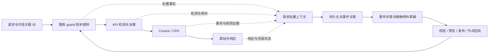

# P0-04：最终处置解释与有限范围例外开发任务书

日期：2026-09-06。状态：待实施。优先级：产品 P0。

前置：[总纲](README.md)、[JWT 身份契约](P0-03_JWT_TRUST_CHAIN.md)。结果接入 [能力证据](P0-01_CAPABILITY_EVIDENCE.md)和[真实基准](P0-02_SECURITY_PERFORMANCE_BENCHMARK.md)。

## 1. 用户任务与完成目标

安全人员从一次事件判断误报时，需要知道“实际由哪个模块执行了什么、依据哪个规则和有效配置、哪些只是观察命中”。创建例外后，需要知道“例外在哪个应用、路径、方法、字段、规则和时间内生效，哪些节点已经应用”。

本任务同时完成处置事实记录与受限例外的真实执行闭环。不能只做解释页面，不能用一条宽泛放行规则假装完成精确例外。

典型验收场景：`POST /api/orders` 的一个指定字段误报，创建 30 分钟例外后，只有该应用、该路径、该方法、该规则对该字段的检测被排除；其他字段、其他规则、API 强制认证及其他防护继续有效。到期无需再次发布，后续请求恢复原防护。

## 2. 现状、复用点与待复现问题

### 2.1 现有代码

| 位置 | 用途 |
|---|---|
| `server/internal/exceptions/exceptions.go` | Exception 字段、输入校验、SecLang 编译与动作 |
| `server/internal/exceptions/provider.go`、`fromevent.go`、`handler.go` | 发布供应、事件转草稿、CRUD |
| `server/internal/gatewayconfig/generator.go` | 应用绑定、例外规则进入 Caddy/Coraza 配置 |
| `server/internal/app/app.go` | `eventExceptionCreator` 及服务真实接线 |
| `gateway/dynamic_security/decision/engine.go` | API 决策；`Input.Exceptions []string` 当前为预留字段，不生效 |
| `gateway/dynamic_security/events/event.go` | API 主事件结构 |
| `gateway/modules/jiuzhang_guard/module.go` | guard 顺序、拦截分支和访问日志注解 |
| `gateway/modules/jiuzhang_guard/events/events.go`、`apievents/apievents.go` | 网关安全事件与 API 事件 |
| `gateway/internal/eventparser/parser.go`、`gateway/cmd/eventparser/main.go` | Coraza 日志解析与事件关联 |
| `server/internal/securityevents/normalize.go`、`server/internal/apiruntime/events.go` | 管理端事件入库与规范化 |
| `web/src/pages/security-events/EventDetailDrawer.tsx` | 事件详情、从事件创建例外和 APM 关联入口 |
| `web/src/pages/exceptions/ExceptionsPage.tsx`、`web/src/api/exceptions.ts` | 例外页面及 API 调用 |

### 2.2 需先写回归用例的代码线索

以下是在当前工作区看到的实现，不等于已证明所有线上场景受影响。开发者应先复现并更新状态。

| 线索 | 风险与必需修复 |
|---|---|
| `GenerateSecLang` 在 URIExact、URIPrefix、URIRegex、Domain 中择一 | 用户填写的域名/路径等不能只取一个；字段必须按声明组合 |
| 编译主体未使用 Methods、SourceIPs、ContentTypes 等限制；CookieNames/HeaderNames 未进入对应目标控制 | 补完整字段映射，不能“保存成功但实际忽略” |
| LOG_ONLY、ADJUST_SCORE 生成 `ctl:ruleEngine=DetectionOnly` | 局部例外可能使该请求的整条 WAF 仅观察；禁止此替代语义 |
| provider 只取第 1 页 1000 条并按返回次序分配生成规则 ID | 可能漏下发，映射随排序漂移；补全量读取和稳定版本映射 |
| 生效/到期主要在 provider 发布时过滤 | 已发布例外可能不按时失效，未来生效规则也可能缺失；必须运行时判断 |
| 从事件创建的 APPLICATION 草稿未可靠传入 ApplicationID，RuleIDs 为空 | 草稿可能无法精确生效；真实绑定缺失时禁止启用，并说明缺什么 |
| 风险确认依赖宽泛性判断，某一个具体字段即可改变判断 | 风险勾选不能替代结构化范围校验，也不能授权全局关闭防护 |

## 3. 总体实施架构

不重排请求链。新增一个请求级处置上下文，由真正执行动作的模块写入；收集观察命中、局部例外、API 决策和下游处理事实，形成可关联的最终记录。



图中 G 包含现有访问控制、风险、配额、CC 等；WAF 例外通过现有 before-CRS 配置进入 W，而非让 G 直接绕过 W。异常中断请求仍需形成能够解释的状态。

## 4. 最终处置记录契约（新增约定）

### 4.1 结构

新增 `final_decision`，不改写原有 API `final_action` 的语义。建议字段：

| 字段 | 契约 |
|---|---|
| `schema_version` | 初始 1 |
| `request_id`、`application_id`、`gateway_node` | 网关可信关联标识；核对现有唯一约束后确定存储键 |
| `completion_status` | COMPLETED / ABORTED / ERROR / PENDING_CORRELATION / UNKNOWN |
| `security_action` | NONE / BLOCK / TEMP_BLOCK / RATE_LIMIT / MASK_RESPONSE；只表示已执行安全动作 |
| `executor_module` | 固定枚举：PROTECTED_ADDRESS / MANUAL_BAN / IP_BLACKLIST / L7_ACL / AUTO_BAN / RISK_POLICY / LICENSE_QUOTA / CC / JWT / API / WAF / NONE / UNKNOWN |
| `response_source` | GATEWAY / ORIGIN / UNKNOWN；来源必须有事实依据 |
| `http_status`、`response_committed` | 实际响应码及响应头是否已发出；不可把计划返回值当作实际值 |
| `reason_codes`、`rule_refs` | 固定原因、模块规则/策略/模型标识及版本；没有证据时为空并解释 |
| `effective_config` | 发布批次、应用策略、规则包/API 模型和节点实际配置指纹；不取当前最新草稿 |
| `findings` / `steps` | 有界摘要；区分 OBSERVED、ENFORCED、EXCEPTED、SKIPPED，不伪造未执行模块 |
| `matched_exceptions` | ID、版本、目标规则、范围摘要、起止时间、实际匹配结果 |
| `identity_verification` | 引用 P0-03 状态和可信主体指纹，历史数据可空 |
| `evidence_refs`、`finalized_at` | 原事件/Coraza 事务关联及完成时间 |

上游主动关闭连接、后端超时、流中断等可能不是安全动作，不能硬映射 BLOCK。观察命中不进入 security_action。多个非终止动作可记录在 steps 中；终止请求的实际执行模块作为 executor。仅发生响应脱敏时，可记录 MASK_RESPONSE，同时注明源站响应来源。

### 4.2 归因规则

1. **实际执行优先**：模块执行拒绝、限流、脱敏时记录事实；不能通过遍历 Finding 最高风险或“最强候选动作”倒推最后处置。
2. **下游事实独立**：API ALLOW 后 Coraza 拒绝，API 结果仍 ALLOW，最终执行者为 WAF。源站返回 403 而没有安全拒绝时，security_action=NONE，response_source=ORIGIN。
3. **不凭状态码猜模块**：403/429/500 都可能来自源站或不同模块。Coraza 需关联真实事务、命中规则和 intervention/audit 证据。
4. **未执行明确标注**：人工封禁提前返回时，后续 API/WAF 不是“检查通过”，而是 SKIPPED。白名单只记录它实际绕过的步骤。
5. **证据不全不造假**：Coraza 异步证据暂未到达时标 PENDING_CORRELATION；到达后按可信键合并。超出登记关联时限标 UNKNOWN 并提示缺失原因；旧事件不补造规则。
6. **所有已知分支有测试**：包括框架返回 error 后写响应、panic 恢复、客户端取消、流式/升级连接。采集开关关闭不能改变实际防护。

### 4.3 采集与存储

- 请求上下文不能依赖“访问日志启用”才创建；安全动作和安全相关事件仍应带处置事实。正常流量是否持久化沿用既有日志策略，不要求新增每请求一条数据库记录。
- ResponseWriter 包装必须保持现有接口能力，覆盖 Flusher、Hijacker、ReaderFrom、ResponseController 等实际使用场景；不能为了归因缓存所有响应体或破坏 WebSocket/SSE/gRPC。
- 进程内每个请求仅完成一次归档；异步证据合并允许更新 pending，但不能用晚到观察记录覆盖已确认拦截。定义来源优先级、去重键与幂等更新条件。
- 复用现有事件表/关联模型或新增有限的请求处置表，实施前核对唯一性。若 request_id 不具备全局唯一保证，应使用应用/节点等复合键，不得跨租户串联。
- 兼容现有重放、检查点和 API 主事件去重。新增 JSON/字段须限制数量与大小，建议 steps ≤ 32、规则引用 ≤ 64；截断需显式标记，不丢最终动作与关键规则引用。
- 有权查看事件不自动有权读取完整请求或原始敏感变量；脱敏规则继续生效。

## 5. 例外数据与范围契约

### 5.1 复用与新增

现有路由继续使用：

```text
GET/POST          /api/v1/exceptions
GET/PUT/DELETE    /api/v1/exceptions/{id}
POST             /api/v1/exceptions/{id}/enable
POST             /api/v1/exceptions/{id}/disable
POST             /api/v1/security-events/{id}/create-exception
```

读权限 `exceptions.read`、写权限 `exceptions.manage`。保留已有安全事件详情、related、remediation 入口，扩展详情字段即可，不新建重复事件中心。

新增例外字段建议：`target_engine`（WAF / API）、`api_rule_refs`、`source_event_id`、`validation_status`、`compiled_fingerprint`。发布状态与有效节点回执使用既有发布数据，不简单在草稿表里写 `published=true`。

旧 RuleIDs 继续表示 WAF 规则整数 ID。API 规则引用采用稳定 detector_id、rule_id、model_version；不得把中文描述或不稳定的规则序号当作唯一标识。具体来源需映射现有模型编译结果；若当前缺稳定 ID，先补编译期 ID 与反查，不允许用任意字符串占位。

### 5.2 条件组合

不同维度为 AND，同一列表内部为 OR；路径三种匹配方式最多一个。例外作用于声明的模块和规则，不产生全局 allow。

| 输入维度 | 后端校验与运行时要求 |
|---|---|
| APPLICATION | application_id 必须存在且有权限；绑定实际接入应用，不能仅凭 Host 推定 |
| GLOBAL 历史记录 | 保留可读；本项不允许新建/启用没有具体应用绑定的防护例外，迁移须人工审查 |
| PolicyID | 配置时必须属于该应用，并与节点实际执行策略匹配；不匹配不生效 |
| Domain | 精确规范化主机名，处理端口、大小写、IDNA；与应用绑定同时满足，禁止任意通配 |
| URIExact / URIPrefix / URIRegex | 明确针对路径、不含 query；prefix 按路径段；正则有长度与复杂度限制，必须在实际引擎验证，不能只通过 Go regex 就认定兼容 |
| Methods | 非空、标准化、限制数量；例外创建表单默认事件原方法，后端不擅自扩为所有方法 |
| SourceIPs | 有界 IP/CIDR 集合；采用可信代理处理后的客户端 IP，不能直接信任 X-Forwarded-For |
| ContentTypes | 规范化 MIME type；分离参数；缺失/非法 Content-Type 不匹配已配置限制 |
| ParamNames / CookieNames / HeaderNames | 表示检测目标名，不代表这些名字对应的所有模块均放行；Header 名大小写语义与引擎一致 |
| RuleIDs / RuleTags | 必须在有效规则包中存在；标签在发布时展开成冻结的有界规则 ID 集，升级时重新校验，不自动扩展 |
| AttackTypes | 仅作事件分类/筛选，不能冒充已实现的运行时范围；新启用配置不得仅凭该字段授权例外，旧字段用途需页面明确 |
| ActionTarget | 校验与对应动作/目标一致；禁止把自由文本直接拼为 SecLang |
| 有效期 | 开始包含、结束不包含：`effective_from <= now < effective_until`；临时例外必须有结束时间 |

新启用例外必须至少绑定具体应用、非空方法、精确路径或按段前缀、非空目标规则。使用 URIRegex 的历史/高级配置需额外审核，不能绕过基本范围边界。默认不把根路径前缀 `/` 作为精确范围；全路径规则例外属于另行明确评审的扩大范围，本 P0 不默认提供。

### 5.3 动作支持矩阵

| 动作 | P0 行为 |
|---|---|
| WAF REMOVE_RULE | 在全部范围条件成立时，仅移除指定 WAF 规则；带目标名时只移除这些规则的这些目标 |
| WAF REMOVE_VAR_DETECTION | 必须同时存在 rule IDs 与具体目标名，编译为对应参数/Cookie/Header 目标排除 |
| WAF REMOVE_RULE_TAG | 发布时解析为明确 ID 集并冻结；范围仍受应用/路径/方法/时间约束；无法安全解析时拒绝启用 |
| WAF LOG_ONLY / ADJUST_SCORE | 本 P0 明确不支持新启用；禁止用整请求 DetectionOnly 代替。历史记录进入 NEEDS_REVIEW，并给出改为精确目标排除的迁移预览 |
| API OBSERVE_RULE（新增动作） | 仅对明确、可例外的 API 规则命中保留观察记录，并取消该命中本次的执行贡献；重新计算其他命中的决策 |

有限范围例外不要求支持每一种旧动作。**明确拒绝不支持的动作、处理历史配置并验证安全边界属于本 P0 的完整交付**；把不支持动作悄悄映射为更宽泛效果不算完成。

API 首批只开放具有稳定规则引用的参数/schema 规则例外；按实际检测器注册受支持能力。JWT 信任链、请求协议/大小底线、人工封禁、访问控制、CC/配额以及全局身份风险策略不得通过该 API 例外跳过。已持久化的临时封禁不会因后续例外自动解除。

API 例外须保留原 Finding，标记 exception_id/version 和 OBSERVED，不删除证据；仅排除被指定命中的本次执法贡献。多个 Finding 汇总分数时按既有评分规则重新计算，不能粗暴把整条请求设 ALLOW。其他 BLOCK/TEMP_BLOCK/RATE_LIMIT 仍正常执行。

## 6. 运行时编译与时间边界

### 6.1 完整字段执行

为每个可提交字段建立“DTO→校验→编译→运行时→回归测试”映射。不能编译的字段在保存/预览/启用时返回字段级错误，不能静默舍弃；映射加入测试以防后续新增 UI 字段无运行效果。

优先在现有 before-CRS 规则中生成正确的条件链和局部 ctl 动作，验证 ctl 仅在全部链条件匹配后执行。注意 phase、请求体解析、变量集合与 CRS 规则执行时机：字段在 phase 1 尚不可读时，不能以“未出现”误触发广泛例外。

Coraza 提供时间变量和运行时控制动作，具体可用语义须用仓库锁定版本做真实测试；参考[变量说明](https://www.coraza.io/docs/seclang/variables/)和[动作说明](https://www.coraza.io/docs/seclang/actions/)。不得仅以当前官网语法能解析为交付证据。

### 6.2 时间与发布

- 发布时带上未来生效且未结束的规则，运行时判断是否进入有效区间。不能只在发布时过滤未来规则。
- 临时例外使用 UTC 秒精度，表单显示时区；相等起止时间非法。每次请求在进入目标检测阶段时取一次时间，按半开区间判断。
- 到期无需管理端再次发布，已断开控制面的节点也不得让新请求继续命中旧例外。已在有效期内进入目标检测阶段的同一请求可完成该事务；不追溯修改已发生处置。
- 首选用实际 Coraza 支持的时间条件参与同一条件链；若锁定版本不能保证语义，必须实现并测试请求级受限适配，不能退化成全局绕过。最终方案和取时点写入设计补充。
- 定时清理/自动发布仅用于移除过期配置、刷新页面状态，不能作为 TTL 的唯一安全保证。
- 时钟异常可能破坏 TTL，节点需暴露时钟异常状态；无可信时间时临时例外按不匹配处理并记录原因。测试时使用受控时钟或隔离节点，不修改宿主生产时钟。

### 6.3 全量、版本与节点

读取全部待发布例外，使用一致性快照/版本条件避免分页期间变更导致混集。超过容量应明确拒绝发布，并展示限制；禁止静默只取前 1000 条。

生成规则 ID 在例外版本内稳定、无冲突，并可反查 exception_id/version。不得单凭当次列表序号归因，也不能依赖无碰撞校验的截断哈希。

配置编译失败保留上一个有效版本并显示错误；不能在页面显示“启用”就认定网关生效。节点回执应带实际配置指纹；部分成功时按节点展示，事件引用本节点实际版本。

禁用/删除属于新发布变更：尚未确认的节点仍可能执行旧例外，页面必须提示。临时例外的硬到期仍独立生效；紧急撤销是否移除节点流量按既有运维流程执行，不伪称瞬间全局撤销。

## 7. 从事件创建例外与预览

### 7.1 安全默认值

从服务端可信事件记录提取 application_id、实际域名/路径/方法、WAF rule ID 或 API 稳定规则引用、可信 IP 和脱敏目标名。来源请求头不能覆盖应用/规则身份；不从攻击类型名猜规则 ID。

默认 DRAFT，临时 30 分钟，尽量仅选误报字段/规则；缺少应用、路径、方法或规则证据时可以创建标为 NEEDS_REVIEW 的草稿，但禁止启用，并指出缺失项。只能通过服务端规则目录和有权限的应用选择补全。

### 7.2 新增预览接口

**新增约定**：`POST /api/v1/exceptions/{id}/preview`，权限 `exceptions.manage`，输入 expected_version；返回：

```text
validation_status、field_errors
normalized_scope、resolved_rule_refs、effective_window
unsupported_fields/actions、protected_modules_unchanged
compiled_fingerprint、required_publish_targets
historical_sample_coverage、estimated_match_count（可空）
```

预览不启用、不发布、不自动回放真实用户请求。历史日志字段不足时估计值为 null，并显示“无法估算”，不能显示零影响。发布前须重验版本和编译摘要，防止预览后草稿被修改。

保存/启用/禁用/删除、从事件创建、预览、发布、回退写审计，包含操作人、理由、源事件、版本、范围摘要和发布结果。风险确认可以作为操作要求，但不能绕过不支持或不安全配置的后端拒绝。

## 8. UI / UX 验收

事件详情第一屏展示：实际执行动作、执行模块、原因、规则与有效配置版本、响应来源；API 中间决策单独列出。提供有界的执行过程，明确“仅观察”“因例外未执行”“未运行”“证据待关联”。

例外编辑器按“应用与请求范围→规则与字段→有效期→影响预览→保存草稿→现有发布流程”组织。高级字段不能隐藏执行限制；不支持动作不提供可启用选项，历史动作只读并提供修正入口。

至少展示 DRAFT、NEEDS_REVIEW、ENABLED_NOT_PUBLISHED、PUBLISHING、PARTIALLY_EFFECTIVE、EFFECTIVE、EXPIRED、DISABLED 等派生状态；后端源状态不必直接改成同名枚举，但展示值必须由草稿、时间、节点回执计算，不能前端凭计时器假装全节点一致。

测试加载、空数据、无权限、过期、冲突、预览失败、部分发布失败及历史事件无字段场景。保留 APM Trace 入口，缺少采样/探针/权限时有正确说明，不用空图表示“没有问题”。

## 9. 实施阶段

1. 先用失败用例复现第 2.2 节；冻结处置 DTO、范围/动作矩阵和字段映射。
2. 补完整条件与安全动作编译、全量读取、稳定映射、运行时起止时间；先跑真实 Coraza 集成。
3. 实现 API 受限规则例外及决策重算，保留其他模块执行顺序和事件。
4. 接入请求处置上下文、各实际执行分支、Coraza 关联、幂等入库与旧数据兼容。
5. 修复事件草稿绑定，实现预览、发布校验、节点状态、权限审计与页面。
6. 做迁移试运行、升级/回退、真实 E2E 和 P0-02 组合基准；归档全部证据。

## 10. 必须通过的验收用例

| ID | 条件 | 预期 |
|---|---|---|
| DEC-01 | API ALLOW 后 Coraza 拦截 | API 结果不变，最终 WAF BLOCK，规则/配置可追溯 |
| DEC-02 | 源站返回 403/429/500，无安全拒绝 | 不伪报 WAF；来源为源站 |
| DEC-03 | 人工封禁、黑名单、L7、风险、配额、CC、JWT 各独立命中 | 实际执行者和 HTTP 状态正确，后续步骤标未运行 |
| DEC-04 | OBSERVE 命中、响应脱敏、多个 API Finding | 观察/实际动作分开，只有真实动作成为最终处置 |
| DEC-05 | Coraza 证据晚到/重复/丢失，旧事件无字段 | 幂等关联，pending/unknown 明确，不跨应用串事件 |
| DEC-06 | SSE/WebSocket/gRPC、返回 error、取消、访问日志关闭 | 不改变协议行为；可捕获范围有说明，安全事件仍有执行事实 |
| EXC-01 | 应用+域名+路径+方法+IP+Content-Type 全匹配；逐个改变一个条件 | 只有条件全部成立时例外生效 |
| EXC-02 | 同一请求不同参数/Cookie/Header，含另一个攻击字段 | 仅指定规则的指定目标排除，其他目标继续防护 |
| EXC-03 | 一条规则例外，同时触发另一条 WAF/API 规则 | 另一规则继续拦截，不出现全局 DetectionOnly/allow |
| EXC-04 | LOG_ONLY/ADJUST_SCORE、未知字段或 unsupported API 动作 | 明确拒绝新启用；历史配置进入审查，不静默降级 |
| EXC-05 | 有效期前、起点、结束前、恰好结束；期间不重新发布 | 半开区间正确；控制面离线也不能延长新请求例外 |
| EXC-06 | 1001 条及配置容量边界、分页期间修改、ID 碰撞 | 完整一致或明确失败；无静默遗漏/错误反查 |
| EXC-07 | 从事件创建，缺应用/规则、伪造客户端关联值 | 绑定真实事件；缺证据不能启用；不跨应用 |
| EXC-08 | URI query、编码/双编码、前缀相似、Host 端口、IPv6、伪造 XFF | 与规范化契约一致，不能扩大范围 |
| EXC-09 | SecLang 控制字符/引号/目标名注入、病态正则 | 有界拒绝/编译失败，不能注入额外规则 |
| EXC-10 | API 指定规则 OBSERVE_RULE，同时另有高风险 Finding | 保留被例外 Finding，重算后其他动作仍有效 |
| EXC-11 | 尝试例外 JWT/协议底线/人工封禁/CC/配额 | 不允许；不能用白名单或 API 例外绕过 |
| EXC-12 | 并发编辑、预览后修改、部分节点失败、禁用未发布 | 版本冲突/摘要变化被检出，页面展示真实生效范围 |
| EXC-13 | 非授权角色、跨应用读写、审计与导出 | 拒绝越权，敏感值不泄漏，操作理由可追溯 |
| EXC-14 | 页面事件→草稿→补齐→预览→发布→到期→回退 | 真实网关行为对应 UI；无占位接口 |
| EXC-15 | 老配置含宽泛动作/被忽略条件，升级与旧二进制回退 | 迁移报告明确，不能无提示放宽防护或假装兼容 |

DEC-01～06、EXC-01～11 需要真实 Caddy/Coraza/guard 集成覆盖，不能只比较 SecLang 字符串。EXC-12～15 补后端接口、真实发布和 E2E。按照 P0-02 验证新增记录、匹配和关联的性能开销。

## 11. 迁移、回退与完成定义

先生成只读迁移报告：列出缺应用/规则、无效时间、未执行字段、宽泛动作和标签规则扩展的历史配置，并提供新规则预览。**禁止静默把历史例外重新解释为更宽范围**。

旧危险配置不得自动重新发布；保留当前有效版本并在升级前显式处理迁移影响。取消旧例外可能让原业务重新被拦截，必须在隔离回放中验证并通过已有配置发布流程执行，不能在数据库迁移中批量启用/关闭所有例外。

新编译契约加入能力版本；不支持时间/范围语义的节点拒绝新配置。回退旧二进制前检查兼容性，不能让旧节点忽略新字段。历史事件的 final_decision 可空，不能回填猜测结果。

完成条件：所有支持字段真正执行、所有不支持语义明确拒绝、历史配置有可执行迁移路径、处置来源有真实证据、临时例外运行时失效、发布/节点状态可见，且必测用例通过。仅修改前端文案或生成器字符串不能算完成。
